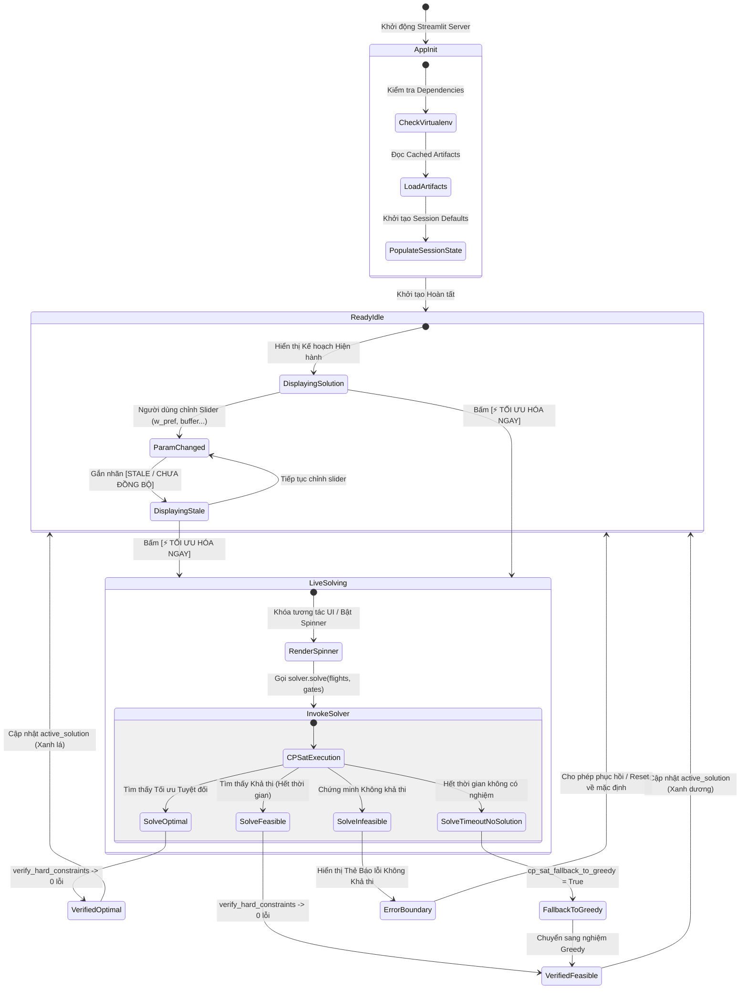
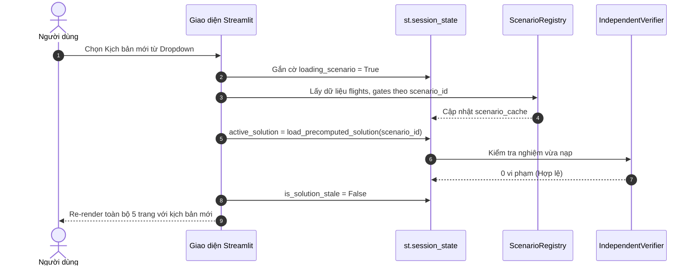

# UI Interaction State Machines & Execution Lifecycle

**Document ID:** `AEOLUS-P10-A-STATE-MACHINES-11`  
**Phase:** P10-A (UI/UX Design Specification & Design Freeze)  
**Status:** DESIGN FROZEN  
**Target Architecture:** Streamlit Reactive Session Lifecycle & Error Boundaries  

---

## 1. Executive Summary

This document specifies the formal finite state machines (FSM) governing UI interaction, asynchronous data fetching, synchronous solver execution, and error recovery in the Aeolus dashboard. 

It explicitly decouples **UI Job State** (the frontend lifecycle: `IDLE`, `SOLVING`, `STALE`, `ERROR`) from **Mathematical Solver Status** (`OPTIMAL_PROVEN`, `FEASIBLE_FOUND`, `PROVEN_INFEASIBLE`), preventing semantic confusion during live solving.

---

## 2. Core State Machine: Application Lifecycle & Solving



---

## 3. Detailed UI Job States vs. Mathematical Statuses

### 3.1. UI Job State Vocabulary
| UI Job State | Description | Visual Indicator | User Interactions Allowed |
| :--- | :--- | :--- | :--- |
| `INIT_LOADING` | Reading CSV/JSON files from disk on startup | Full-page pulsing skeleton | None (Loading screen) |
| `READY_IDLE` | Solution matches currently selected parameters | Subtle green dot `● SẴN SÀNG` | All dropdowns, tabs, sliders |
| `PARAM_STALE` | User modified sliders but hasn't clicked solve | Amber badge `⚠️ THAM SỐ CHƯA CẬP NHẬT` | Sliders active, Re-solve button glowing |
| `SOLVING_LIVE` | Solver executing in Python backend | Spinner `⏳ Đang tính toán tối ưu...` | Form controls locked |
| `SOLVE_SUCCESS`| Solver returned valid assignment; 0 violations | Clearance Green badge `[🛡️ HỢP LỆ]` | Full inspection & export |
| `FALLBACK_USED`| Solver timed out; fallen back to Greedy | Blue badge `[DỰ PHÒNG THAM LAM]` | Allows re-solve with more time |
| `ERROR_BOUNDARY`| Infeasibility or unhandled exception caught | Alert Red card with diagnostic trace | Reset parameters button |

### 3.2. Mapping to Domain Mathematical Statuses
When a solve concludes, the mathematical domain objects (`SolverStatus` and `TerminationReason`) are mapped to the UI badges:

```python
def map_solver_status_to_badge(result: OptimizationResult) -> Dict[str, str]:
    if result.termination_reason == TerminationReason.OPTIMAL_PROVEN:
        return {
            "label": "TỐI ƯU TUYỆT ĐỐI (OPTIMAL PROVEN)",
            "color": "#34C759",  # Clearance Green
            "icon": "🏆",
            "tooltip": "Đã chứng minh cận dưới toán học bằng OR-Tools CP-SAT (Optimality Gap = 0.0%)."
        }
    elif result.termination_reason == TerminationReason.FEASIBLE_FOUND:
        gap_str = f"{result.gap * 100:.2f}%" if result.gap else "N/A"
        return {
            "label": f"KHẢ THI (FEASIBLE - GAP: {gap_str})",
            "color": "#00D2FF",  # Runway Cyan
            "icon": "✓",
            "tooltip": "Tìm thấy nghiệm hợp lệ trước khi chạm giới hạn thời gian tìm kiếm."
        }
    elif result.termination_reason == TerminationReason.HEURISTIC_STOP:
        return {
            "label": "HEURISTIC THAM LAM (GREEDY COMPLETED)",
            "color": "#E5AD55",  # Caution Amber
            "icon": "⚡",
            "tooltip": "Nghiệm tìm thấy tức thì bằng thuật toán Greedy thứ tự ưu tiên."
        }
    elif result.status == SolverStatus.INFEASIBLE:
        return {
            "label": "KHÔNG KHẢ THI (INFEASIBLE)",
            "color": "#E47777",  # Alert Red
            "icon": "⚠️",
            "tooltip": "Không tìm thấy phương án phân cổng nào thỏa mãn toàn bộ ràng buộc cứng."
        }
    else:
        return {
            "label": "TRẠNG THÁI KHÔNG XÁC ĐỊNH",
            "color": "#94A3B8",
            "icon": "❓",
            "tooltip": "Bộ giải dừng với trạng thái chưa xác định."
        }
```

---

## 4. Scenario Transition & Data Invalidation Lifecycle



---

## 5. Error Boundaries & Graceful Degradation Rules

1. **Local Card Error Boundary:** Every Plotly figure generator is wrapped in a `try...except` block. If a figure fails due to unexpected formatting, only that specific card displays:
   ```
   ┌──────────────────────────────────────────────────────────┐
   │ ⚠️ Lỗi hiển thị biểu đồ [CHART-03]                       │
   │ Dữ liệu không đầy đủ để vẽ động lực học quay vòng.      │
   │ Bấm để xem mã lỗi chi tiết: [Xem Log Chi tiết]           │
   └──────────────────────────────────────────────────────────┘
   ```
   The rest of the dashboard remains interactive and functional.
2. **Infinite Overflow Safeguard:** By setting `allow_unbounded_overflow = True` as default, CP-SAT and Greedy are guaranteed never to return `INFEASIBLE` under high load; excess flights are allocated to the remote apron with cost penalties, preserving operational continuity.
