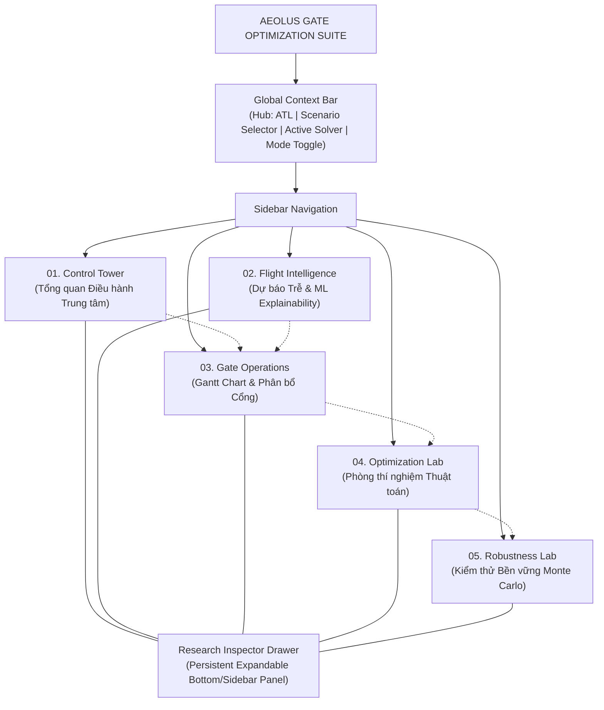
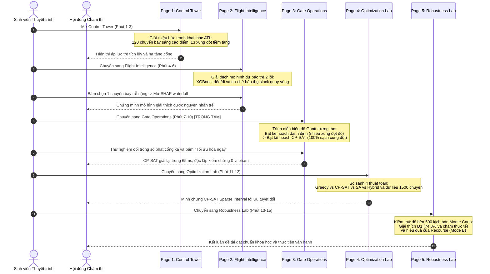

# Navigation Architecture & User Journeys Specification

**Document ID:** `AEOLUS-P10-A-NAV-02`  
**Phase:** P10-A (UI/UX Design Specification & Design Freeze)  
**Status:** DESIGN FROZEN  
**Target Application:** Streamlit Demonstration & Research Dashboard  

---

## 1. Executive Summary

This document specifies the global navigation hierarchy, user journeys, persistent session state architecture, and view transitions across the Aeolus application. It ensures a frictionless experience for both high-stakes thesis defense presentations and deep academic research sessions.

---

## 2. Navigation Sitemap & Information Hierarchy



---

## 3. Global Context Bar Specification

The **Global Context Bar** is pinned at the top of the interface across all five pages, rendering critical operational metadata in a unified horizontal status bar:

```
┌────────────────────────────────────────────────────────────────────────────────────────────────────────┐
│ ✈ AEOLUS HUB: ATL (Atlanta) │ Kịch bản: [ SCEN_P09_CANONICAL_120 ▼ ] │ Chuyến bay: 120 │ Cổng đỗ: 25+1 │
│ Thuật toán: [ CP-SAT (Sparse) ▼ ] │ Trạng thái: ● TỐI ƯU TUYỆT ĐỐI │ [✓] Chế độ Nghiên cứu (Research)  │
└────────────────────────────────────────────────────────────────────────────────────────────────────────┘
```

### Context Bar Components
1. **Hub Identifier:** `ATL (Hartsfield-Jackson Atlanta Int'l Airport)`.
2. **Scenario Selector Dropdown:**
   - Option A: `SCEN_P09_CANONICAL_120` (Canonical Peak Morning Wave — 120 flights, 25 gates) `[DEFAULT]`.
   - Option B: `SCEN_2023_PEAK_01` (Concourse T Intensive Stress — 85 flights, 15 gates).
   - *(Note: 2024 scenarios are quarantined and excluded from this selector).*
3. **Operational Scale Badge:** `120 Chuyến bay | 25 Cổng tiếp xúc + 1 Cổng từ xa`.
4. **Active Solver Indicator:** Reflects current solver algorithm (`CP-SAT`, `Greedy`, `Hybrid`).
5. **Global Solution Status Badge:** Real-time indicator of current solution state (`TỐI ƯU TUYỆT ĐỐI`, `KHẢ THI`, `ĐANG TÍNH TOÁN`, `CHƯA GIẢI`).
6. **Mode Toggle Switch:** `[ ] Chế độ Nghiên cứu (Research Mode)` — default is unchecked (`Presentation Mode`).

---

## 4. User Journeys

### User Journey 1: The 15-Minute Thesis Defense Walkthrough (Hành trình Bảo vệ Khóa luận)
- **Actor:** Graduate Student presenting to the Thesis Evaluation Committee.
- **Goal:** Deliver an airtight, compelling demonstration proving the scientific hypothesis and software engineering quality.
- **Mode:** Presentation Mode (clean, high-contrast, zero clutter).



---

### User Journey 2: The Operations Dispatcher (Hành trình Điều phối viên Cảng)
- **Actor:** Airline Hub Operations Dispatcher managing a tactical delay wave.
- **Workflow:**
  1. Opens **Control Tower** to monitor predicted delay pressure ($> 25$ min threshold).
  2. Navigates to **Gate Operations** to review affected aircraft turns on Concourse A.
  3. Uses **Concourse Filter** to isolate gates `A01` to `A15`.
  4. Identifies 2 inbound aircraft delayed by 45 minutes that will violate the 15-minute gate separation buffer.
  5. Selects `HybridGateSolver` for immediate tactical recourse.
  6. Adjusts `w_remote` to 300 to minimize towing passengers to remote stands.
  7. Clicks **"Tối ưu hóa ngay (Live Solve)"**.
  8. Reviews the updated Gantt chart: 1 flight reassigned to adjacent gate `A08`, 0 remote stands used, 0 buffer violations.
  9. Verifies the **Independent Safety Badge** displays `"HỢP LỆ — 0 VI PHẠM"`.

---

### User Journey 3: The Research Software Auditor (Hành trình Nhà Nghiên cứu / Kiểm toán viên)
- **Actor:** Research Auditor validating algorithmic invariants and empirical distributions.
- **Workflow:**
  1. Activates **Research Mode** toggle in the Global Context Bar.
  2. Inspects the **Research Inspector** drawer: checks model training provenance, XGBoost commit hash, and scenario random seed (`42`).
  3. Navigates to **Flight Intelligence** $\to$ Tab C (Model Explainability): reviews global feature importance, CRPS metric ($8.12$), and out-of-fold residuals.
  4. Navigates to **Optimization Lab**: opens CP-SAT formulation comparison card, observing memory reduction and 12x speedup of `sparse_interval` vs `dense_grid`.
  5. Navigates to **Robustness Lab**: inspects Mode A vs. Mode B vs. Mode C empirical CDF curves.
  6. Reads the **Academic Research Note** on Mode B/C parity ($p = 1.0$), confirming scientific honesty regarding the greedy baseline.
  7. Uses the **Scenario Drill-Down Slider** to inspect Scenario `#42` (worst-case tail disruption with 8 reassignments).

---

## 5. Persistent Session State Schema (`st.session_state`)

To prevent loss of computational results during page transitions, the application maintains a strict, strongly-typed session state contract:

```python
# Session State Key Registry
SESSION_STATE_DEFAULTS = {
    # Navigation & Mode
    "current_page": "01_control_tower",
    "is_research_mode": False,
    
    # Scenario Context
    "active_scenario_id": "SCEN_P09_CANONICAL_120",
    "scenario_cache": {},          # Loaded scenario flights and gates
    
    # Active Optimization Result
    "active_solver_name": "cpsat", # "greedy" | "cpsat" | "sa" | "hybrid"
    "active_solution": None,       # Instance of OptimizationResult
    "is_solution_stale": False,    # True if user changed params without re-solving
    
    # Solver Hyperparameters (Draft & Committed)
    "param_w_pref": 10.0,
    "param_w_remote": 200.0,
    "param_buffer_time_min": 15,
    "param_allow_overflow": True,
    "param_time_limit_sec": 30.0,
    
    # View Filters
    "gantt_concourse_filter": ["T", "A", "REMOTE"],
    "gantt_search_query": "",
    "selected_flight_id": None,
    "selected_mc_scenario_id": 42,
}
```

### State Transition Rules
1. **Page Switching Rule:** Navigating between pages via the sidebar modifies only `current_page`. All data in `active_solution`, `scenario_cache`, and filter settings **MUST persist unaltered**.
2. **Parameter Adjustment Rule:** Moving slider controls updates `param_*` and sets `is_solution_stale = True`. The existing Gantt chart continues rendering the last valid solution, but displays a subtle amber badge: `"Tham số đã thay đổi — Vui lòng bấm Tối ưu hóa để cập nhật"`.
3. **Scenario Switch Rule:** Selecting a different scenario in the dropdown prompts a confirmation check, invalidates `active_solution`, loads the new scenario data into `scenario_cache`, and auto-loads the precomputed baseline solution for that scenario.
4. **Crash Recovery Rule:** If an individual plot fails to render, an inline error card is shown inside that specific container, leaving the rest of the page and session state intact.
