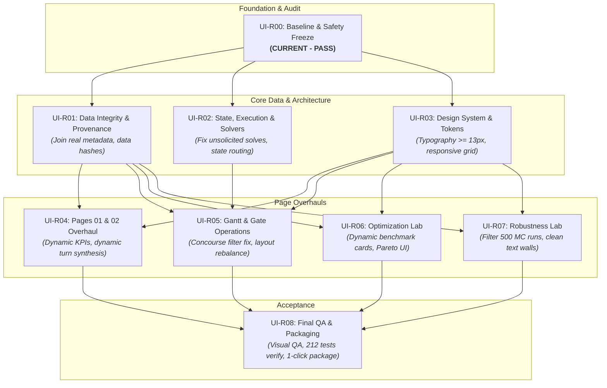

# UI-R00: 07 — REQUIREMENTS TRACEABILITY & REMEDIATION MAP

**Document ID:** `AEOLUS-UI-R00-07-REMEDIATION-MAP`  
**Phase:** UI-R00 (Baseline, Technical Audit & Safety Freeze)  
**Audit Timestamp:** 2026-10-10T23:31:00+07:00  
**Auditor:** Principal Software Auditor & Technical Project Lead  

---

## 1. Executive Summary

This document establishes the end-to-end Requirements Traceability Matrix and Remediation Dependency Architecture. It maps every defect identified in the Issue Register (`02_issue_register.md`) to its root cause, affected files, proposed redesign phase (UI-R01 through UI-R08), validation tests, and quality gate criteria.

Per safety rules, **this map defines the forward plan; no remediation phases are executed during UI-R00**.

---

## 2. Requirements Traceability Matrix

| Issue ID | Severity | Root Cause | Affected Files | Fix Phase | Validation Test | Quality Gate Criterion |
| :--- | :---: | :--- | :--- | :---: | :--- | :--- |
| **ISSUE-R00-01** | **P0** | Unconditional CP-SAT call when `active_run` is None or scenario differs | `dashboard/pages/page_03_gate_operations.py` | **UI-R02** | `test_p10d_16_explicit_run_executes_exactly_once` | Solver runs = 0 on page load; runs = 1 only on button click |
| **ISSUE-R00-02** | **P0** | `predictions_sample.csv` lacks flight manifest fields; adapter uses dummy fallbacks | `dashboard/adapters/prediction_adapter.py`, `dashboard/pages/page_02_flight_intelligence.py` | **UI-R01** | `test_p10c_12_zero_leakage_in_flight_intelligence` | Predictions joined to real scenario flights (multi-carrier, multi-origin) |
| **ISSUE-R00-03** | **P0** | Raw 1,500-row MC DataFrame passed to charts without solver filtering | `dashboard/pages/page_05_robustness_lab.py`, `dashboard/visualizers/robustness_charts.py` | **UI-R07** | `test_p10e_11_monte_carlo_modes_remain_distinct` | Visualizers plot exactly 500 scenarios for selected solver |
| **ISSUE-R00-04** | **P0** | Static string literals hardcoded in KPI cards instead of dynamic data | `dashboard/pages/page_01_control_tower.py`, `dashboard/pages/page_04_optimization_lab.py` | **UI-R04** / **UI-R06** | `test_p10c_13_kpi_card_dual_encoding`, `test_p10e_01` | All KPI card values derived dynamically from dataset |
| **ISSUE-R00-05** | **P0** | Context bar defaults and page arguments claim CP-SAT optimality prematurely | `dashboard/components/context_bar.py`, `dashboard/pages/page_01..02.py` | **UI-R02** | `test_p10c_15_context_bar_modes` | Status reflects page reality (Baseline / ML / Solver status) |
| **ISSUE-R00-06** | **P1** | `compute_scenario_hash` hashes a static string template | `dashboard/services/scenario_service.py` | **UI-R01** | `test_scenario_service_canonical_load` | SHA256 uniquely hashes full flight schedule and gates |
| **ISSUE-R00-07** | **P1** | Concourse parsing logic matches `APRON` to Concourse A via `startswith("A")` | `dashboard/visualizers/gantt_chart.py`, `dashboard/adapters/assignment_adapter.py` | **UI-R05** | `test_p10b_15_unbounded_apron_distinct` | Remote aprons never classified as terminal contact gates |
| **ISSUE-R00-08** | **P1** | `SOLVER_IDENTITY_KEYS` does not track `scenario_id` | `dashboard/services/experiment_service.py` | **UI-R02** | `test_p10d_27_two_sessions_do_not_share_stale_results` | Switching scenarios marks prior solution as stale |
| **ISSUE-R00-09** | **P1** | Static Python list of 3 turns in Page 02 Tab B | `dashboard/pages/page_02_flight_intelligence.py` | **UI-R04** | `test_p10c_07_chart03_turn_dynamics` | Turns populated dynamically from scenario turn pairs |
| **ISSUE-R00-10** | **P1** | Inconsistent session keys and button routing strings | `dashboard/core/state.py`, `dashboard/pages/page_01_control_tower.py`, `dashboard/app.py` | **UI-R02** | `test_p10c_16_page_routing_registration` | Clean enum-based navigation without fuzzy string matching |
| **ISSUE-R00-11** | **P1** | Concourse filter checkboxes hardcode gate count labels | `dashboard/pages/page_03_gate_operations.py` | **UI-R05** | `test_p10b_07_chart_only_filter_does_not_change_execution_identity` | Filter labels dynamically display actual gate inventory count |
| **ISSUE-R00-12** | **P2** | Streamlit 1.65.0 deprecation of `use_container_width` | Global (All Pages & Visualizers) | **UI-R03** | `AppTest` deprecation warning audit | Zero deprecation warnings in stdout/stderr |
| **ISSUE-R00-13** | **P2** | 11px font sizes and narrow 3.5/12 control column | `dashboard/components/styles.py`, `dashboard/pages/page_03_gate_operations.py` | **UI-R03** | Visual QA review & WCAG inspection | Minimum 13px body text; balanced layout grid |
| **ISSUE-R00-14** | **P2** | Dense blocks of scientific text in Page 05 and drawer | `dashboard/pages/page_05_robustness_lab.py`, `dashboard/components/research_inspector.py` | **UI-R03** / **UI-R07** | Readability audit | Progressive disclosure with clean callout cards |

---

## 3. Redesign Sequence & Dependency Architecture

---

## 4. Phase Scope Definitions

### Phase UI-R01: Data Integrity & Provenance Layer
- **Target Issues:** `ISSUE-R00-02`, `ISSUE-R00-06`.
- **Scope:**
  - Create data joining utility between `predictions_sample.csv` and active scenario flights.
  - Implement full deterministic scenario hashing across flights and gates.
  - Guarantee zero target data leakage remains preserved.

### Phase UI-R02: Session State, Routing & Execution Lifecycle
- **Target Issues:** `ISSUE-R00-01`, `ISSUE-R00-05`, `ISSUE-R00-08`, `ISSUE-R00-10`.
- **Scope:**
  - Decouple Page 03 render from CP-SAT execution; load nominal plan or precomputed solution on initial visit.
  - Standardize `SessionStateKeys` and eliminate fuzzy string matching in `app.py`.
  - Fix `is_stale` logic to include `scenario_id`.
  - Update `context_bar` to display genuine operational status instead of unconditional optimality.

### Phase UI-R03: Design System, Typography & Layout Engine
- **Target Issues:** `ISSUE-R00-12`, `ISSUE-R00-13`, `ISSUE-R00-14`.
- **Scope:**
  - Update typography scale (base font size 13px–14px, KPI titles 12px uppercase).
  - Wrap/migrate `use_container_width` to eliminate Streamlit 1.65 deprecation notices.
  - Establish standardized callout container styles and progressive disclosure patterns.

### Phase UI-R04: Page 01 (Control Tower) & Page 02 (Flight Intelligence)
- **Target Issues:** `ISSUE-R00-04` (Page 01), `ISSUE-R00-09`.
- **Scope:**
  - Connect Page 01 KPI scorecards to dynamic scenario analytics.
  - Replace hardcoded `sample_turns` in Page 02 Tab B with active scenario turn rotation pairs.

### Phase UI-R05: Page 03 (Gate Operations & Interactive Gantt)
- **Target Issues:** `ISSUE-R00-07`, `ISSUE-R00-11`.
- **Scope:**
  - Fix concourse matching bug (`clean.startswith("A")` vs `APRON_*`).
  - Calculate concourse filter counts dynamically from scenario gate inventory.
  - Rebalance 2-column layout (expand solver control column, add collapse toggle).

### Phase UI-R06: Page 04 (Optimization Lab & Benchmarking)
- **Target Issues:** `ISSUE-R00-04` (Page 04).
- **Scope:**
  - Wire Page 04 solver KPI cards to calculated averages from `benchmark_df`.
  - Preserve explicit UNKNOWN badge and fair comparison safeguards.

### Phase UI-R07: Page 05 (Robustness Lab & Monte Carlo Audit)
- **Target Issues:** `ISSUE-R00-03`, `ISSUE-R00-14`.
- **Scope:**
  - Filter `fixed_df` and `recourse_df` to selected solver before passing to CHART-12 through CHART-15.
  - Refactor verbose Finding D1–D4 text into clean accordion callouts with visual badges.

### Phase UI-R08: Final Acceptance, Packaging & Visual QA
- **Scope:**
  - Run full test suite (212 tests).
  - Perform visual verification at 1366x768 and 1920x1080.
  - Finalize defense rehearsal presentation mode.
