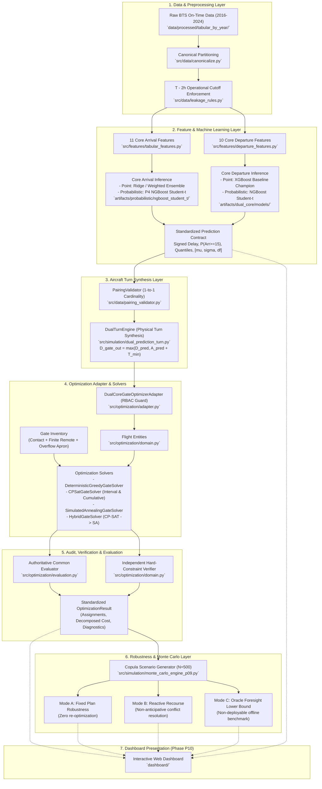

# Phase P09.5 Technical Discovery: System Architecture & Module Audit

**Document ID:** `DISC-01-ARCH`  
**Phase:** `P09.5 — DASHBOARD DISCOVERY & TECHNICAL HANDOFF`  
**Audit Date:** 2026-10-09  
**Auditor Roles:** Senior Software Architect, Research Software Auditor, ML Systems Engineer  
**Repository Working Tree:** `Aeolus Gate Optimization` (`D:\Study\Code\Python\Aelous`)  
**Git Branch:** `development/scalability-1500x50`  

---

## 1. Project Background & Thesis Scope

The **Aeolus Gate Optimization** project is a Master's Thesis research codebase entitled:

> **"Ứng dụng học máy và lập trình ràng buộc trong dự báo độ trễ chuyến bay và tối ưu tái phân bổ cổng đỗ tàu bay."**  
> *(Application of Machine Learning and Constraint Programming in Flight Delay Forecasting and Airport Gate Re-allocation Optimization)*

### 1.1 Core Research Objective
The research implements a **Predict-then-Optimize** paradigm for airport hub operations (specifically Hartsfield–Jackson Atlanta International Airport, `ATL`). Rather than optimizing gate schedules using nominal static timetable buffers or heuristic delay padding, the system:
1. Forecasts inbound flight arrival delays and outbound departure delays at a pre-tactical operational cutoff ($T_{\text{cutoff}} = \text{CRS\_DEP\_TIME} - 2\text{ hours}$).
2. Synthesizes physical **Aircraft Turns** coupling inbound arrivals with outbound departures while enforcing mandatory turnaround service times.
3. Solves the **Gate Assignment Problem (GAP)** using mathematical optimization to minimize operational friction (gate reassignments and remote apron overflow).
4. Validates solution resilience against extreme operational disruptions using stochastic **Monte Carlo simulations** across 500 correlated delay realizations.

### 1.2 Evolution Through Project Phases
- **P00–P03:** Domain contract hardening, multi-year BTS data canonicalization (2016–2024), timezone and midnight wrap-around handling, and finite remote stand capacity modeling.
- **P04:** Standardization of the objective function, decoupling decision-dependent costs from exogenous reporting costs.
- **P05:** Fair benchmark harness with monotonic high-resolution instrumentation (`perf_counter_ns`), isolating model construction from search time.
- **P06:** Scalability re-architecting of Google OR-Tools CP-SAT using sparse variable generation and native interval scheduling primitives (`AddNoOverlap`, `AddCumulative`), eliminating pairwise constraint explosion.
- **P07:** Native dual-core predict-then-optimize pipeline loading cryptographically validated model checkpoints without data leakage.
- **P08:** Machine learning scientific validation, proper scoring rules (CRPS, Brier score), and TreeSHAP explainability attributions.
- **P09:** Monte Carlo robustness validation over 500 realizations, formalizing Mode A (Fixed Plan), Mode B (Reactive Recourse), and Mode C (Oracle Foresight).
- **Target Phase P10:** Interactive Thesis Demonstration Application & Scientific Dashboard.

---

## 2. End-to-End Pipeline Architecture

The complete system workflow progresses across six distinct functional stages:

---

## 3. Detailed Module Status Matrix

| Module Directory | Primary Role | Implementation Status | Evidence Level | Reusable for Dashboard? | Notes & Gaps |
| :--- | :--- | :---: | :---: | :---: | :--- |
| `src/data/` | Data filtering, temporal protocols, leakage checks | **Complete** | `VERIFIED_CODE` | Yes (Data ingestion & schema validation) | Expanding window folds; sealed 2024 holdout. |
| `src/features/` | Tabular feature transformations | **Complete** | `VERIFIED_CODE` | Yes (Feature definitions & metadata) | Core Arrival (11 feats) and Departure (10 feats). |
| `src/models/` | Model registry, point and probabilistic baselines | **Complete** | `VERIFIED_CODE` | Yes (Inference & metadata lookups) | Native inference supported for P4 Student-t and XGBoost. |
| `src/models/probabilistic/` | Distribution classes, evaluation engine | **Complete** | `VERIFIED_CODE` | Yes (Statistical parameter rendering) | Parametric Student-t density & log-likelihood. |
| `src/simulation/dual_prediction_turn.py` | Turn synthesis & physical timeline | **Complete** | `VERIFIED_CODE` | Yes (Turn calculation & timeline metrics) | Enforces $D_{\text{gate\_out}} = \max(D_{\text{pred}}, A_{\text{pred}} + T_{\text{min}})$. |
| `src/simulation/native_dual_core_pipeline.py` | End-to-end pipeline orchestrator | **Complete** | `VERIFIED_CODE` | Yes (Primary backend execution engine) | Synchronous CLI runner; lacks web progress callbacks. |
| `src/simulation/monte_carlo_engine_p09.py` | 500-scenario stochastic engine | **Complete** | `VERIFIED_CODE` | Yes (Batch evaluation & statistics) | Bivariate Gaussian Copula ($\rho=0.45$), Mode A/B/C. |
| `src/optimization/domain.py` | Domain classes (`Flight`, `Gate`, `OptimizationResult`) | **Complete** | `VERIFIED_CODE` | Yes (Core data structures for UI) | Independent verifier, full serialization support. |
| `src/optimization/config.py` | Solver configurations & weights | **Complete** | `VERIFIED_CODE` | Yes (Parameter binding for UI widgets) | Objective weights, time limits, formulation flags. |
| `src/optimization/adapter.py` | Turn-to-Flight adapter with RBAC | **Complete** | `VERIFIED_CODE` | Yes (Model eligibility firewall) | Blocks Auxiliary Departure models fail-closed. |
| `src/optimization/evaluation.py` | Authoritative common evaluator | **Complete** | `VERIFIED_CODE` | Yes (Objective breakdown computation) | Enforces Decision vs Reporting cost identity. |
| `src/optimization/solvers/` | Greedy, CP-SAT, SA, Hybrid solvers | **Complete** | `VERIFIED_CODE` | Yes (Optimization execution) | All solvers conform to identical public `.solve()` contract. |
| `dashboard/` | Interactive presentation layer | **Empty** | `VERIFIED_CODE` | Needs creation in P10 | Directory exists but currently contains zero files. |
| `backend / api / service` | REST API, FastAPI, or task queue | **Not Implemented**| `NOT_IMPLEMENTED` | N/A | Pipeline currently runs as in-process Python calls. |

---

## 4. Architectural Findings & Answers to Core Discovery Questions

### Q1: Is there an orchestration layer?
- **Finding:** **Yes, for batch/CLI execution; No, for asynchronous web services.**
- **Evidence:** `NativeDualCorePipeline` ([`src/simulation/native_dual_core_pipeline.py`](file:///D:/Study/Code/Python/Aelous/src/simulation/native_dual_core_pipeline.py)) coordinates the end-to-end process: loading models -> verifying hashes -> extracting features -> running inference -> pairing legs -> synthesizing turns -> building gate inventory -> invoking solvers -> auditing constraints -> writing artifacts.
- **Limitation:** The orchestrator executes synchronously in-thread. There is no Celery, Redis, or background daemon.

### Q2: Is there a reusable service layer?
- **Finding:** **Yes, Python-level service classes exist.**
- **Evidence:** `NativeDualCorePipeline`, `DualTurnEngine`, `DualCoreGateOptimizerAdapter`, and `evaluate_gate_assignment` are modular and can be called directly from dashboard scripts without shelling out to CLI.

### Q3: Is there a backend or API (REST / GraphQL)?
- **Finding:** **No.**
- **Evidence:** All repository interfaces are Python classes or CLI scripts in `scripts/`. A Streamlit or Dash application will import Python modules directly (`in-process execution`).

### Q4: Does an existing dashboard exist?
- **Finding:** **No.**
- **Evidence:** The directory `dashboard/` exists in the repository root but is completely empty (0 files). No previous Streamlit or Dash app has been committed.

### Q5: Is there an artifact registry?
- **Finding:** **Yes, structured file-based artifact stores with JSON manifests.**
- **Evidence:** 
  - Model Registry: [`src/models/registry.py`](file:///D:/Study/Code/Python/Aelous/src/models/registry.py) (`_MODEL_CATALOG` with metadata and cryptographic hashes).
  - Remediation Artifacts: `artifacts/remediation/` containing subdirectories for `baseline`, `benchmarks`, `cp_sat`, `ml_validation`, `monte_carlo`, and `native_dual_core`.
  - Manifests: Every major pipeline run outputs a `run_manifest.json` or `simulation_manifest.json` recording environment, configuration, and SHA-256 hashes.

### Q6: Can the system run an end-to-end scenario from scratch?
- **Finding:** **Yes.**
- **Evidence:** `scripts/run_native_dual_core_pipeline.py` executes end-to-end on canonical 2023 ATL data in ~2.7 seconds for 30 turns / 20 gates.

### Q7: Can multiple solvers be executed on the exact same scenario?
- **Finding:** **Yes, with guaranteed fairness.**
- **Evidence:** Verified in Phase P05 ([`tests/test_benchmark_fairness_p05.py`](file:///D:/Study/Code/Python/Aelous/tests/test_benchmark_fairness_p05.py)). Invariant `B01` and `B02` guarantee that when multiple solvers are called on a scenario, they receive identical flight lists, identical gate inventories, and identical objective weights.

---

## 5. Architectural Recommendations for Dashboard (Phase P10)

1. **In-Process Python Integration:**  
   Since no REST API exists, the dashboard should directly import domain entities and solvers from `src.optimization.domain`, `src.simulation.dual_prediction_turn`, and `src.simulation.native_dual_core_pipeline`.
2. **Execution Decoupling:**  
   Because exact optimization (CP-SAT on large scales) or Monte Carlo simulation (500 iterations) takes several seconds to minutes, running them directly inside a naive Streamlit button callback risks locking the UI or re-triggering upon widget state updates. Session state guards or caching (`@st.cache_data`, `@st.cache_resource`) must be used.
3. **Precomputed Artifact Fallback:**  
   For heavy research views (such as the 500-scenario Monte Carlo distributions or 1,500-flight scalability benchmarks), the dashboard should default to reading verified precomputed artifacts from `artifacts/remediation/` while offering on-demand live execution for smaller interactive demo scenarios.
