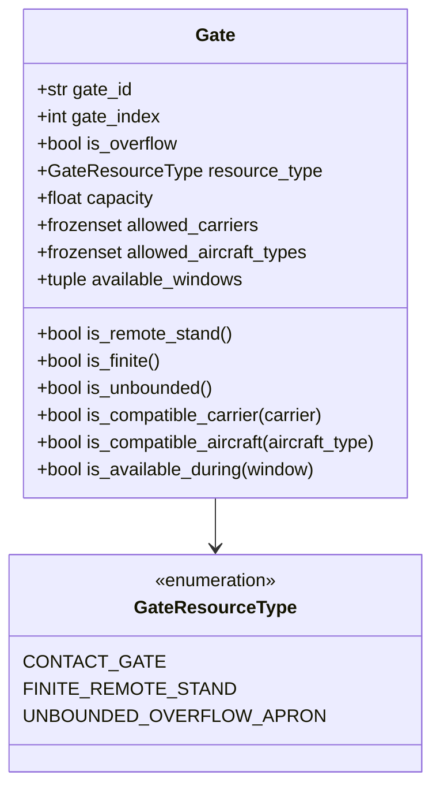

# Phase P09.5 Technical Discovery: Data & Artifact Contracts

**Document ID:** `DISC-02-CONTRACTS`  
**Phase:** `P09.5 — DASHBOARD DISCOVERY & TECHNICAL HANDOFF`  
**Audit Date:** 2026-10-09  
**Auditor Roles:** Senior Python Engineer, Data Architect, Operations Research Specialist  

---

## 1. Flight Datasets & Ingestion Contracts

### 1.1 Dataset Provenance & Scope
- **Source:** United States Bureau of Transportation Statistics (BTS) Airline On-Time Performance Data (2016–2024).
- **Airport Focus:** Hartsfield–Jackson Atlanta International Airport (`ATL`).
  - Inbound stream: Chunks filtered on `DEST == "ATL"`.
  - Outbound stream: Chunks filtered on `ORIGIN == "ATL"`.
- **Storage Hierarchy:** Partitioned Parquet datasets under `data/processed/tabular_by_year/year={YYYY}/`.
- **Timezone Standardization:** Timestamps in BTS are local airport time. In the pipeline, flight legs are indexed to an epoch minute timeline ($t \in [0, 1440)$ for single-day schedules, with $+1440$ minute wrap-around for flights crossing midnight).
- **Operational Cutoff:** Fixed at $T_{\text{cutoff}} = \text{CRS\_DEP\_TIME} - 120\text{ minutes}$. No actual flight realization features (actual departure/arrival time, taxi durations, cancellation status) are permitted before the cutoff.

---

## 2. Comprehensive Dashboard Data Dictionary

The following table specifies all flight-level fields relevant to dashboard presentation:

| Field | Type | Description | Unit / Format | Nullable | Source | Available at Cutoff ($T-2\text{h}$) |
| :--- | :--- | :--- | :---: | :---: | :--- | :---: |
| `flight_id` / `turn_id` | string | Unique aircraft turn identifier (e.g. `TURN_0001`) | String | No | Turn Synthesis Engine | Yes |
| `arrival_leg_id` | string | Inbound flight leg identifier (e.g. `LEG_ARR_0001`) | String | Yes | BTS / Flight Chain | Yes |
| `departure_leg_id` | string | Outbound flight leg identifier (e.g. `LEG_DEP_0001`) | String | Yes | BTS / Flight Chain | Yes |
| `carrier` | string | Operating airline two-letter IATA code (e.g. `DL`, `AA`, `UA`) | String | No | BTS Schedule (`OP_CARRIER`) | Yes |
| `flight_number` | string | Scheduled flight number (e.g. `1639`) | String | No | BTS Schedule (`OP_CARRIER_FL_NUM`) | Yes |
| `aircraft_type` | string | Aircraft physical categorization (`NARROWBODY`, `WIDEBODY`) | Enum / String | Yes | Reconstructed Chain / BTS | Yes |
| `scheduled_arrival_min` | integer | Timetable scheduled gate arrival time | Minutes from 00:00 | No | BTS (`CRS_ARR_TIME`) | Yes |
| `scheduled_departure_min` | integer | Timetable scheduled gate departure pushback time | Minutes from 00:00 | No | BTS (`CRS_DEP_TIME`) | Yes |
| `predicted_arrival_delay_min` | float | Model predicted inbound arrival delay (signed) | Minutes ($[-60, +300]$) | No | Arrival ML Model | Yes |
| `predicted_departure_delay_min` | float | Model predicted outbound pushback delay (signed) | Minutes ($[-60, +300]$) | Yes | Departure ML Model | Yes |
| `simulated_arrival_min` | integer | Effective gate-in time: $A_{\text{sched}} + \text{round}(\Delta A_{\text{pred}})$ | Minutes | No | DualTurnEngine | Yes |
| `simulated_departure_min` | integer | Effective gate-out time: $\max(D_{\text{pred}}, A_{\text{pred}} + T_{\text{min}})$ | Minutes | No | DualTurnEngine | Yes |
| `nominal_gate_id` | string | Pre-published terminal gate assignment (e.g. `G01`, `A12`) | String | Yes | Schedule Fixture | Yes |
| `min_turnaround_min` | integer | Mandatory ground service minimum duration (default 45 min) | Minutes | No | Operational Configuration | Yes |
| `separation_buffer_min` | integer | Safety buffer between successive gate occupants (default 15 min)| Minutes | No | Operational Configuration | Yes |
| `gate_release_min` | integer | Stand availability clock: $D_{\text{gate\_out}} + B_{\text{buffer}}$ | Minutes | No | DualTurnEngine | Yes |
| `actual_arrival_delay_min` | float | Realized actual arrival delay (for post-hoc evaluation only) | Minutes | Yes | BTS (`ARR_DELAY`) | **NO** (Post-Hoc Only) |
| `actual_departure_delay_min` | float | Realized actual departure delay (for post-hoc evaluation only) | Minutes | Yes | BTS (`DEP_DELAY`) | **NO** (Post-Hoc Only) |

---

## 3. Structural Distinctions: Legs vs Turns, Planned vs Realized

### 3.1 Flight Legs vs Aircraft Turns
- **Flight Leg:** A single flight segment (Inbound arrival leg or Outbound departure leg). In a hub airport, an aircraft arrives, parks at a gate for turnaround service, and departs as a subsequent flight.
- **Aircraft Turn:** The unified physical entity representing the aircraft's continuous ground occupancy at the hub gate.
- **Pairing Rule:** In the historical BTS dataset, tail numbers (`TAIL_NUM`) enable linking arrival legs to departure legs. If an aircraft turn cannot be paired with authentic aircraft rotation data, it is tagged as `SYNTHETIC_PAIR` or `UNMATCHED_ARR` / `UNMATCHED_DEP`. The dashboard must never assume $N_{\text{legs}} = N_{\text{turns}}$. For 30 turn pairs, there are exactly 60 flight legs (30 arrival + 30 departure).

### 3.2 Planned Occupancy vs Realized Occupancy
- **Planned Occupancy Window:** $[A_{\text{pred}}, T_{\text{release}}) = [A_{\text{pred}}, D_{\text{gate\_out}} + B_{\text{buffer}})$. This is what solvers see and optimize against.
- **Realized Occupancy Window:** $[A_{\text{actual}}, D_{\text{actual}} + B_{\text{buffer}})$. In operational reality, delays fluctuate stochastically. The dashboard Gantt chart must visually distinguish between the planned window and realized actual occupancy to highlight gate conflicts caused by delay variations.

---

## 4. Gate Inventory Contract & Topology Modeling

In [`src/optimization/domain.py`](file:///D:/Study/Code/Python/Aelous/src/optimization/domain.py), gates are modeled with three distinct resource classifications:



### 4.1 Resource Types & Capacity Policy
1. **`CONTACT_GATE`:**  
   - Terminal passenger boarding bridge gate (e.g. `G01`, `T04`).  
   - Discrete capacity: Strictly $1$. Overlaps are strictly forbidden ($C_{\text{conflict}}$ hard violation).
2. **`FINITE_REMOTE_STAND`:**  
   - Hardstand remote parking stand requiring bus transfer (e.g. `R01`, `R02`).  
   - Discrete capacity: $1$ per discrete stand, or $K \ge 1$ for pooled stands.  
   - Incurs severe operational cost penalty ($w_{\text{overflow}} = 200.0$).
3. **`UNBOUNDED_OVERFLOW_APRON`:**  
   - Theoretical infinite parking buffer (`OVERFLOW_APRON`).  
   - Capacity: $\infty$. Can absorb any flight volume to guarantee feasibility during mathematical stress testing.
   - **Crucial Distinction:** 50 finite gates does NOT equal 50 finite gates + 1 unbounded apron. If capacity is strictly finite and flight demand exceeds capacity, CP-SAT correctly returns `INFEASIBLE`. The dashboard must expose this capacity toggle clearly.

### 4.2 Verified Sample Gate Inventory
From [`docs/dashboard_discovery/samples/gate_inventory_sample.json`](file:///D:/Study/Code/Python/Aelous/docs/dashboard_discovery/samples/gate_inventory_sample.json):
```json
[
  {
    "gate_id": "G01",
    "gate_index": 0,
    "is_overflow": false,
    "resource_type": "CONTACT_GATE",
    "capacity": 1.0,
    "allowed_carriers": ["AA", "DL"],
    "allowed_aircraft_types": ["NARROWBODY", "WIDEBODY"],
    "available_windows": null
  },
  {
    "gate_id": "R01",
    "gate_index": 2,
    "is_overflow": true,
    "resource_type": "FINITE_REMOTE_STAND",
    "capacity": 1.0,
    "allowed_carriers": null,
    "allowed_aircraft_types": null,
    "available_windows": null
  },
  {
    "gate_id": "OVERFLOW_APRON",
    "gate_index": 4,
    "is_overflow": true,
    "resource_type": "UNBOUNDED_OVERFLOW_APRON",
    "capacity": "unbounded",
    "allowed_carriers": null,
    "allowed_aircraft_types": null,
    "available_windows": null
  }
]
```

---

## 5. Domain Structures & Optimization Results Contract

### 5.1 Optimization Result Schema (`OptimizationResult`)
When any solver executes, it produces an `OptimizationResult` structure containing:

```json
{
  "status": "OPTIMAL",
  "normalized_status": "OPTIMAL",
  "raw_solver_status": "OPTIMAL",
  "optimality_proven": true,
  "termination_reason": "OPTIMAL_PROVEN",
  "objective_value": 450.0,
  "feasible": true,
  "runtime_ms": 10.72,
  "optimality_gap": 0.0,
  "best_bound": 450.0,
  "assignment_count": 10,
  "contact_count": 8,
  "remote_count": 2,
  "unassigned_count": 0,
  "hard_constraint_violations": 0,
  "objective_breakdown": {
    "objective_version": "v1",
    "total_cost": 450.0,
    "decision_cost": 450.0,
    "reporting_cost": 0.0,
    "reassignment_cost": 50.0,
    "overflow_cost": 400.0,
    "conflict_cost": 0.0,
    "delay_cost": 0.0,
    "risk_cost": 0.0,
    "weights": {
      "reassignment_weight": 10.0,
      "overflow_weight": 200.0,
      "delay_weight": 1.0,
      "conflict_weight": 1000.0,
      "risk_weight": 2.0
    }
  },
  "constraint_diagnostics": {
    "is_valid": true,
    "all_flights_assigned": true,
    "no_contact_gate_conflicts": true,
    "gate_availability_satisfied": true,
    "gate_compatibility_satisfied": true,
    "turnaround_valid": true,
    "conflict_count": 0,
    "planned_contact_violations": 0,
    "planned_remote_violations": 0,
    "max_concurrent_remote_usage": 2,
    "resource_capacity_policy": "FINITE_ENFORCED"
  }
}
```

### 5.2 Gate Assignment Record (`GateAssignment`)
Each flight assignment in `assignments` conforms to:
```json
{
  "flight_id": "TURN_0001",
  "gate_id": "G01",
  "flight_index": 0,
  "gate_index": 0,
  "is_overflow": false,
  "is_reassignment": false,
  "occupancy_start_min": 882,
  "occupancy_end_min": 982,
  "assignment_state": "CONTACT_GATE"
}
```

---

## 6. Artifact Inventory & Format Catalog

| Artifact Path | Format | Size | Producer Module | Purpose | Validated |
| :--- | :---: | :---: | :--- | :--- | :---: |
| `artifacts/remediation/benchmarks/solver_runs.csv` | CSV | 21 KB | `scripts/run_p05_benchmark_suite.py` | 85 individual solver benchmark runs across scales | **VERIFIED** |
| `artifacts/remediation/benchmarks/aggregate_metrics.json` | JSON | 13 KB | `scripts/run_p05_benchmark_suite.py` | Multi-run medians, std, failure rates | **VERIFIED** |
| `artifacts/remediation/cp_sat/scalability_results.csv` | CSV | 2.1 KB | `scripts/run_p06_scalability_benchmark.py` | Formulation scaling from 100 to 1,500 flights | **VERIFIED** |
| `artifacts/remediation/ml_validation/classification_metrics.csv`| CSV | 1.1 KB | `scripts/generate_p08_validation_artifacts.py` | ROC-AUC, PR-AUC, Brier score across models | **VERIFIED** |
| `artifacts/remediation/ml_validation/regression_metrics.csv` | CSV | 1.8 KB | `scripts/generate_p08_validation_artifacts.py` | MAE, RMSE, bias, tail quantiles | **VERIFIED** |
| `artifacts/remediation/ml_validation/probabilistic_metrics.csv` | CSV | 1.2 KB | `scripts/generate_p08_validation_artifacts.py` | CRPS, continuous NLL, 80%/90% coverage | **VERIFIED** |
| `artifacts/remediation/ml_validation/shap_outputs/` | JSON/PNG | 150 KB | `scripts/generate_p08_validation_artifacts.py` | Global TreeSHAP importance & local case studies | **VERIFIED** |
| `artifacts/remediation/monte_carlo/fixed_plan_results.csv` | CSV | 221 KB | `src/simulation/monte_carlo_engine_p09.py` | 500 realizations under Mode A (Fixed Plan) | **VERIFIED** |
| `artifacts/remediation/monte_carlo/recourse_results.csv` | CSV | 221 KB | `src/simulation/monte_carlo_engine_p09.py` | 500 realizations under Mode B (Recourse) | **VERIFIED** |
| `artifacts/remediation/monte_carlo/statistical_summary.json` | JSON | 8.6 KB | `src/simulation/monte_carlo_engine_p09.py` | 95% CIs, MCSE, CVaR-90/95, paired differences | **VERIFIED** |
| `artifacts/remediation/native_dual_core/run_manifest.json` | JSON | 2.6 KB | `scripts/run_native_dual_core_pipeline.py` | Full cryptographic execution manifest | **VERIFIED** |

---

## 7. Sample Data Files Available for Design
All 10 authentic design sample files have been generated and validated in [`docs/dashboard_discovery/samples/`](file:///D:/Study/Code/Python/Aelous/docs/dashboard_discovery/samples):
1. `flight_sample.json`
2. `inbound_prediction_sample.json`
3. `outbound_prediction_sample.json`
4. `aircraft_turn_sample.json`
5. `gate_inventory_sample.json`
6. `gate_assignment_sample.json`
7. `solver_comparison_sample.json`
8. `monte_carlo_scenario_sample.json`
9. `monte_carlo_summary_sample.json`
10. `experiment_manifest_sample.json`
