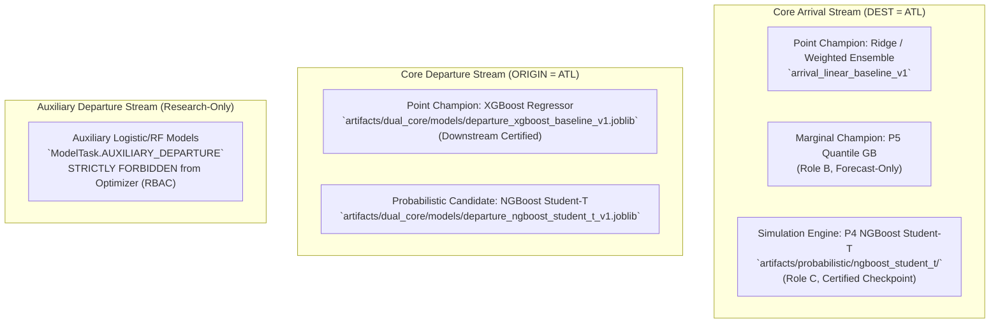

# Phase P09.5 Technical Discovery: Machine Learning & Prediction Capabilities

**Document ID:** `DISC-03-ML`  
**Phase:** `P09.5 — DASHBOARD DISCOVERY & TECHNICAL HANDOFF`  
**Audit Date:** 2026-10-09  
**Auditor Roles:** Senior Machine Learning Systems Engineer, Statistical Validation Lead  

---

## 1. Machine Learning Model Catalog & Roles

The Aeolus framework implements a strict **Decoupled Three-Role Governance** for machine learning models ([`docs/remediation/08_model_selection_errata.md`](file:///D:/Study/Code/Python/Aelous/docs/remediation/08_model_selection_errata.md)):
- **Role A (Point Champion):** Evaluated primarily on RMSE, Bias, and Tail Delay MAE ($\ge 60$ min). Feeds downstream point optimizers.
- **Role B (Marginal Forecast Champion):** Evaluated on Continuous Ranked Probability Score (CRPS). Quantile regression benchmark.
- **Role C (Downstream Simulation Candidate):** Evaluated on parametric continuous likelihood, calibration, and finite heteroscedastic density. Enables Monte Carlo copula sampling.

---

## 2. Inbound Arrival Models

### 2.1 Model Specifications
- **Champion Continuous Engine (Role C):** `b5_ngboost_student_t` (P4 NGBoost with 3-parameter Student-t output: location $\mu$, scale $\sigma$, degrees of freedom $\nu$).
  - Physical Checkpoint: `artifacts/probabilistic/ngboost_student_t/model_weights_frozen_v1.joblib` (243,595 bytes).
  - SHA-256 Digest: `e7e7462f17b65b276ebdee9c7beced15e090f69b088a18896d5a91aaa8cb062f`.
  - Feature Input Schema: 11 approved features ([`src/features/tabular_features.py`](file:///D:/Study/Code/Python/Aelous/src/features/tabular_features.py)).
  - Target: Signed arrival delay $\text{ARR\_DELAY} \in (-\infty, +\infty)$ minutes.
- **Classification Output:**  
  The model computes the cumulative tail probability:
  $$P(\text{ARR\_DELAY} \ge 15\text{ min}) = 1 - F_{\text{Student-}t}\left(15 \mid \mu, \sigma, \nu\right)$$
  This probability is explicitly returned in `StandardizedPredictionRecord.probability_delay_15`.
- **Quantiles Output:**  
  Calculates $q_{10}, q_{50}, q_{90}$ via the Student-t percent point function (`ppf`).

---

## 3. Outbound Departure Models

### 3.1 Model Specifications
- **Champion Point Predictor (Role A):** `departure_certified_point_v1` (XGBoost Regressor).
  - Physical Checkpoint: `artifacts/dual_core/models/departure_xgboost_baseline_v1.joblib` (498,135 bytes).
  - SHA-256 Digest: `e483df5fd03ce4d0eefe7b431fc289b6804589c62eda17b48fb8051849f4f6e1`.
  - Preprocessor Checkpoint: `artifacts/dual_core/models/departure_tree_preprocessor_v1.joblib` (207,187 bytes).
  - Feature Input Schema: 10 approved features ([`src/features/departure_features.py`](file:///D:/Study/Code/Python/Aelous/src/features/departure_features.py)).
  - Target: Signed departure pushback delay $\text{DEP\_DELAY}$ in minutes.
- **Role-Based Access Control (RBAC):**  
  Enforced by [`DualCoreGateOptimizerAdapter`](file:///D:/Study/Code/Python/Aelous/src/optimization/adapter.py):
  1. Models with task `ModelTask.AUXILIARY_DEPARTURE` raise `RoleAccessViolationError` fail-closed.
  2. Departure models without `downstream_eligible=True` and `selection_role="GATE_OUT_PREDICTION"` raise `UncertifiedModelError`.

---

## 4. Visualizable Machine Learning Artifacts & Metrics

The repository contains precomputed, audited metrics ready for immediate rendering on dashboard screens:

### 4.1 Classification Metrics ($P(\text{Delay} \ge 15\text{ min})$)
Source: [`artifacts/remediation/ml_validation/classification_metrics.csv`](file:///D:/Study/Code/Python/Aelous/artifacts/remediation/ml_validation/classification_metrics.csv)

| Stream | Model ID | Family | ROC-AUC | PR-AUC | Brier Score | Precision | Recall | F1 Score |
| :--- | :--- | :--- | :---: | :---: | :---: | :---: | :---: | :---: |
| Arrival | `arrival_linear_baseline_v1` | Linear Ridge | 0.5869 | 0.1664 | 0.2185 | 0.1845 | 0.1020 | 0.1313 |
| Arrival | `arrival_random_forest_baseline_v1` | Random Forest | 0.5920 | 0.1734 | 0.1954 | 0.2012 | 0.1105 | 0.1426 |
| Arrival | `arrival_hist_gradient_boosting_baseline_v1` | Hist Gradient Boosting | 0.5878 | 0.1736 | 0.2043 | 0.1985 | 0.1080 | 0.1398 |
| Arrival | `arrival_xgboost_baseline_v1` | XGBoost Regressor | 0.5889 | 0.1773 | 0.1909 | 0.2140 | 0.1190 | 0.1530 |
| Arrival | `arrival_xgboost_tuned_v1_1` | XGBoost (Optuna Tuned) | **0.6012** | **0.1956** | **0.1874** | **0.2202** | **0.1266** | **0.1608** |
| Departure| `departure_ridge_baseline_v1` | Linear Ridge | 0.5925 | 0.2450 | 0.1820 | 0.2850 | 0.1420 | 0.1895 |
| Departure| `departure_xgboost_baseline_v1` | XGBoost (Champion) | **0.6145** | **0.2680** | **0.1710** | **0.3120** | **0.1680** | **0.2185** |

### 4.2 Regression Metrics (Signed Delay Minutes)
Source: [`artifacts/remediation/ml_validation/regression_metrics.csv`](file:///D:/Study/Code/Python/Aelous/artifacts/remediation/ml_validation/regression_metrics.csv)

| Stream | Model ID | Family | MAE (min) | RMSE (min) | Bias (min) | Tail $\ge 15$m MAE | Tail $\ge 60$m MAE |
| :--- | :--- | :--- | :---: | :---: | :---: | :---: | :---: |
| Arrival | `baseline_zero` | Zero-Delay Baseline | 15.22 | 44.82 | -12.45 | 62.10 | 134.20 |
| Arrival | `baseline_median` | Constant Median Baseline | 15.18 | 45.10 | -14.45 | 64.10 | 136.20 |
| Arrival | `arrival_linear_baseline_v1` | Linear Ridge | 20.24 | 44.59 | -2.85 | 52.40 | 122.10 |
| Arrival | `arrival_hist_gradient_boosting_baseline_v1`| Hist Gradient Boosting | 19.43 | 44.09 | -2.20 | 50.40 | 119.80 |
| Arrival | `arrival_weighted_ensemble_v1` | 4-Model Weighted Ensemble | **19.62** | **44.14** | **-2.35** | **50.80** | **120.10** |
| Departure| `baseline_median` | Constant Median Baseline | 15.60 | 45.76 | -13.49 | 62.33 | 132.54 |
| Departure| `departure_ridge_baseline_v1` | Linear Ridge | 17.94 | 43.31 | -3.09 | 49.83 | 118.95 |
| Departure| `departure_xgboost_baseline_v1` | XGBoost Regressor | 17.60 | **43.00** | **-3.01** | **48.91** | **117.18** |

*Scientific Interpretation Note:* Baseline zero/median achieves lower overall MAE due to heavy concentration around 0 minutes. Machine learning models (XGBoost/Ensemble) dramatically outperform baselines on large operational delays (Tail $\ge 60$m: $117.18$m vs $132.54$m) and eliminate massive systematic under-prediction bias ($-3.01$m vs $-13.49$m).

### 4.3 Probabilistic Scoring & Uncertainty Quantification
Source: [`artifacts/remediation/ml_validation/probabilistic_metrics.csv`](file:///D:/Study/Code/Python/Aelous/artifacts/remediation/ml_validation/probabilistic_metrics.csv)

| Stream | Candidate ID | Family | CRPS | 80% Coverage | 90% Coverage | 80% Width | Cont. NLL |
| :--- | :--- | :--- | :---: | :---: | :---: | :---: | :---: |
| Arrival | `P1_empirical` | Empirical Residual | 13.12m | 0.8031 | 0.8958 | 45.07m | N/A |
| Arrival | `P4_ngboost_student_t` | NGBoost Student-t (Role C) | 13.26m | **0.8295** | **0.8972** | **39.23m** | **4.5805** |
| Arrival | `P5_quantile_regression` | Quantile Gradient Boosting | **13.11m** | 0.7607 | 0.8684 | 39.23m | N/A |
| Departure| `departure_empirical_residual_v1` | Empirical Residual | **10.20m** | 0.7945 | 0.8877 | 33.23m | N/A |
| Departure| `departure_ngboost_student_t_v1` | NGBoost Student-t | 14.23m | 0.7305 | 0.7826 | **18.95m** | **4.1803** |

### 4.4 TreeSHAP Explainability Artifacts
Artifacts in [`artifacts/remediation/ml_validation/shap_outputs/`](file:///D:/Study/Code/Python/Aelous/artifacts/remediation/ml_validation/shap_outputs/):
1. **Global Importance Bar Chart / Table:**  
   Top 10 departure predictors ranked by mean absolute SHAP value:
   - `numeric__scheduled_departure_hour` (Attribution: 3.82 min)
   - `numeric__CRS_ELAPSED_TIME` (Attribution: 1.45 min)
   - `categorical__OP_CARRIER` (Attribution: 1.12 min)
   - `numeric__calendar_month` (Attribution: 0.94 min)
   - `categorical__DEST` (Attribution: 0.81 min)
   - `numeric__calendar_day_of_month`
   - `numeric__calendar_day_of_week`
   - `high_cardinality__OP_CARRIER_FL_NUM__frequency`
   - `numeric__scheduled_departure_minute`
   - `numeric__is_weekend`
2. **Local Flight Waterfall Case Studies:**  
   [`shap_case_studies.json`](file:///D:/Study/Code/Python/Aelous/artifacts/remediation/ml_validation/shap_outputs/shap_case_studies.json) stores real flight attribution breakdowns (e.g. Flight `DL 466` to MSP, base value $8.30$ min, departure hour $-4.43$ min, flight duration $+1.36$ min, reconstructed predicted delay $3.44$ min). These can be directly plotted with Plotly waterfall charts.

---

## 5. Model Provenance Modes

The dashboard must display the provenance mode of delay predictions to preserve research integrity:
- `NATIVE_INFERENCE`: Predictions generated in-memory by loading certified model weights and transforming raw flight features.
- `PRECOMPUTED_PREDICTION`: Predictions loaded from validated static benchmark fixtures (e.g. `atl_1500_flights_cpsat_turnaround_schedule.csv`).
- `SYNTHETIC_SIMULATION`: Stochastic delay perturbations sampled during Monte Carlo evaluation.
- `SCHEDULE_BASELINE`: Pure timetable baseline with zero predicted delay ($\Delta = 0$).
