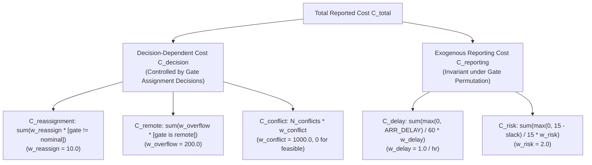

# Phase P09.5 Technical Discovery: Gate Optimization Capabilities

**Document ID:** `DISC-04-OPTIM`  
**Phase:** `P09.5 — DASHBOARD DISCOVERY & TECHNICAL HANDOFF`  
**Audit Date:** 2026-10-09  
**Auditor Roles:** Operations Research & Optimization Specialist, Python Algorithm Engineer  

---

## 1. Solver Catalog & Public Interfaces

The repository provides four primary optimization solvers, all conforming to a uniform, interchangeable public execution method:

| Solver Name | Python Class | Source File | Method Signature | Execution Style | Interactive Readiness |
| :--- | :--- | :--- | :--- | :---: | :---: |
| **Deterministic Greedy** | `DeterministicGreedyGateSolver` | [`src/optimization/solvers/greedy_solver.py`](file:///D:/Study/Code/Python/Aelous/src/optimization/solvers/greedy_solver.py) | `solve(flights, gates, *, allow_overflow=True)` | Synchronous | **YES (Ultra-Fast: < 100 ms)** |
| **Exact CP-SAT** | `CPSatGateSolver` | [`src/optimization/solvers/cp_sat_solver.py`](file:///D:/Study/Code/Python/Aelous/src/optimization/solvers/cp_sat_solver.py) | `solve(flights, gates, *, allow_overflow=True, initial_assignments=None)` | Synchronous | **YES for $N \le 300$ (with timeout budget)** |
| **Simulated Annealing** | `SimulatedAnnealingGateSolver` | [`src/optimization/sa/annealer.py`](file:///D:/Study/Code/Python/Aelous/src/optimization/sa/annealer.py) | `solve(flights, gates, *, allow_overflow=True)` | Synchronous | **CONDITIONAL (2s to 60s runtime)** |
| **Two-Stage Hybrid** | `HybridGateSolver` | [`src/optimization/solvers/hybrid_solver.py`](file:///D:/Study/Code/Python/Aelous/src/optimization/solvers/hybrid_solver.py) | `solve(flights, gates, *, allow_overflow=True)` | Synchronous | **CONDITIONAL (CP-SAT stage + SA stage)** |

---

## 2. Parameter & Configuration Classification

All optimization runs are configured via [`GateOptimizationConfig`](file:///D:/Study/Code/Python/Aelous/src/optimization/config.py). We recommend categorizing parameters into three user levels:

### 2.1 Basic Controls (Suitable for all Dashboard Users)
- `solver_name`: Selection dropdown (`"CPSat"`, `"DeterministicGreedy"`, `"SimulatedAnnealing"`, `"Hybrid"`).
- `time_limit_seconds`: Maximum solver search budget (Slider: $1.0\text{s} - 30.0\text{s}$, default: $10.0\text{s}$).
- `allow_unbounded_overflow`: Boolean toggle. If enabled, adds an infinite overflow apron so the problem is always feasible. If disabled, enforces strictly finite gates.
- `random_seed`: Integer seed for deterministic reproduction (default: `202601`).

### 2.2 Advanced Controls (For Researchers & Thesis Committee)
- `cp_sat_formulation`: CP-SAT constraint model formulation:
  - `"sparse_interval"`: **(Recommended)** Native OR-Tools `AddNoOverlap` and `AddCumulative`. Extremely fast Python construction ($< 3\text{s}$ for 500 flights).
  - `"sparse_pairwise"`: Sparse pairwise conflict cliques $x_{i,g} + x_{j,g} \le 1$.
  - `"dense_pairwise"`: Baseline dense formulation (causes build time explosion on $N \ge 300$).
- `cp_sat_use_warm_start`: Boolean flag to pass a Greedy initial solution hint into CP-SAT.
- `cp_sat_fallback_to_greedy`: Boolean flag to fall back to Greedy if CP-SAT search budget expires without an incumbent.
- `objective_weights`:
  - `reassignment_weight`: Penalty for deviating from nominal gate (default: $10.0$).
  - `overflow_weight`: Penalty for remote stand or overflow apron usage (default: $200.0$).
- `operational_timelines`:
  - `min_turnaround_minutes`: Ground service minimum (default: $45\text{ min}$).
  - `separation_buffer_minutes`: Stand release separation (default: $15\text{ min}$).

### 2.3 Internal Controls (Fixed, Do Not Expose on UI)
- `scale_factor`: Fixed multiplier to convert floating costs to integer expressions for CP-SAT (Fixed: `100`).
- `num_search_workers`: Number of CP-SAT search threads (Fixed: `1` to guarantee exact mathematical determinism).
- `objective_version`: Canonical contract version string (Fixed: `"v1"`).

---

## 3. Objective Function Decomposition Contract

Standardized in Phase P04 ([`04_objective_semantics.md`](file:///D:/Study/Code/Python/Aelous/docs/remediation/04_objective_semantics.md)):

$$C_{\text{total\_reported}} = C_{\text{decision}} + C_{\text{reporting}}$$

$$\text{Identity Axiom: } \forall \text{ candidate assignment } x, \quad C_{\text{total\_reported}}(x) - (C_{\text{decision}}(x) + C_{\text{reporting}}) = 0$$

### Critical Scientific Principle:
Solvers cannot claim to "reduce flight delay" or "minimize turnaround risk". Because flight arrival times and aircraft turnaround requirements are determined exogenously before gate assignment, $C_{\text{reporting}}$ is identical across all possible gate assignments. Solvers solely minimize $C_{\text{decision}}$ ($C_{\text{reassignment}} + C_{\text{remote}}$).

---

## 4. Solver Output Semantics & Status Handling

When displaying solver outcomes, the dashboard must strictly adhere to normalized statuses in [`src/optimization/domain.py`](file:///D:/Study/Code/Python/Aelous/src/optimization/domain.py):

| Status | Mathematical Meaning | Feasible? | Optimality Proven? | Ranking Cost | Dashboard UI Badge |
| :--- | :--- | :---: | :---: | :---: | :---: |
| **`OPTIMAL`** | Exact global optimum proven with zero optimality gap ($\text{gap} = 0.0\%$). | **True** | **True** | `objective_value` | Green: `Optimal (Proven)` |
| **`FEASIBLE`** | Hard-feasible solution found, but optimality not proven within time limit. | **True** | **False** | `objective_value` | Blue: `Feasible Solution` |
| **`TIMEOUT_NO_SOLUTION`** | Search budget expired before finding any valid incumbent. | **False** | **False** | $+\infty$ | Amber: `Timeout (No Incumbent)` |
| **`INFEASIBLE`** | Proved that no assignment can satisfy hard constraints (e.g. insufficient gates). | **False** | **False** | $+\infty$ | Red: `Infeasible Scenario` |
| **`MODEL_INVALID`** | Input validation failure (e.g. flight with zero eligible gates). | **False** | **False** | $+\infty$ | Red: `Model Configuration Error` |

### Independent Verifier Primacy:
Solvers **never** self-certify feasibility. Every solution returned by CP-SAT, Greedy, SA, or Hybrid is independently audited by `verify_hard_constraints_independently()`. If any contact gate overlap, turnaround violation, or compatibility breach is detected, `feasible` is forced to `False` and `ranking_cost` becomes $+\infty$.

---

## 5. Gantt Chart Data Requirements

To render the Gate Assignment Gantt chart, the dashboard requires the following fields per bar:
- `flight_id` / `turn_id`: Flight turn identifier.
- `carrier` & `flight_number`: E.g. `DL 1639`.
- `assigned_gate`: Gate ID assigned by solver (Y-axis category).
- `nominal_gate`: Original timetable gate.
- `is_reassignment`: Boolean indicating if `assigned_gate != nominal_gate` (triggers highlight color).
- `start_min` / `occupancy_start`: Planned gate entry time ($A_{\text{pred}}$).
- `pushback_min`: Planned gate pushback time ($D_{\text{gate\_out}}$).
- `end_min` / `gate_release`: Stand release time ($D_{\text{gate\_out}} + B_{\text{buffer}}$).
- `resource_type`: `CONTACT_GATE`, `FINITE_REMOTE_STAND`, or `OVERFLOW_APRON`.
- `risk_slack`: Turnaround slack time $\text{slack} = (D_{\text{gate\_out}} - A_{\text{pred}}) - T_{\text{min}}$.

---

## 6. Empirical Benchmark Results (Fairness & Scalability)

### 6.1 Solver Comparison Across Scales (from P05 Fair Benchmark)
Source: [`artifacts/remediation/benchmarks/solver_runs.csv`](file:///D:/Study/Code/Python/Aelous/artifacts/remediation/benchmarks/solver_runs.csv)

| Scale | Solver | Feasible | Wall Clock | Build Time | Search Time | Decision Cost | Reassignments | Remote Usage |
| :--- | :--- | :---: | :---: | :---: | :---: | :---: | :---: | :---: |
| **10F / 3G** | Greedy | **Yes** | **1.8 ms** | 0.0 ms | 1.8 ms | 450.0 | 5 | 2 |
| **10F / 3G** | CP-SAT | **Yes** | 10.7 ms | 6.1 ms | 3.2 ms | **430.0** | 3 | 2 |
| **10F / 3G** | SA | **Yes** | 2,263 ms | 1.8 ms | 2,261 ms | **430.0** | 3 | 2 |
| **100F / 20G**| Greedy | **Yes** | **23.1 ms**| 0.0 ms | 23.1 ms | 830.0 | 43 | 2 |
| **100F / 20G**| CP-SAT | **Yes** | 940.8 ms | 827.6 ms | 92.1 ms | **450.0** | 25 | 1 |
| **100F / 20G**| SA | **Yes** | 21,980 ms| 22.8 ms | 21,957 ms| 796.7 | 41 | 2 |
| **200F / 30G**| Greedy | **Yes** | **55.2 ms**| 0.0 ms | 55.2 ms | 919.7 | 72 | 1 |
| **200F / 30G**| CP-SAT | **Yes** | 5,143 ms | 3,606 ms | 1,490 ms | **639.7** | 44 | 1 |
| **300F / 50G**| Greedy | **Yes** | **100.6 ms**| 0.0 ms | 100.6 ms| 1,209.2| 101 | 1 |
| **300F / 50G**| CP-SAT (Pairwise)| **No** (Timeout)| 14,368 ms| 12,081 ms | 2,288 ms | **null** | N/A | N/A |
| **300F / 50G**| CP-SAT (Interval)| **Yes** | 12,808 ms| **2,566 ms**| 10,016 ms| **979.2** | 58 | 2 |

### 6.2 Key Takeaways for Dashboard Integration:
1. **Deterministic Greedy** is lightning fast (< 100 ms up to 300 flights), making it the perfect real-time solver for interactive UI exploration.
2. **Exact CP-SAT** with the `sparse_interval` formulation achieves superior objective cost (reducing reassignments significantly) and is suitable for on-demand live solving with a 5s to 10s budget for up to 300 flights.
3. **Simulated Annealing** requires 20s to 70s for 100–300 flights, making standalone interactive runs sluggish unless precomputed.
