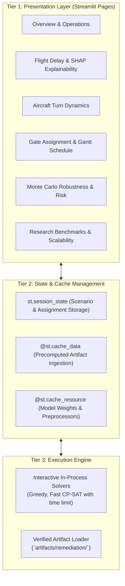

# Phase P09.5 Technical Discovery: System Execution & UI Integration Architecture

**Document ID:** `DISC-06-EXEC`  
**Phase:** `P09.5 — DASHBOARD DISCOVERY & TECHNICAL HANDOFF`  
**Audit Date:** 2026-10-09  
**Auditor Roles:** Senior Python Engineer, MLOps Architect, Performance Engineer  

---

## 1. Production CLI Entrypoints & Commands

The repository provides several production-grade execution scripts:

### 1.1 Native Dual-Core Pipeline Runner
- **Command:**  
  ```bash
  .venv\Scripts\python scripts/run_native_dual_core_pipeline.py --airport ATL --start-date 2023-11-23 --end-date 2023-11-23 --solver CPSat --capacity-policy FINITE --simulation-mode DUAL_POINT --seed 202601
  ```
- **Inputs:** Date range, hub airport, solver name, capacity policy, simulation mode.
- **Outputs:** Outputs `optimization_result.json`, `predictions_sample.csv`, `run_manifest.json`, and `turn_pairing_audit.json` in `artifacts/remediation/native_dual_core/`.
- **Runtime:** $\sim 2.7\text{ seconds}$ on reference machine (30 turns, 20 contact gates).

### 1.2 Monte Carlo Robustness Validation Runner
- **Command:**  
  ```bash
  .venv\Scripts\python scripts/run_p09_monte_carlo_validation.py
  ```
- **Inputs:** Evaluates 500 stochastic scenarios across 120 flights, 25 contact gates, and 5 finite remote stands under Mode A, Mode B, and Mode C.
- **Outputs:** Outputs `fixed_plan_results.csv`, `recourse_results.csv`, `oracle_results.csv`, `paired_comparison.csv`, and `statistical_summary.json` in `artifacts/remediation/monte_carlo/`.
- **Runtime:** $\sim 3.5\text{ seconds}$ total across all 3,500 evaluations.

### 1.3 Solver Parity & Fairness Benchmark
- **Command:**  
  ```bash
  .venv\Scripts\python scripts/run_p05_benchmark_suite.py
  ```
- **Inputs:** Executes 5 standard tiers (10F/3G to 300F/50G) across 5 solver variants with repeated runs.
- **Outputs:** Outputs `solver_runs.csv`, `aggregate_metrics.json`, and `failures.json` in `artifacts/remediation/benchmarks/`.
- **Runtime:** $\sim 4.5\text{ minutes}$ (dominated by high-temperature Simulated Annealing runs).

---

## 2. In-Process Python APIs for Dashboard Integration

Rather than invoking subprocesses via shell commands, a web dashboard can directly invoke Python service objects in-process:

```python
# Direct In-Process Execution Example
from src.optimization.config import GateOptimizationConfig
from src.optimization.solvers.cp_sat_solver import CPSatGateSolver
from src.optimization.solvers.greedy_solver import DeterministicGreedyGateSolver
from src.simulation.dual_prediction_turn import DualTurnEngine, SimulationMode
from src.simulation.monte_carlo_engine_p09 import (
    MonteCarloScenarioGenerator,
    evaluate_mode_a_fixed_plan,
    evaluate_mode_b_reactive_recourse,
)

# 1. Configure
config = GateOptimizationConfig(
    time_limit_seconds=5.0,
    cp_sat_formulation="sparse_interval",
    allow_unbounded_overflow=True,
)

# 2. Optimize
solver = CPSatGateSolver(config=config)
result = solver.solve(flights, gates)

# 3. Access verified results
assignments_dict = result.assignments
objective_breakdown = result.objective_breakdown
is_feasible = result.feasible
```

---

## 3. Execution Model & Web Concurrency Hazards

The current repository execution architecture has specific characteristics that must inform dashboard design:

### 3.1 Synchronous Execution Model
- **Observation:** All solvers, pipeline steps, and simulation loops run **synchronously** in the calling thread.
- **Limitation:** There is no asynchronous job queue (Celery/RQ), background worker process, or WebSocket event loop.
- **UI Hazard:** If an optimization solver or Monte Carlo batch runs for 10–15 seconds on the main Streamlit thread, the browser window will freeze in a "Running..." state.

### 3.2 Lack of Cancellation Tokens & Progress Callbacks
- **Observation:** Google OR-Tools CP-SAT and the internal Monte Carlo loops do not currently accept a cancellation token or interactive progress callback hook.
- **UI Hazard:** Once `solver.solve()` is launched, the web server cannot cancel the search midway without killing the Python process.

### 3.3 Streamlit Reactive Re-execution Risk
- **Observation:** Streamlit's reactive model reruns the entire Python script from top to bottom upon any user widget change (e.g. toggling a checkbox, moving a slider, switching a tab).
- **Severe Risk:** If `solver.solve()` or `pipeline.run()` is called directly in the script body without session state caching, adjusting any visualization filter will trigger a full, expensive re-optimization, causing CPU thrashing and destroying user state.

---

## 4. Empirical Resource Consumption & Latency Profile

| Task Scale | Solver / Engine | Typical Execution Time | Peak Memory | UI Interaction Recommendation |
| :--- | :--- | :---: | :---: | :--- |
| **Micro (10–30 Flights)** | Greedy / CP-SAT | **< 100 ms** | < 50 MB | **Instant Live Execution** (smooth interactive sliders) |
| **Medium (100–200 Flights)**| Greedy | **< 60 ms** | < 60 MB | **Instant Live Execution** |
| **Medium (100–200 Flights)**| CP-SAT (Sparse Interval)| **1s – 5s** | < 100 MB | **Live Execution with Spinner (`st.spinner`)** |
| **Large (300 Flights)** | CP-SAT (Sparse Interval)| **5s – 12s** | < 150 MB | **Live Execution with Button Trigger** |
| **Large (300 Flights)** | Simulated Annealing | **40s – 70s** | < 200 MB | **Precomputed Artifact Recommended** |
| **Stress (500–1,500 Flights)**| CP-SAT / Benchmark | **15s – 190s** | < 300 MB | **Precomputed Artifact ONLY (Display CSV/JSON)** |
| **Monte Carlo 500 Scenarios**| Recourse Engine (120F) | **~3.5s** | < 120 MB | **Live Execution or Precomputed Artifact** |

---

## 5. Recommended Architecture for Phase P10 Dashboard

To guarantee responsive, crash-proof operation during the thesis presentation, the dashboard should adopt a **Three-Tier Architecture**:



### Key Implementation Principles for P10:
1. **Precomputed Artifact Primacy:**  
   The dashboard should load verified artifacts by default on page open, so all charts and metrics render instantly without requiring the user to run computations first.
2. **Dedicated "Run Optimization" Triggers:**  
   Live solving should only execute when the user explicitly clicks an `st.button("Run Optimizer")`. Results must be stored in `st.session_state["current_optimization_result"]`.
3. **Guard Against Data Leakage:**  
   The UI must never accept or display post-hoc actual delays (`ARR_DELAY`) during the planning phase. Actuals should only appear in an optional "Post-Operations Evaluation" view.
