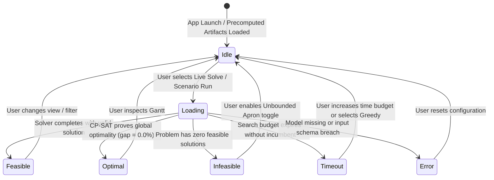

# Phase P09.5 Technical Discovery: UI/UX Research, Framework Evaluation & Design Questions

**Document ID:** `DISC-08-UIUX`  
**Phase:** `P09.5 — DASHBOARD DISCOVERY & TECHNICAL HANDOFF`  
**Audit Date:** 2026-10-09  
**Auditor Roles:** Streamlit/Plotly Dashboard Architect, UI/UX Requirements Analyst  

---

## 1. User Personas & Journey Analysis

The demonstration application must serve four distinct stakeholders:

### Persona 1: Master's Thesis Presenter (Student)
- **Primary Goal:** Guide committee smoothly through a 20–30 minute presentation without crashes, freezes, or confusing screens.
- **Workflow:** High-level problem overview $\to$ ML delay forecasting proof $\to$ Aircraft turn synthesis $\to$ Live gate optimization run $\to$ Gantt chart demonstration $\to$ Monte Carlo 500-scenario robustness proof.
- **Needs:** Pre-loaded baseline scenarios, fast deterministic solver runs (< 5s), one-click demo presets, crash-proof defaults.

### Persona 2: Thesis Evaluation Committee (Professors / Examiners)
- **Primary Goal:** Validate scientific integrity, mathematical correctness, and real-world applicability.
- **Key Questions:** Did the optimizer respect hard constraints? Is CP-SAT truly optimal? Are delay predictions leakage-free? Why is Mode B better than Mode A?
- **Needs:** Clear constraint verification badges (`Independent Verifier: PASSED`), explicit objective decomposition (Decision vs Reporting), statistical confidence intervals, and SHAP interpretability.

### Persona 3: ML & Operations Research Specialist
- **Primary Goal:** Deep-dive into solver performance, convergence, and probabilistic distributions.
- **Needs:** Optimality gaps, model build vs search time profiling, CP-SAT formulation selector (`sparse_interval` vs `pairwise`), and Student-t distribution parameters.

### Persona 4: Airport Operations Dispatcher / Domain Observer
- **Primary Goal:** Understand operational consequences on flights, gates, and passengers.
- **Needs:** Intuitive Gantt visualization, clear contact gate vs remote apron differentiation, reassignment flags, and intuitive delay color gradients.

---

## 2. Technical Framework Evaluation: Streamlit vs Plotly Dash

We conducted an architectural comparison tailored specifically to the Aeolus repository:

| Dimension | Streamlit (`streamlit`) | Plotly Dash (`dash`) | Evaluation for Aeolus Project |
| :--- | :--- | :--- | :--- |
| **Python Ecosystem Reuse** | Seamless direct import of all domain dataclasses and solvers. | Direct import possible, but requires separate component encapsulation. | **Streamlit is faster to integrate with existing dataclasses.** |
| **Gantt Chart Capabilities** | Uses `st.plotly_chart(fig, use_container_width=True)`. | Native Dash core components (`dcc.Graph`). | **Tie (both use Plotly Python).** |
| **Multi-page Architecture** | Native filesystem multi-page (`pages/*.py`) or single-app tabs. | Requires manual URL routing (`dcc.Location`) or Dash Multi-Page API. | **Streamlit multi-page is simpler to navigate and maintain.** |
| **State Management** | `st.session_state` dictionary with reactive script reruns. | Pure functional callback architecture with explicit `Input`/`Output`/`State`. | **Dash avoids reruns, but requires boilerplate callbacks; Streamlit needs session guards.** |
| **Long-Running Computation** | Requires `st.spinner()` or thread delegation; reactive reruns can trigger redundant runs. | Asynchronous callbacks via Celery or Dash background callbacks. | **Dash handles long jobs better, but Streamlit is sufficient with `@st.cache_data`.** |
| **Deployment & Startup** | Zero boilerplate: `streamlit run app.py`. | Requires WSGI/Flask server configuration. | **Streamlit is significantly easier to run on a local defense laptop.** |
| **Current Environment Status**| Not yet installed in `.venv` (requires `pip install streamlit plotly`). | Not yet installed in `.venv` (requires `pip install dash plotly`). | **Equal prerequisite installation.** |

### Architectural Recommendation:
**Adopt Streamlit + Plotly Python (`plotly.graph_objects` & `plotly.express`).**  
*Rationale:* Streamlit offers rapid prototyping, elegant out-of-the-box typography and theme controls, and seamless integration with Python scientific libraries. Its multi-page structure perfectly aligns with the proposed 5-page layout. Streamlit's reactive rerun risk can be completely mitigated through proper `st.session_state` guarding.

---

## 3. UI State Handling & Error Guardrails

The application must handle all operational states gracefully:

### Required Visual Feedback:
1. **`Loading State`:** Render `st.spinner("Solving Gate Assignment Problem via CP-SAT (Time budget: 5.0s)...")`. Disable solver action buttons while active.
2. **`Optimal State`:** Display green badge: `OPTIMAL (Global Minimum Proven, Gap: 0.00%)` with decision cost breakdown.
3. **`Feasible State`:** Display blue badge: `FEASIBLE (Hard Constraints Satisfied; Heuristic / Search Time-Limited)`.
4. **`Infeasible State`:** Display clear alert: `INFEASIBLE: Finite gate capacity exceeded. Recommendation: Enable Unbounded Apron toggle or increase available remote stands.`
5. **`Timeout State`:** Display amber warning: `SEARCH TIME EXPIRED: No incumbent found within 5.0s. Falling back to Deterministic Greedy solution.`
6. **`Scientific Caution Alert`:** If displaying Mode C Oracle or post-hoc actual delays, show a prominent banner: `RESEARCH BENCHMARK: Contains perfect foresight information. NOT deployable for pre-tactical operations.`

---

## 4. Key Questions for User Alignment & ChatGPT UI Design

To finalize the UI/UX specification in collaboration with ChatGPT, the following 12 design decisions require user alignment:

### Question 1: Primary Application Target
- **Why it matters:** Determines whether the dashboard is optimized for a fast, scripted presentation or exploratory user sandbox testing.
- **Options:**  
  A. *(Recommended)* **Thesis Defense Showcase:** Polished, pre-loaded demo scenarios, fast execution (< 5s), crisp narrative progression.  
  B. **Interactive Airport Operations Simulator:** Deep parameter tweaking, arbitrary schedule generation, complex multi-flight adjustments.  
  C. **Hybrid Mode:** Clean presentation presets with an "Advanced Sandbox" tab.
- **Default Recommendation:** Option A (with Option C expandable sections).

### Question 2: Interface Language
- **Why it matters:** Affects technical terminology consistency with the written thesis document.
- **Options:**  
  A. *(Recommended)* **Bilingual (English with Vietnamese subtitles / tooltips):** Aviation operational terms (e.g. *Pushback, Contact Gate, Turnaround Slack, TreeSHAP*) remain standard in English, with Vietnamese section headers and metric descriptions.  
  B. **100% Vietnamese:** Full translation of all operational and optimization concepts.  
  C. **100% English:** Standard international research format.
- **Default Recommendation:** Option A.

### Question 3: Visual Theme & Aesthetic Style
- **Why it matters:** Establishes the visual tone for examiners.
- **Options:**  
  A. *(Recommended)* **Professional Aviation Dark Mode:** Sleek dark airfield aesthetic (navy/charcoal slate, emerald green status accents, amber warning indicators) providing high-contrast readability for Gantt timelines.  
  B. **Clean Academic Light Mode:** White background, minimal borders, journal-style visualization styling.  
  C. **Automatic (System Default):** Follows browser OS preference.
- **Default Recommendation:** Option A.

### Question 4: Execution Paradigm (Live Computation vs Precomputed Artifacts)
- **Why it matters:** Live computation carries risk of lag or timeouts during live presentation.
- **Options:**  
  A. *(Recommended)* **Hybrid Smart-Loading:** Load verified precomputed artifacts instantly upon page open; provide a "Run Live Optimizer" button for live interactive demonstrations on small/medium scenarios (10–100 flights).  
  B. **Strictly Precomputed:** View-only dashboard visualizing saved artifacts from P00–P09. Zero risk of runtime failure.  
  C. **Strictly Live Computation:** Everything computed from raw data dynamically.
- **Default Recommendation:** Option A.

### Question 5: Gantt Chart Interactivity Scope
- **Why it matters:** Complex Plotly figures can impact browser performance if rendering > 500 bars.
- **Options:**  
  A. *(Recommended)* **Standard Interactive Gantt (10 to 120 flights):** Zoom, pan, hover tooltips, filter by carrier, gate type toggle, hover highlight.  
  B. **Static Summary Plot with Sub-Slice Drilldown:** Select time window (e.g. morning peak 08:00–12:00) to keep render times under 500 ms.
- **Default Recommendation:** Option A.

### Question 6: Level of ML Explainability to Expose
- **Why it matters:** TreeSHAP waterfall charts can be confusing if users lack ML interpretability background.
- **Options:**  
  A. *(Recommended)* **Global Importance + Flight Selector for Local Waterfall:** Show top-ranked features, allow choosing a flight (e.g. on-time vs delayed) to see exact minute attributions.  
  B. **Global Feature Importance Only:** High-level bar chart.
- **Default Recommendation:** Option A.

### Question 7: Monte Carlo 500 Scenarios Handling
- **Why it matters:** Evaluating 500 scenarios live takes ~3.5s for 120 flights, but would take several minutes on 300+ flights.
- **Options:**  
  A. *(Recommended)* **Display Precomputed 500-Scenario Artifacts with Live Inspection:** Instant rendering of precomputed distributions; allow selecting individual simulated days (Day 1 to Day 500) to inspect conflicts.  
  B. **Add Live Run Button for N=50 or N=100 Scenarios:** Live sampling with interactive progress bar.
- **Default Recommendation:** Option A.

### Question 8: Algorithm Comparison Scope
- **Why it matters:** Simulated Annealing takes ~20–70s, which is too slow for live committee presentation.
- **Options:**  
  A. *(Recommended)* **Live Greedy & CP-SAT; Precomputed SA & Hybrid:** Allow live runs for fast solvers, display benchmark tables for SA.  
  B. **Allow Live Runs for All Solvers:** Include warning for SA runtime.
- **Default Recommendation:** Option A.

### Question 9: Schedule Data Source for Interactive Mode
- **Why it matters:** Processing raw multi-gigabyte Parquet partitions takes considerable memory.
- **Options:**  
  A. *(Recommended)* **Pre-extracted Operational Slices:** Curate 3 authentic representative day slices (e.g. Normal Day: 30 turns, Peak Busy Day: 100 turns, Disrupted Weather Day: 120 turns) pre-sliced from 2023 ATL data.  
  B. **Arbitrary Date Picker across 2016–2023:** Dynamically queries Parquet partitions on disk.
- **Default Recommendation:** Option A (prevents multi-second Parquet scan latencies).

### Question 10: Capacity Policy Toggle Exposure
- **Why it matters:** Demonstrates thesis research into finite remote stands vs unbounded aprons.
- **Options:**  
  A. *(Recommended)* **Explicit Radio Selector:** "Strictly Finite (Enforce max remote capacity)" vs "Flexible Overflow (Allow infinite apron backup)".  
  B. **Fixed Finite Capacity:** Lock to realistic finite mode.
- **Default Recommendation:** Option A.

### Question 11: Export & Reporting Requirements
- **Why it matters:** Committee members occasionally request downloading results.
- **Options:**  
  A. *(Recommended)* **CSV Export for Assignments & Benchmark Tables:** Built-in `st.download_button()` for resulting schedule CSVs.  
  B. **Automated PDF Defense Report Generation:** Requires additional templating libraries.
- **Default Recommendation:** Option A.

### Question 12: Advanced Scientific Audit Screen
- **Why it matters:** Proves research transparency (zero data leakage, cryptographic hashes, random seed logs).
- **Options:**  
  A. *(Recommended)* **Include as Collapsible Section on Final Page:** Available if a committee member asks for validation evidence.  
  B. **Omit from Dashboard:** Keep strictly in Markdown docs.
- **Default Recommendation:** Option A.
