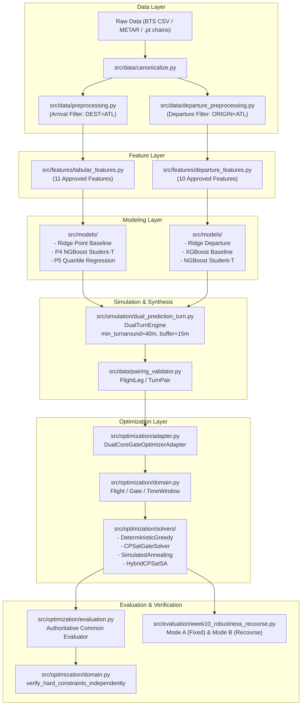

# P00 Baseline Inventory: Repository & Architectural Architecture

**Phase:** `P00 — BASELINE FREEZE & EVIDENCE AUDIT`  
**Audit Date:** 2026-10-09  
**Auditor Roles:** Senior Software Architect, Research Software Engineer, Python Code Auditor, ML/Optimization QA Engineer  
**Repository Working Tree:** `Aeolus Gate Optimization` (`D:\Study\Code\Python\Aelous`)  

---

## 1. Git Baseline & Working Tree Status

| Parameter | Value | Verification Command |
| :--- | :--- | :--- |
| **Active Branch** | `development/scalability-1500x50` | `git branch --show-current` |
| **Commit HEAD SHA** | `8cf96b9fd5ba6711da0c047181ea0e7004551781` | `git rev-parse HEAD` |
| **Commit Message** | `docs(certification): complete e2e benchmarks, audit report and P10 simulation certification` | `git log -n 1 --oneline` |
| **Working Tree State** | Clean (prior to P00 audit document creation) | `git status --porcelain` |
| **Upstream Status** | Up to date with `origin/development/scalability-1500x50` | `git status` |
| **Key Prior Branches** | `v4-final-forensic-certification` (HEAD `7ba0aba9...`), `main` (HEAD `c16379a...`) | `git branch -a` |

---

## 2. Runtime Environment & Dependencies

### 2.1 Python Interpreter & Hardware

- **Host Operating System:** Windows 10 Home/Pro 64-bit (`Windows-10-10.0.19045-SP0`)
- **System Python (Host):** `3.10.11` (at `C:\Users\Heikapu\AppData\Local\Programs\Python\Python310\python.exe`)
- **Active Project Virtualenv:** `.venv` (at `D:\Study\Code\Python\Aelous\.venv\Scripts\python.exe`)
- **Virtualenv Python Version:** `Python 3.11.15` (MSC v.1944 64-bit AMD64)
- **CPU / Compute Resources:** 8 Physical Cores / 16 Logical Cores
- **RAM Total:** 31.72 GB

### 2.2 Dependency Integrity (`pip check` & `requirements.txt`)

- `pip check` result: **PASS (No broken requirements found)**.
- `requirements.txt` Status: Contains 11 pinned packages (`numpy==2.2.6`, `pandas==2.3.3`, `pyarrow==25.0.1`, `psutil==7.2.2`, `pytest==9.1.1`, `PyYAML==6.0.3`, `scikit-learn==1.9.0`, `xgboost==3.2.0`, `optuna==5.0.0`).
- **Discrepancy / Dependency Gap:**
  - `requirements.txt` was frozen in early research (Week 5 protocol) with a test asserting that future dependencies (`ortools`, `shap`, `streamlit`, `plotly`) are **not** present in `requirements.txt` ([`tests/test_feature_manifest.py`](file:///D:/Study/Code/Python/Aelous/tests/test_feature_manifest.py#L102-L110)).
  - `.venv` contains installed packages: `ortools==9.15.6755`, `ngboost==0.5.11`, `lightgbm==4.7.0`, `torch==2.14.0`, `lifelines==0.30.3`, `matplotlib==3.11.2`, `seaborn==0.13.2`, `scipy==1.17.1`.
  - Completely missing from environment: `streamlit`, `plotly`, `shap`.

---

## 3. Module Inventory & Dependency Architecture

### 3.1 Mapping of Functional Roles

1. **Nguồn tạo dữ liệu đầu vào:**
   - Raw BTS On-Time Performance (2016–2024): `data/raw/tabular/{year}/flight_with_weather_{year}.csv`
   - Canonical Parquet Datasets: `data/processed/inbound_atl/year={year}/`
   - Pre-cooked turnaround benchmark fixture: [`src/artifacts/predictions/atl_1500_flights_cpsat_turnaround_schedule.csv`](file:///D:/Study/Code/Python/Aelous/src/artifacts/predictions/atl_1500_flights_cpsat_turnaround_schedule.csv)
2. **Nguồn tạo prediction:**
   - Inbound / Arrival:
     - Point: [`src/models/linear_models.py`](file:///D:/Study/Code/Python/Aelous/src/models/linear_models.py) (`RidgeBaseline`), [`src/models/week5_xgboost.py`](file:///D:/Study/Code/Python/Aelous/src/models/week5_xgboost.py)
     - Continuous Probabilistic: [`artifacts/probabilistic/ngboost_student_t/model_weights_frozen_v1.joblib`](file:///D:/Study/Code/Python/Aelous/artifacts/probabilistic/ngboost_student_t/model_weights_frozen_v1.joblib) (P4 Student-t)
     - Quantile: P5 Quantile Regression (Role B, no serialized checkpoint)
   - Outbound / Departure:
     - Point: `artifacts/dual_core/models/departure_xgboost_baseline_v1.joblib`, `departure_ridge_baseline_v1.joblib`
     - Probabilistic: `artifacts/dual_core/models/departure_ngboost_student_t_v1.joblib`
3. **Ai tạo aircraft turns:**
   - Single-Core Legacy: [`src/simulation/aircraft_turn.py`](file:///D:/Study/Code/Python/Aelous/src/simulation/aircraft_turn.py) (`AircraftTurnModel`), synthesizes outbound time as $D = \max(D_{\text{sched}}, A_{\text{pred}} + T_{\text{min}})$.
   - Dual-Core Engine: [`src/simulation/dual_prediction_turn.py`](file:///D:/Study/Code/Python/Aelous/src/simulation/dual_prediction_turn.py) (`DualTurnEngine`), couples paired inbound + outbound legs, enforces physical feasibility $D_{\text{gate\_out}} = \max(D_{\text{pred}}, A_{\text{pred}} + T_{\text{min}})$.
4. **Solver được gọi ở đâu:**
   - Greedy: [`src/optimization/solvers/greedy_solver.py`](file:///D:/Study/Code/Python/Aelous/src/optimization/solvers/greedy_solver.py) (`DeterministicGreedyGateSolver`)
   - CP-SAT: [`src/optimization/solvers/cp_sat_solver.py`](file:///D:/Study/Code/Python/Aelous/src/optimization/solvers/cp_sat_solver.py) (`CPSatGateSolver` via Google OR-Tools)
   - Simulated Annealing: [`src/optimization/sa/annealer.py`](file:///D:/Study/Code/Python/Aelous/src/optimization/sa/annealer.py) (`SimulatedAnnealingGateSolver`) and [`src/simulation/scalability_benchmark.py`](file:///D:/Study/Code/Python/Aelous/src/simulation/scalability_benchmark.py) (`TimeBudgetedSimulatedAnnealingSolver`)
   - Hybrid: [`src/optimization/solvers/hybrid_solver.py`](file:///D:/Study/Code/Python/Aelous/src/optimization/solvers/hybrid_solver.py) (`HybridGateSolver`)
5. **Independent verifier nằm ở đâu:**
   - Authoritative Function: [`verify_hard_constraints_independently`](file:///D:/Study/Code/Python/Aelous/src/optimization/domain.py#L400-L565) in `src/optimization/domain.py`. Checks all-flights-assigned, contact gate overlaps, operational hours availability, aircraft/carrier compatibility, and turnaround minimum duration.
6. **Objective được tính ở đâu:**
   - Authoritative Evaluator: [`evaluate_gate_assignment`](file:///D:/Study/Code/Python/Aelous/src/optimization/evaluation.py#L30-L160) in `src/optimization/evaluation.py`.
   - SA Internal Evaluator: [`compute_state_objective`](file:///D:/Study/Code/Python/Aelous/src/optimization/sa/objective.py#L20-L95) in `src/optimization/sa/objective.py`.
7. **Monte Carlo được gọi ở đâu:**
   - Scenario realization: [`src/simulation/scenario_runner.py`](file:///D:/Study/Code/Python/Aelous/src/simulation/scenario_runner.py)
   - Gate dynamic simulation: [`src/simulation/gate_simulator.py`](file:///D:/Study/Code/Python/Aelous/src/simulation/gate_simulator.py)
   - Robustness evaluation: [`src/evaluation/week10_robustness_recourse.py`](file:///D:/Study/Code/Python/Aelous/src/evaluation/week10_robustness_recourse.py)
   - Native P4 sampling: [`src/evaluation/native_downstream_p4.py`](file:///D:/Study/Code/Python/Aelous/src/evaluation/native_downstream_p4.py)
   - Scalability MC: [`src/simulation/scalability_benchmark.py`](file:///D:/Study/Code/Python/Aelous/src/simulation/scalability_benchmark.py)
8. **Benchmark tạo kết quả bằng phương pháp nào:**
   - Scalability Benchmark: [`scripts/run_scalability_benchmark.py`](file:///D:/Study/Code/Python/Aelous/scripts/run_scalability_benchmark.py) (runs 1500x50 scenario + 6 scaling rungs from 250 to 1500 flights).
   - Dual Core Benchmark: [`scripts/run_dual_core_benchmark.py`](file:///D:/Study/Code/Python/Aelous/scripts/run_dual_core_benchmark.py) (evaluates 4 branches: SCHEDULE_ONLY, ARRIVAL_P4_ONLY_LEGACY, DUAL_POINT, DUAL_PROBABILISTIC).
   - Post-Holdout Re-evaluation (P11-R): [`scripts/run_p11r_post_holdout_reevaluation.py`](file:///D:/Study/Code/Python/Aelous/scripts/run_p11r_post_holdout_reevaluation.py).

---

## 4. Checkpoints, Datasets & Artifact Categorization

### 4.1 Physical Model Checkpoints on Disk
- `artifacts/probabilistic/ngboost_student_t/model_weights_frozen_v1.joblib` (243,595 B, SHA-256 `e7e7462f...`) — **Role C P4 arrival continuous engine**
- `artifacts/models/refactored/best_hgb_absolute_weighted.joblib` (550,712 B)
- `artifacts/models/refactored/best_hurdle_delay_predictor.joblib` (1,189,093 B)
- `artifacts/models/refactored/best_xgboost_baseline_mse.json` (885,211 B)
- `artifacts/models/refactored/best_xgboost_huber_weighted.json` (943,097 B)
- `artifacts/models/refactored/best_xgboost_quantile_075_weighted.json` (918,810 B)
- `artifacts/dual_core/models/departure_distribution_v1.joblib` (375,309 B)
- `artifacts/dual_core/models/departure_xgboost_baseline_v1.joblib` (498,135 B)
- `artifacts/dual_core/models/departure_ridge_baseline_v1.joblib` (2,217 B)
- `artifacts/dual_core/models/departure_linear_preprocessor_v1.joblib` (212,590 B)
- `artifacts/dual_core/models/departure_tree_preprocessor_v1.joblib` (207,187 B)
- `artifacts/dual_core/models/departure_ngboost_student_t_v1.joblib` (375,309 B)

### 4.2 Missing Checkpoints & Models
- `P1_empirical`: In-memory empirical conditional distribution (no checkpoint).
- `P2_xgb_gaussian_oof`: In-memory Gaussian OOF estimator (no checkpoint).
- `P3_ngboost_normal`: No standalone checkpoint.
- `P5_quantile_regression`: **NO SERIALIZED CHECKPOINT ON DISK** (certified in P14 as Role B forecast-only).
- `arrival_linear_baseline_v1` (Ridge): Fitted on demand in evaluation scripts; no frozen checkpoint file.

### 4.3 Data Files
- Raw BTS tabular files 2016–2024: ~15 GB CSVs under `data/raw/tabular/{year}/`
- Raw PyTorch flight chains 2016–2024: ~7.5 GB `.pt` files under `data/raw/chain/{year}/`
- Canonical Parquet partitions: `data/processed/`
- Prediction fixtures: `src/artifacts/predictions/atl_1500_flights_cpsat_turnaround_schedule.csv` (1,500 flights, 851 turns).

### 4.4 Frozen Artifacts to Protect
All manifests in `artifacts/manifests/`, `system_freeze_manifest.json`, `DUAL_CORE_RELEASE_MANIFEST.json`, `artifacts/audit/`, `artifacts/post_holdout_re_evaluation_v1/`, and `artifacts/stress_1500x50/` are **frozen and immutable**.
