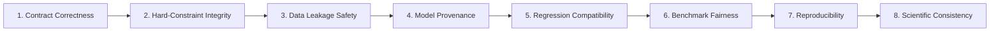

# Quality Gate Framework: Remediation Governance (P00–P12)

**Phase:** `P00 — BASELINE FREEZE & EVIDENCE AUDIT`  
**Author:** Senior Software Architect & ML/Optimization QA Engineer  
**Scope:** Governance across all remediation phases (P00 through P12)  

---

## 1. Governance Principles & Core Pillars

To ensure that remediation work remains scientifically rigorous, reproducible, and non-destructive to historical findings, all proposed changes across Phases P01–P12 must satisfy the **Eight Core Quality Gates**:

### Pillar 1: Contract Correctness (`QG-CONTRACT`)
- Canonical schemas (`canonical_schema_v1`) must never be silently mutated.
- All domain classes (`Flight`, `Gate`, `TimeWindow`, `FlightLeg`, `TurnPair`, `OptimizationResult`) must strictly enforce type hints, immutability, and boundary validations.
- Date/time normalization must enforce strict chronologic ordering and handle midnight rollover ($+1,440$ min) without exception.

### Pillar 2: Hard-Constraint Integrity (`QG-CONSTRAINTS`)
- All gate assignments must be evaluated by the **independent verifier** ([`verify_hard_constraints_independently`](file:///D:/Study/Code/Python/Aelous/src/optimization/domain.py#L400-L565)).
- Solvers are never permitted to self-certify feasibility or optimality.
- Zero planned contact gate overlaps ($[s_i, e_i)$ non-overlapping on contact gates).
- Physical turnaround feasibility ($e_i - s_i \ge T_{\text{min}}$) must be strictly enforced.
- Remote stand / overflow apron must be modeled with realistic finite capacity bounds ($C_{\text{remote}}$) rather than treated as infinite.

### Pillar 3: Data Leakage Safety (`QG-LEAKAGE`)
- Strict separation of inbound and outbound feature pipelines.
- Feature extraction cutoff strictly enforced at $T_{\text{cutoff}} = \text{CRS\_DEP\_TIME} - 120$ minutes.
- Prohibited features (actual departure delays, wheels-off/on, taxi durations, point-in-time METAR weather) must fail-closed via [`assert_zero_leakage`](file:///D:/Study/Code/Python/Aelous/src/data/leakage_rules.py).
- Fold safety: Encoders, scalers, and frequency transformations must fit strictly on training fold rows.

### Pillar 4: Model Provenance (`QG-PROVENANCE`)
- Every model checkpoint must be cryptographically hashed (SHA-256) and recorded in the model catalog.
- Checkpoints from sealed holdouts (year 2024) must remain strictly read-only and immutable.
- Role decoupling must be preserved:
  - `arrival_linear_baseline_v1`: Fast point comparator.
  - `P5_quantile_regression`: Role B (Marginal Quantile Champion, Forecast-Only).
  - `P4_ngboost_student_t`: Role C (Continuous Downstream Engine).

### Pillar 5: Regression Compatibility (`QG-REGRESSION`)
- Full test suite regression pass rate must remain $\ge 99.7\%$.
- Existing core tests (1,369 tests) must not be broken or weakened.
- Legacy freeze tests must be modernized with task-aware governance rather than deleted or modified to produce artificial passes.

### Pillar 6: Benchmark Fairness (`QG-BENCHMARK`)
- All competing solvers (Greedy, CP-SAT, SA, Hybrid) must receive identical flight intervals, identical gate inventories, and identical objective weights.
- Wall-clock budget ceilings must be enforced across the **entire solver lifecycle** (including model construction), not merely search loops.
- Re-used incumbents across benchmark runs must be transparently logged and timed.

### Pillar 7: Reproducibility (`QG-REPRODUCIBILITY`)
- All experiments must declare explicit PRNG seeds (`seed_registry.yaml`).
- Stochastic simulation runs must produce bit-for-bit identical results on the reference platform (Python 3.11.15 AMD64 Windows 10).
- Runtime variability across replications must be logged and bounded.

### Pillar 8: Scientific Evidence Consistency (`QG-EVIDENCE`)
- All narrative claims in thesis text and reports must trace directly to underlying JSON or Parquet artifacts.
- No historical evidence may be retroactively overwritten or averaged.
- Mode A (Fixed Plan) and Mode B (Dynamic Recourse) must remain strictly distinguished in all operational metrics.

---

## 2. Gate Definitions by Remediation Phase

| Phase | Phase Name | Entry Precondition | Mandatory Quality Gates | Exit Criteria |
| :--- | :--- | :--- | :--- | :--- |
| **`P00`** | **Baseline Freeze & Evidence Audit** | Initial Repository State | QG-PROVENANCE, QG-EVIDENCE, QG-REGRESSION | Complete inventory, issue register, manifest hashes, zero code modification. |
| **`P01`** | Dependency & Environment Harmonization | P00 Passed | QG-CONTRACT, QG-REPRODUCIBILITY | Full `requirements.txt` / virtualenv parity, zero dependency breakage. |
| **`P02`** | Test Harness & Quarantined Guard Modernization | P01 Passed | QG-REGRESSION, QG-PROVENANCE | 100% of non-retired tests pass (1,373/1,373), task-aware guard validation. |
| **`P03`** | Canonical Schema & Contract Hardening | P02 Passed | QG-CONTRACT, QG-LEAKAGE | Rigorous validation of `flight_key`, `TAIL_NUM`, timezone/midnight wrapping. |
| **`P04`** | ML Feature & Fold-Safety Auditing | P03 Passed | QG-LEAKAGE, QG-PROVENANCE | Proven fold-isolation, label-free inference verified on arrival & departure. |
| **`P05`** | Native Inference & Dual Turn Synthesis | P04 Passed | QG-CONTRACT, QG-PROVENANCE | Replacement of CSV fixture lookups with native model inference calls. |
| **`P06`** | Gate Domain & Finite Remote Apron Capacity | P05 Passed | QG-CONSTRAINTS, QG-CONTRACT | Implementation of finite remote stand capacity ($C_{\text{remote}}$) in domain & solvers. |
| **`P07`** | Simulated Annealing Refinement & Status Fix | P06 Passed | QG-CONSTRAINTS, QG-BENCHMARK | Fix tautological `OPTIMAL` status; rigorous cooling schedule calibration. |
| **`P08`** | CP-SAT Formulation & Wall-Clock Budget Enforcement | P07 Passed | QG-CONSTRAINTS, QG-BENCHMARK | Sweep-line / interval formulation eliminating 190s build; strict timeout enforcement. |
| **`P09`** | Two-Stage Hybrid Solver Integration & Fair Benchmarking | P08 Passed | QG-BENCHMARK, QG-REPRODUCIBILITY | Complete CP-SAT + SA two-stage execution accounting; fair 2.0s benchmark. |
| **`P10`** | Monte Carlo Robustness & Recourse Clarity | P09 Passed | QG-EVIDENCE, QG-REPRODUCIBILITY | Clear separation of Mode A (Fixed) and Mode B (Recourse); N=500 convergence. |
| **`P11`** | Scientific Evidence Reconciliation & Retraction Audit | P10 Passed | QG-EVIDENCE, QG-PROVENANCE | Bit-level alignment between thesis tables and JSON/Parquet artifacts. |
| **`P12`** | Presentation Layer & Interactive Dashboard | P11 Passed | QG-CONTRACT, QG-EVIDENCE | Streamlit/Plotly dashboard in `dashboard/`, SHAP analysis, end-to-end demo. |

---

## 3. Phase Gate Verdict Rules

Each phase exit evaluation produces one of three verdicts:
- **`PASS`**: All mandatory quality gates satisfied. Code changes validated by automated tests and cryptographic manifests. Ready to proceed to next phase.
- **`FAIL`**: One or more quality gates breached (e.g. broken test, data leakage, constraint violation, unbacked metric). Immediate rollback or remediation required before proceeding.
- **`BLOCKED`**: Prerequisite dependencies, data files, or environment capabilities unavailable. Requires explicit resolution of blockers before gate evaluation.
