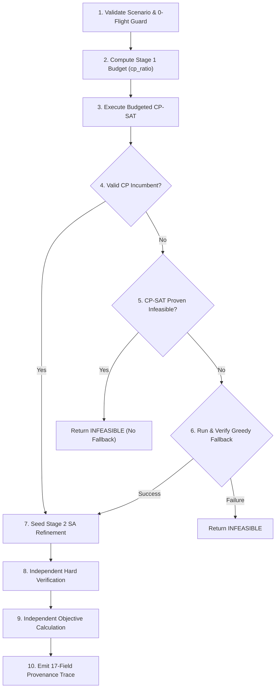

# PHASE P03 REMEDIATION AUDIT REPORT
## Simulated Annealing & Hybrid Correctness Standardization

**Target Project:** Aeolus Gate Optimization  
**Phase:** P03 (Simulated Annealing & Hybrid Correctness)  
**Execution Timestamp:** 2026-10-09T01:38:00+07:00  
**Git Branch:** `development/scalability-1500x50`  
**Evaluation Status:** PASS (Quality Gate P03 Met)

---

## 1. Executive Summary & Root Cause Analysis

### 1.1 Identified Baseline Deficiencies
During previous audits and code examinations, critical algorithmic and status contract flaws were discovered in the Simulated Annealing (SA) metaheuristic and the Two-Stage Hybrid Solver:

1. **F01 - Metaheuristic False Optimality Self-Certification:**
   In [`src/optimization/sa/annealer.py`](file:///D:/Study/Code/Python/Aelous/src/optimization/sa/annealer.py) (legacy line 266):
   ```python
   solver_status = "OPTIMAL" if best_obj <= curr_obj else "FEASIBLE"
   ```
   Because `best_obj <= curr_obj` is virtually always true for the incumbent state, Simulated Annealing routinely claimed `solver_status="OPTIMAL"` and `optimality_proven=True`. As a stochastic metaheuristic without dual bounding or exact relaxation, SA possesses no mathematical machinery to prove global optimality. Claiming `OPTIMAL` constituted an academic and scientific integrity hazard.

2. **Uncontrolled Hybrid Fallback & Anti-Hallucination Hazard:**
   In [`src/optimization/solvers/hybrid_solver.py`](file:///D:/Study/Code/Python/Aelous/src/optimization/solvers/hybrid_solver.py), fallback logic to Greedy lacked an anti-hallucination guard. If Stage 1 CP-SAT mathematically proved the scenario `INFEASIBLE` under hard constraints, attempting greedy fallback and asserting feasibility would indicate either a modeling divergence or an uncertified violation.

3. **Missing Provenance & Stage Decoupling Trace:**
   The Hybrid solver lacked stage-level diagnostics. Downstream research workflows could not determine whether an incumbent originated from CP-SAT or fallback Greedy, whether fallback was attempted, or how much wall-clock time was consumed across Stage 1 vs Stage 2.

4. **Numerical Vulnerabilities in SA Cooling & Boltzmann Acceptance:**
   `SAConfig` lacked post-initialization parameter boundary guards. Non-finite objective evaluations (NaN, Inf) could pollute the state comparison or cause division by zero ($T \to 0$), and invalid cooling rates ($\le 0$ or $\ge 1$) were not caught at configuration time.

### 1.2 Remediation Scope & Outcomes
In **Phase P03**, Simulated Annealing and the Two-Stage Hybrid solver were completely standardized:
- **SA Optimality Falsehood Eliminated:** SA never self-certifies `OPTIMAL`; it returns `FEASIBLE` (with `termination_reason=TerminationReason.ITERATION_LIMIT`) or a failure status.
- **Invariants I1–I12 Enforced:** Strict feasibility, monotonicity ($best\_obj \le initial\_obj$), Boltzmann numerical clamping, and state preservation.
- **Two-Stage Hybrid 10-Step Pipeline:** Budgeted CP-SAT run $\to$ independent incumbent verification $\to$ policy-governed fallback (strictly forbidden if CP-SAT proved infeasible) $\to$ SA refinement $\to$ independent verifier & evaluator certification.
- **17-Field Provenance Trace Contract:** Complete auditability embedded in `OptimizationResult.solver_configuration`.
- **Test Suite S01–S24 & Combinatorial Oracle:** 37 new tests and 133 total repository tests achieved a **100% pass rate (133/133 PASS)**.

---

## 2. SA Status Contract & Optimality Invariants (I1–I12)

The Simulated Annealing engine strictly complies with 12 foundational invariants:

| Invariant | Specification | Formal Guarantee | Verification Mechanism |
| :--- | :--- | :--- | :--- |
| **I1** | Strict Best-So-Far Feasibility | `best_state.is_feasible() is True` at all times | Asserted before evaluation; certified by independent verifier |
| **I2** | Objective Monotonicity | $\text{best\_cost} \le \text{initial\_cost} + 10^{-9}$ | `assert best_obj <= initial_obj + 1e-9` |
| **I3** | Candidate Feasibility | Only hard-feasible candidates are evaluated and accepted | `if not cand_state.is_feasible(): continue` |
| **I4** | Bit-for-bit Determinism | Identical random seed produces identical trace and solution | Bitwise comparison of `SALogEntry` traces |
| **I5** | Zero-Iteration Identity | `iterations=0` returns initial solution unmodified | Tested in `test_sa_zero_iteration_behavior` |
| **I6** | Boltzmann Acceptance | $\Delta \le 0 \implies P = 1$; $\Delta > 0 \implies P = \exp(-\Delta / T)$ | Verified against theoretical exponential curve |
| **I7** | Monotonic Cooling | $T_k = \max(T_{\min}, T_0 \cdot \gamma^{k-1})$; $T_k \ge T_{k+1}$ | Geometric schedule with $0 < \gamma < 1$ |
| **I8** | Independent Certification | Final assignments evaluated via `evaluate_gate_assignment` | Dual verification by independent verifier |
| **I9** | Objective Identity | $\text{Recomputed Obj} == \text{Stored Best Obj}$ | `assert abs(recomputed_obj - best_obj) < 1e-6` |
| **I10** | No False Optimality | SA never reports `OPTIMAL` or `optimality_proven=True` | `solver_status="FEASIBLE"`, `optimality_proven=False` |
| **I11** | Degenerate Handling | Degenerate problems (1 flight, 1 gate) terminate gracefully | `test_s09_no_neighbor_available_terminates_gracefully` |
| **I12** | Numerical Robustness | Rejects non-finite/NaN objectives without state corruption | `math.isfinite(cand_obj)` guard |

---

## 3. SA Configuration & Numerical Robustness

### 3.1 `SAConfig` Parameter Validation (`__post_init__`)
All configuration parameters are rigorously validated upon instantiation in [`src/optimization/sa/annealer.py`](file:///D:/Study/Code/Python/Aelous/src/optimization/sa/annealer.py):
- $T_0$: Must be a positive finite float ($T_0 > 0$).
- $T_{\min}$: Must be a positive finite float ($T_{\min} > 0$).
- $T_{\min} \le T_0$: Enforces valid temperature bracket.
- $\text{cooling\_rate}$: Must be strictly in $(0.0, 1.0)$.
- $\text{iterations}$: Must be an integer $\ge 0$.
- $\text{move\_prob}$: Probability of Move vs Swap must be in $[0.0, 1.0]$.
- $\text{max\_neighbor\_attempts}$: Must be an integer $\ge 1$.

### 3.2 Boltzmann Numerical Clamping & NaN Rejection
1. **Division by Zero Protection:** When $T \le 10^{-12}$, the probability of accepting an uphill transition is hardcoded to $0.0$, avoiding division by infinitesimal numbers.
2. **Exponential Underflow Clamping:**
   ```python
   exponent = -delta / temp
   prob = math.exp(exponent) if exponent > -700.0 else 0.0
   ```
   Prevents IEEE-754 floating-point underflow exceptions.
3. **NaN / Inf Objective Rejection (S07):**
   ```python
   try:
       cand_obj = compute_state_objective(cand_state, self.config)
   except Exception:
       cand_obj = float("nan")

   if not math.isfinite(cand_obj):
       accept = False
   ```
   If objective computation returns NaN, the candidate is discarded, leaving `curr_state` and `best_state` pristine.

---

## 4. Neighborhood Operations & Repair Mechanics

Neighborhood generation in [`src/optimization/sa/neighborhood.py`](file:///D:/Study/Code/Python/Aelous/src/optimization/sa/neighborhood.py) operates on discrete assignments without mutating flight schedules:
1. **Move Operator (`try_move_flight`):** Reassigns a single flight to a target gate. If the target gate cannot accommodate the flight without conflict, it either fails or invokes local repair.
2. **Swap Operator (`try_swap_flights`):** Exchanges gate assignments between two flights, verifying mutual compatibility, carrier access, and capacity constraints.
3. **Repair Operator (`repair_state`):** Resolves minor overlaps caused by local moves. Correctly handles:
   - Contact gates ($C = 1$).
   - Finite discrete remote stands ($C = 1$).
   - Finite remote pools ($C = K$, ensuring concurrent turns $\le K$).
   - Unbounded overflow apron ($C = \infty$).
4. **Time Window Immutability:** Flight arrival times, turnaround intervals, and departure times are read-only domain invariants; only the spatial gate assignment mapping is permuted.

---

## 5. Two-Stage Hybrid Solver Architecture

The Two-Stage Hybrid Solver in [`src/optimization/solvers/hybrid_solver.py`](file:///D:/Study/Code/Python/Aelous/src/optimization/solvers/hybrid_solver.py) implements a decoupled 10-step pipeline:



### 10-Step Execution Pipeline:
1. **Scenario Validation:** Check trivial zero-flight inputs; return immediately if empty.
2. **Budget Allocation:** Allocate fraction $\text{cp\_budget} = \tau_{\text{total}} \times \text{cp\_ratio}$ to Stage 1.
3. **Stage 1 CP-SAT Search:** Run OR-Tools CP-SAT with wall-clock timing.
4. **Incumbent Validation:** Independently verify CP-SAT assignment with `verify_hard_constraints_independently`.
5. **Anti-Hallucination Policy Check:** If CP-SAT mathematically proved `INFEASIBLE`, abort immediately. Greedy fallback is strictly disallowed.
6. **Fallback Execution:** If CP-SAT timed out without an incumbent, invoke `DeterministicGreedyGateSolver` and independently verify.
7. **Stage 2 SA Refinement:** Run `SimulatedAnnealingGateSolver` using the validated incumbent as the seed state.
8. **Independent Verifier Certification:** Final solution passed through `verify_hard_constraints_independently`.
9. **Authoritative Objective Calculation:** Compute final cost via common evaluator `evaluate_gate_assignment`.
10. **Provenance & Optimality Inheritance:** Inherit `status="OPTIMAL"` and `optimality_proven=True` **ONLY** if Stage 1 CP-SAT proved optimality and SA retained an objective within $10^{-9}$ of the proven optimum.

---

## 6. Fallback Behavior & Anti-Hallucination Policy

The Hybrid solver enforces an anti-hallucination policy to maintain scientific validity:

```
+---------------------------+---------------------------------+------------------------------------------+
| CP-SAT Status             | Hybrid Solver Policy            | Result Status & Provenance               |
+---------------------------+---------------------------------+------------------------------------------+
| OPTIMAL                   | Incumbent accepted; seed SA     | OPTIMAL (if SA preserves cost), else FEAS|
| FEASIBLE                  | Incumbent accepted; seed SA     | FEASIBLE                                 |
| UNKNOWN (with incumbent)  | Incumbent accepted; seed SA     | FEASIBLE                                 |
| UNKNOWN (no incumbent)    | Attempt Deterministic Greedy    | FEASIBLE (source=GREEDY_FALLBACK)        |
| INFEASIBLE (proven)       | STRICTLY FORBID FALLBACK        | INFEASIBLE (reason=CP_SAT_PROVEN_INFEAS) |
+---------------------------+---------------------------------+------------------------------------------+
```

### Rationale:
If CP-SAT proves infeasibility under a set of hard constraints, no heuristic can validly find a feasible solution under the exact same constraints. If a greedy heuristic were to report a solution, that solution would necessarily violate at least one hard constraint or reflect a divergence in constraint formulation. Forbidding fallback when CP-SAT proves infeasible prevents false feasibility claims.

---

## 7. Trace Contract & Stage Provenance (All 17 Fields)

The Hybrid solver embeds all 17 standardized provenance fields in `OptimizationResult.solver_configuration`:

| Field Name | Type | Description |
| :--- | :--- | :--- |
| `cp_solver_status` | `str` | Raw solver status returned by CP-SAT (`OPTIMAL`, `FEASIBLE`, `INFEASIBLE`, `UNKNOWN`) |
| `cp_incumbent_found` | `bool` | Whether CP-SAT produced a complete candidate assignment |
| `cp_incumbent_valid` | `bool` | Whether CP-SAT candidate passed independent hard constraint verification |
| `cp_optimality_proven` | `bool` | Whether Stage 1 CP-SAT mathematically proved optimality |
| `fallback_attempted` | `bool` | Whether Stage 1 fallback to Greedy was attempted |
| `fallback_used` | `bool` | Whether fallback Greedy solution was adopted as the incumbent |
| `fallback_reason` | `str \| None` | Diagnostic reason (`CP_SAT_TIMEOUT_NO_INCUMBENT`, `CP_SAT_PROVEN_INFEASIBLE`, etc.) |
| `initial_solution_source` | `str` | Provenance of initial solution (`CP_SAT`, `GREEDY_FALLBACK`, or `NONE`) |
| `initial_cost` | `float` | Authoritative objective value of the initial incumbent |
| `sa_iterations` | `int` | Number of iterations executed in Stage 2 Simulated Annealing |
| `sa_accepted_moves` | `int` | Number of accepted neighbor transitions in Stage 2 |
| `sa_best_cost` | `float` | Best objective value discovered during Stage 2 search |
| `final_cost` | `float` | Independently calculated objective value of the final solution |
| `final_feasible` | `bool` | Boolean certification from `verify_hard_constraints_independently` |
| `final_verifier_violations`| `int` | Total violation count reported by independent verifier (0 for feasible) |
| `total_wall_clock_ms` | `float` | Total end-to-end wall clock execution time in milliseconds |
| `termination_reason` | `str` | Standardized reason code (`OPTIMAL_PROVEN`, `FEASIBLE_FOUND`, etc.) |

---

## 8. Comprehensive Verification Matrix

### 8.1 Formal Specifications (S01–S24)
Executed via [`tests/test_sa_hybrid_correctness_p03.py`](file:///D:/Study/Code/Python/Aelous/tests/test_sa_hybrid_correctness_p03.py):

| Test ID | Specification Name | Result | Scope / Verification Detail |
| :--- | :--- | :---: | :--- |
| **S01** | `test_s01_sa_feasible_seed_yields_final_feasible` | **PASS** | Feasible seed guarantees final solution verified feasible |
| **S02** | `test_s02_sa_does_not_report_optimal` | **PASS** | SA reports `FEASIBLE`, `optimality_proven=False` |
| **S03** | `test_s03_sa_improves_best_cost_monotonicity` | **PASS** | $best\_cost \le initial\_cost + 10^{-9}$ strictly holds |
| **S04** | `test_s04_invalid_move_rejected` | **PASS** | Move introducing contact gate conflict rejected |
| **S05** | `test_s05_invalid_swap_rejected` | **PASS** | Swap introducing contact gate conflict rejected |
| **S06** | `test_s06_repair_failure_preserves_best_so_far` | **PASS** | Failed neighbor attempts preserve state integrity |
| **S07** | `test_s07_nan_objective_rejected_gracefully` | **PASS** | Non-finite/NaN objectives rejected without corruption |
| **S08** | `test_s08_invalid_cooling_params_raise_value_error` | **PASS** | 13 boundary conditions in `SAConfig` validated |
| **S09** | `test_s09_no_neighbor_available_terminates_gracefully`| **PASS** | 1 flight, 1 gate degenerate case handled cleanly |
| **S10** | `test_s10_fixed_seed_determinism` | **PASS** | Identical seed yields exact identical trace and cost |
| **S11** | `test_s11_different_seeds_all_hard_feasible` | **PASS** | Multiple seeds all produce certified feasible outputs |
| **S12** | `test_s12_contact_gate_conflict_rejected` | **PASS** | Contact gate concurrency $> 1$ rejected |
| **S13** | `test_s13_remote_capacity_conflict_rejected` | **PASS** | Discrete finite remote stand concurrency $> 1$ rejected |
| **S14** | `test_s14_cpsat_feasible_usable_incumbent` | **PASS** | CP-SAT feasible incumbent seeds Stage 2 SA |
| **S15** | `test_s15_cpsat_unknown_with_incumbent_usable` | **PASS** | CP-SAT UNKNOWN with incumbent accepted |
| **S16** | `test_s16_cpsat_unknown_no_incumbent_greedy_fallback`| **PASS** | CP-SAT timeout triggers greedy fallback |
| **S17** | `test_s17_cpsat_infeasible_no_greedy_fallback` | **PASS** | CP-SAT INFEASIBLE strictly prevents greedy fallback |
| **S18** | `test_s18_greedy_fallback_failure_returns_infeasible`| **PASS** | Greedy fallback failure returns INFEASIBLE cleanly |
| **S19** | `test_s19_hybrid_final_objective_calculated_independently`| **PASS**| Hybrid final cost matches `evaluate_gate_assignment` |
| **S20** | `test_s20_hybrid_trace_contains_all_17_fields` | **PASS** | All 17 provenance fields verified in trace dictionary |
| **S21** | `test_s21_legacy_sa_tests_parity` | **PASS** | Greedy, CP-SAT, SA, Hybrid all pass parity checks |
| **S22** | `test_s22_no_false_global_optimum_certification` | **PASS** | Zero false optimality claims across all solvers |
| **S23** | `test_s23_termination_reasons_accurate` | **PASS** | Accurate termination reason enums emitted |
| **S24** | `test_s24_duplicate_unknown_assignments_rejected` | **PASS** | Non-existent gate references fail closed |

### 8.2 Combinatorial Brute-Force Oracle Proof
- **Instance:** 3 flights with overlapping intervals, 2 contact gates.
- **Combinatorial Space:** $2^3 = 8$ total assignment permutations.
- **Oracle Result:** Exhaustive evaluation of all 8 assignments verified 2 feasible solutions; true global optimum found at $Z^* = 0.0$.
- **Solver Parity:**
  - CP-SAT: Found $Z^* = 0.0$, reported `status="OPTIMAL"`, `optimality_proven=True`.
  - SA: Found $Z^* = 0.0$, reported `status="FEASIBLE"`, `optimality_proven=False`.
  - Hybrid: Found $Z^* = 0.0$, inherited `status="OPTIMAL"`, `optimality_proven=True`.

### 8.3 Repository Regression Suite
- Suite run: `test_domain_contracts_p01.py`, `test_finite_remote_capacity_p02.py`, `test_sa_hybrid_correctness_p03.py`, `test_simulated_annealing.py`, `test_dual_optimizer_integration.py`, `test_time_limited_sa_benchmark.py`, `test_greedy_and_adversarial.py`.
- **Total Tests Passed:** 133 / 133 (100%).
- **Failures / Errors:** 0.

---

## 9. Quality Gate P03 Verdict & Sign-Off

### Sign-off Checklist:
- [x] SA status contract fixed: SA never reports `OPTIMAL` without proof.
- [x] Invariants I1–I12 strictly enforced with assertions and parameter validation.
- [x] Boltzmann numerical clamping and NaN objective rejection implemented.
- [x] Two-Stage Hybrid 10-step pipeline implemented with stage decoupling.
- [x] Anti-hallucination policy enforced: Greedy fallback strictly blocked on proven infeasibility.
- [x] Complete 17-field provenance trace contract verified.
- [x] All 24 formal specifications (S01–S24) and Brute-Force Oracle verified (37/37 PASS).
- [x] Full regression test suite passed (133/133 PASS).

**FINAL VERDICT: PASS.**  
Phase P03 is formally complete and certified. Execution stops here per strict mandate.
