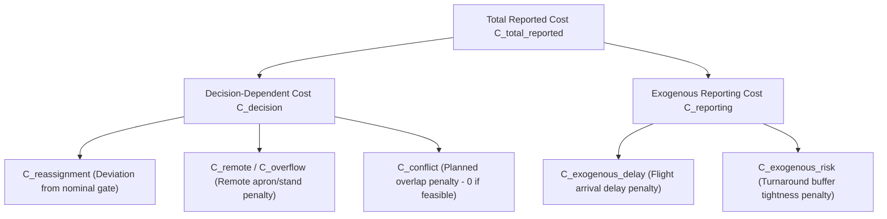

# OBJECTIVE FUNCTION SEMANTICS & METRIC SPECIFICATION CONTRACT
## Aeolus Gate Optimization — Phase P04 Technical Standard

**Specification Document:** `04_objective_semantics.md`  
**Phase:** P04 (Objective Function Standardization & Metric Semantics)  
**Version:** `v1.0`  
**Target Architecture:** Aeolus Predict-then-Optimize Gate Optimization Engine  
**Release Date:** 2026-10-09  

---

## 1. Mathematical Formalization & Cost Decomposition

In the Aeolus Gate Optimization architecture, the total reported objective function evaluated for any candidate gate assignment $x \in \{0, 1\}^{|F| \times |G|}$ is partitioned into two mutually exclusive cost categories:

$$C_{\text{total\_reported}}(x, F, G) = C_{\text{decision}}(x, F, G) + C_{\text{reporting}}(F)$$

$$\text{Identity Axiom: } \forall x, \quad C_{\text{total\_reported}} - (C_{\text{decision}} + C_{\text{reporting}}) = 0$$



### 1.1 Decision-Dependent Objective ($C_{\text{decision}}$)
$C_{\text{decision}}$ aggregates all cost components that vary with respect to the spatial gate assignment decision variables $x_{f, g}$:

$$C_{\text{decision}}(x) = C_{\text{reassignment}}(x) + C_{\text{remote}}(x) + C_{\text{conflict}}(x)$$

For any valid and feasible assignment certified by the Independent Verifier, planned conflicts are strictly zero ($C_{\text{conflict}} = 0$). Thus, for all feasible solutions:

$$C_{\text{decision}}(x) = C_{\text{reassignment}}(x) + C_{\text{remote}}(x)$$

### 1.2 Exogenous Reporting Objective ($C_{\text{reporting}}$)
$C_{\text{reporting}}$ aggregates operational baseline metrics that are exogenous flight-level constants with respect to the gate assignment decision variables:

$$C_{\text{reporting}}(F) = C_{\text{delay}}(F) + C_{\text{risk}}(F)$$

Given a fixed scenario dataset $F$ of flight arrival predictions and scheduled departure requirements:

$$\forall x_1, x_2 \quad (\text{feasible assignments}), \quad C_{\text{reporting}}(x_1, F) \equiv C_{\text{reporting}}(x_2, F)$$

$$\frac{\partial C_{\text{reporting}}}{\partial x_{f, g}} \equiv 0, \quad \forall f \in F, g \in G$$

**Scientific Integrity Requirement:** Solvers (Greedy, CP-SAT, SA, Hybrid) do not alter flight arrival delays or fixed turnaround buffers by changing gate assignments. Solvers cannot claim to "reduce delay cost" or "mitigate buffer risk" relative to a baseline in a fixed scenario, as these values are invariant across all possible permutations of gate assignments.

---

## 2. Term-by-Term Objective Contract Matrix

Each component of the objective function conforms to the following standardized contract:

| Term Name | Code Field Name | Unit | Default Weight ($w$) | Decision Dependency | Mathematical Formulation | Valid Range | Version |
| :--- | :--- | :---: | :---: | :---: | :--- | :---: | :---: |
| **Reassignment Cost** | `reassignment_cost` | Cost Points | $10.0$ | **YES** | $\sum_{f} \sum_{g \ne g^{\text{nom}}_f} w_{\text{reassign}} \cdot x_{f, g}$ | $[0, +\infty)$ | `v1` |
| **Remote Stand Cost** | `overflow_cost` / `remote_cost` | Cost Points | $200.0$ | **YES** | $\sum_{f} \sum_{g \in G_{\text{remote}}} (w_{\text{overflow}} + w_{\text{reassign}}) \cdot x_{f, g}$ | $[0, +\infty)$ | `v1` |
| **Planned Conflict Cost** | `conflict_cost` | Cost Points | $1000.0$ | **YES** | $N_{\text{conflicts}}(x) \cdot w_{\text{conflict}}$ | $\{0\}$ for feasible | `v1` |
| **Exogenous Delay Cost** | `delay_cost` / `exogenous_delay_cost` | Cost Points | $1.0$ | **NO** | $\sum_{f} \frac{\max(0, \text{ARR\_DELAY}_f)}{60.0} \cdot w_{\text{delay}}$ | $[0, +\infty)$ | `v1` |
| **Exogenous Risk Cost** | `risk_cost` / `exogenous_risk_cost` | Cost Points | $2.0$ | **NO** | $\sum_{f} \frac{\max(0, 15 - \text{slack}_f)}{15.0} \cdot w_{\text{risk}}$ | $[0, +\infty)$ | `v1` |

### 2.1 Detailed Definitions & Units

1. **Reassignment Cost ($C_{\text{reassignment}}$):**
   - **Definition:** Operational friction caused by reallocating a flight away from its pre-published nominal contact gate $g^{\text{nom}}_f$. Incurs passenger dissatisfaction and airline tow/ground-crew rescheduling.
   - **Unit:** Dimensionless cost points ($10.0$ points per reassigned flight).
   - **Optimization Impact:** Minimizing reassignments preserves schedule stability.

2. **Remote Stand Penalty ($C_{\text{remote}}$ / $C_{\text{overflow}}$):**
   - **Definition:** Severe operational penalty incurred when an aircraft turn is parked at an open remote stand or overflow apron instead of a passenger boarding bridge (contact gate). Requires passenger bus shuttling and mobile airstairs.
   - **Unit:** Dimensionless cost points ($200.0$ points per remote assignment).
   - **Note:** If a flight having a nominal contact gate is displaced to a remote stand, it incurs both the overflow penalty ($200.0$) and the reassignment penalty ($10.0$), totaling $210.0$ points.

3. **Planned Conflict Penalty ($C_{\text{conflict}}$):**
   - **Definition:** Penalty applied when two aircraft turns overlap in space-time on a contact gate or finite remote stand.
   - **Unit:** Dimensionless cost points ($1000.0$ points per conflict).
   - **Hard Constraint Primacy:** In Aeolus optimization, no soft penalty replaces hard constraint feasibility. Any solution with $N_{\text{conflicts}} > 0$ is rejected by the Independent Verifier and receives `feasible=False` and `ranking_cost = +inf`.

4. **Exogenous Arrival Delay Cost ($C_{\text{delay}}$):**
   - **Definition:** Baseline passenger delay cost evaluated from the flight's predicted arrival delay $\text{ARR\_DELAY}_f$ in minutes.
   - **Normalization:** Normalized from minutes to hours ($\div 60.0$).
   - **Unit:** Cost points per hour of arrival delay ($1.0$ pt/hr).
   - **Invariance:** Given by exogenous flight data. For any gate decision $x$, $\Delta C_{\text{delay}} = 0$.

5. **Exogenous Turnaround Buffer Risk Cost ($C_{\text{risk}}$):**
   - **Definition:** Buffer tightness penalty assessed when a flight turn's scheduled dwell $(D_f - A_f)$ is close to the minimum physical turnaround time $\text{min\_turnaround}_f$.
   - **Slack Formulation:** $\text{slack}_f = (D_f - A_f) - \text{min\_turnaround}_f$. If $\text{slack}_f < 15\text{ min}$, penalty is $((15 - \text{slack}_f) / 15.0) \times w_{\text{risk}}$.
   - **Unit:** Dimensionless risk cost points.
   - **Invariance:** Dwell and minimum turnaround are determined prior to gate assignment. For any gate decision $x$, $\Delta C_{\text{risk}} = 0$.

---

## 3. CP-SAT Integer Scaling Parity

Google OR-Tools CP-SAT is an exact integer programming solver requiring integer linear expressions.

### 3.1 Scaling Model
To represent floating-point weights without loss of precision, floating-point coefficients are scaled by `scale_factor` ($\text{SF} = 100$ by default):

$$\text{int\_coeff}_{f, g} = \text{round}\left( \text{cost}_{f, g} \times \text{SF} \right)$$

$$\text{Minimize} \quad Z_{\text{CP}} = \sum_{f} \sum_{g} \text{int\_coeff}_{f, g} \cdot x_{f, g}$$

### 3.2 Decision vs. Exogenous Invariance in CP-SAT
Because $C_{\text{reporting}}$ is constant across all feasible assignment vectors $x$ satisfying $\sum_g x_{f, g} = 1$:

$$\arg\min_{x} \left( C_{\text{decision}}(x) + C_{\text{reporting}} \right) \equiv \arg\min_{x} C_{\text{decision}}(x)$$

CP-SAT directly minimizes the integer-scaled decision cost $Z_{\text{CP}}$, excluding exogenous constants from decision variables to avoid artificial integer scaling distortion.

### 3.3 Evaluator Reconciliation & Declared Tolerance
When CP-SAT completes, the authoritative common evaluator `evaluate_gate_assignment()` recomputes all cost components in IEEE-754 double-precision floating point.

- **Reconciliation Identity:**
  $$\left| \frac{Z_{\text{CP}}}{\text{SF}} - C_{\text{decision}} \right| \le \text{scale\_tolerance} = \frac{1}{\text{SF}} = 0.01$$
- **Audited Parity:** Evaluated and verified in test specification **O05**.

---

## 4. Ranking & Infeasible Solution Exclusion Contract

A critical vulnerability in optimization benchmark design occurs when an infeasible solution (violating hard capacity or mutual exclusion constraints) achieves a lower raw mathematical cost than a feasible solution that legitimately utilized high-cost remote stands.

To prevent invalid solutions from being ranked ahead of feasible solutions:

### 4.1 `ranking_cost` and `ranking_key` Contract
In [`src/optimization/domain.py`](file:///D:/Study/Code/Python/Aelous/src/optimization/domain.py), `OptimizationResult` implements:

```python
@property
def ranking_cost(self) -> float:
    """Effective objective value for ranking candidate solutions."""
    if not self.feasible:
        return float("inf")
    return float(self.objective_value)

@property
def ranking_key(self) -> tuple[int, float]:
    """Tuple key for sorting solutions: (0 if feasible else 1, objective_value)."""
    return (0 if self.feasible else 1, self.objective_value if self.feasible else float("inf"))
```

### 4.2 Benchmark Sorting Guarantee
All comparisons and rankings must order candidate results using `s.ranking_key`. This guarantees:
1. Feasible partition ($0$) always precedes infeasible partition ($1$).
2. Infeasible candidates are never certified or displayed as higher performing than feasible candidates.

---

## 5. Numerical Safety & Safe Metric Computation

### 5.1 Safe Improvement Percentage
When calculating the percentage improvement between a baseline solution and an optimized solution:

$$\text{improvement\_pct} = \frac{C_{\text{baseline}} - C_{\text{optimized}}}{C_{\text{baseline}}} \times 100\%$$

If $C_{\text{baseline}} \le 0$ (e.g., zero reassignments and zero remote stands in an unconstrained scenario), division by zero is prevented via [`compute_improvement_pct`](file:///D:/Study/Code/Python/Aelous/src/optimization/config.py):

```python
def compute_improvement_pct(baseline_cost: float, optimized_cost: float) -> float:
    if not math.isfinite(baseline_cost) or baseline_cost <= 1e-9:
        return 0.0
    return float(((baseline_cost - optimized_cost) / baseline_cost) * 100.0)
```

### 5.2 Strict Configuration Validation (`__post_init__`)
[`GateOptimizationConfig`](file:///D:/Study/Code/Python/Aelous/src/optimization/config.py) rejects:
- Negative weights ($w < 0$).
- Non-finite numbers (NaN, $+\infty$, $-\infty$).
- Non-positive scale factor ($\text{SF} \le 0$).
- Non-positive time limit ($\tau \le 0$).

### 5.3 Version Compatibility Guard
```python
def assert_compatible_objective_version(config_a, config_b):
    if config_a.objective_version != config_b.objective_version:
        raise ValueError(
            f"Cannot compare results with different objective versions: "
            f"'{config_a.objective_version}' vs '{config_b.objective_version}'"
        )
```

---

## 6. Theoretical Analysis of Gate-Induced Delay

### 6.1 Motivation & Context
In real-world airport ramp operations, gate assignment decisions can induce secondary delays:
- **Gate Waiting Time:** An arriving aircraft must hold on the taxiway if its assigned contact gate is still occupied by a delayed departing turn.
- **Pushback & Taxiway Conflicts:** Simultaneous pushbacks from adjacent gates on the same cul-de-sac ramp cause ground congestion.
- **Towing & Ground Transit Delays:** Transporting aircraft or passengers to remote apron stands adds transit time.

### 6.2 Architectural Stance for Phase P04
In the current Aeolus Predict-then-Optimize framework:
1. **Planned vs. Realized Separation:** Solvers schedule gates using predicted arrival times and separation buffers ($15\text{ min}$) to proactively eliminate planned gate waiting.
2. **Empirical Modeling Grounding:** Gate-induced delay depends heavily on dynamic taxiway topology, pushback queueing theory, and air traffic control dispatching rules. Introducing an ad-hoc soft penalty into the static solver objective without calibrated operational empirical data would create artificial optimization incentives.
3. **Formal Decision:**
   - Gate-induced delay is **NOT** included in the static optimization objective function in Phase P04.
   - Post-hoc gate waiting and operational conflicts are evaluated exclusively in the post-hoc simulation module ([`src/simulation/`](file:///D:/Study/Code/Python/Aelous/src/simulation/)) against realized actuals.
   - Future extensions seeking to include gate-induced delay into the solver objective must undergo formal mathematical review, discrete-event simulation calibration, and separate approval.
