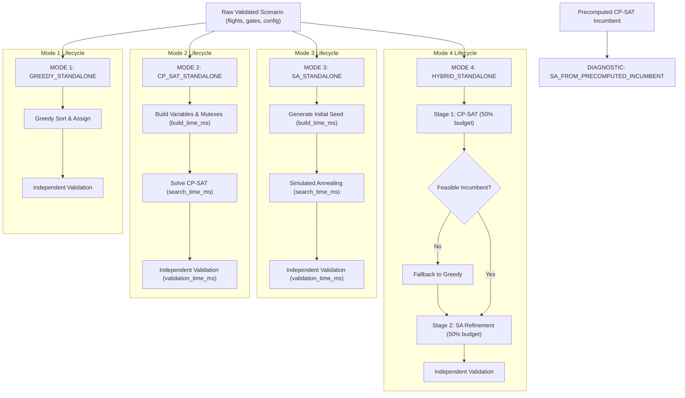

# Phase P05: Fair & Reproducible Solver Benchmark Protocol

**Document ID:** `DOC-P05-PROTOCOL-V1`  
**Phase:** P05 (Fair & Reproducible Solver Benchmark)  
**Schema Version:** `benchmark_v1.0`  
**Status:** Certified / Active  
**Author:** Performance Engineering Lead & Optimization Domain Architect  

---

## 1. Executive Summary & Purpose

The Aeolus Gate Optimization system evaluates four core optimization approaches to resolve gate assignments for commercial flights under stochastic delay conditions:
1. **Deterministic Greedy (`DeterministicGreedy`)**
2. **Constraint Programming (`CPSatGateSolver` / Google OR-Tools)**
3. **Simulated Annealing (`SimulatedAnnealingGateSolver`)**
4. **Two-Stage Hybrid (`HybridGateSolver`: CP-SAT + SA)**

Prior benchmark implementations suffered from critical methodological flaws:
- **Synthetic CP-SAT Model Build Estimation:** Inferring model construction latency as $\max(0, \text{total\_time} - \text{time\_limit})$, obscuring massive Python overheads.
- **Truncated Hybrid Latency Accounting:** Reusing precomputed CP-SAT incumbents without including Stage 1 model construction and search times in the hybrid benchmark runtime.
- **Conflation of Warm-Start Diagnostic Modes with Standalone Solvers.**
- **Missing or Masked Failure Accounting:** Converting timeouts or infeasible outcomes into arbitrary zeroes.

Phase P05 standardizes a rigorous, transparent, and reproducible benchmark protocol that guarantees mathematical parity, exact monotonic instrumentation, and full audit provenance.

---

## 2. The Benchmark Contract

Every benchmark scenario execution conforms to a typed, immutable 21-field specification and a 19-field result schema.

### 2.1 Benchmark Case Specification (`BenchmarkCaseSpec` - 21 Fields)

| Field Name | Type | Description |
| :--- | :--- | :--- |
| `experiment_id` | `str` | Unique experiment batch identifier (e.g., `EXP_TIER_A`, `EXP_TIER_B`). |
| `scenario_id` | `str` | Unique scenario identifier (e.g., `SCEN_TIER_B_100F_20G`). |
| `scenario_hash` | `str` | Canonical SHA-256 fingerprint over sorted flight windows and gate topologies. |
| `input_dataset_hash` | `str` | Cryptographic SHA-256 of canonical input development partition. |
| `scenario_type` | `str` | Scenario classification (`SYNTHETIC_MICRO`, `SYNTHETIC_THESIS`, `CANONICAL_STRESS`). |
| `n_flights` | `int` | Exact count of flight events evaluated. |
| `n_aircraft_turns` | `int` | Exact count of operational turns ($1 \text{ turn} = 1 \text{ inbound} + 1 \text{ outbound}$). |
| `n_contact_gates` | `int` | Number of physical contact terminal gates. |
| `n_finite_remote_stands` | `int` | Number of discrete finite remote apron stands. |
| `capacity_policy` | `str` | Standard capacity enforcement policy (`remote_stand_capacity_finite`). |
| `objective_version` | `str` | Declared objective contract version (`v1` / `v1.0_canonical_audit`). |
| `objective_weights` | `dict[str, float]` | Decomposed soft objective weights vector ($w_{\text{reassign}}, w_{\text{overflow}}, \dots$). |
| `prediction_mode` | `str` | Operational prediction mode (`point_prediction`, `probabilistic_student_t`). |
| `solver_name` | `str` | Official solver class identifier (`DeterministicGreedy`, `CPSat`, etc.). |
| `solver_variant` | `str` | Execution mode variant string (`GREEDY_STANDALONE`, `HYBRID_STANDALONE`, etc.). |
| `seed` | `int` | Pseudo-random number generator seed controlling reproducibility. |
| `worker_count` | `int` | Number of search threads (fixed to 1 for strict determinism). |
| `solver_config` | `dict[str, Any]` | Full serialized solver parameter dictionary. |
| `time_budget_ms` | `float` | Hard wall-clock search budget allocated in milliseconds. |
| `memory_budget_mb` | `float` | Declared memory threshold before triggering resource aborts. |
| `environment_info` | `dict[str, Any]` | Full hardware and software environment profile. |

### 2.2 Benchmark Run Result (`BenchmarkRunResult` - 19 Fields)

| Field Name | Type | Description |
| :--- | :--- | :--- |
| `build_time_ms` | `float \| None` | Measured Python model/data/seed construction time in milliseconds. |
| `search_time_ms` | `float \| None` | Measured pure solver search latency in milliseconds. |
| `validation_time_ms` | `float \| None` | Authoritative evaluator & independent verifier latency in milliseconds. |
| `total_wall_clock_ms` | `float` | Monotonic wall-clock elapsed time across the complete solver lifecycle. |
| `peak_memory_mb` | `float \| None` | Peak resident working set memory observed during execution. |
| `solver_status` | `str` | Domain `SolverStatus` enum string (`OPTIMAL`, `FEASIBLE`, `UNKNOWN`, `INFEASIBLE`). |
| `feasible` | `bool` | Strict boolean: True only if independently verified with 0 hard violations. |
| `optimality_proven` | `bool` | True only if mathematical optimality is certifiably proven by solver. |
| `objective_value` | `float \| None` | Authoritative objective cost (`null` if infeasible or failed; NEVER 0). |
| `best_bound` | `float \| None` | Mathematical lower bound from MIP/CP proof (`null` if heuristic or unproven). |
| `gap` | `float \| None` | Relative optimality gap $|(\text{obj} - \text{bound})/\text{obj}|$ (`null` if unproven). |
| `hard_constraint_violations` | `int` | Count of hard violations certified by independent verifier. |
| `reassignment_count` | `int \| None` | Flights assigned away from nominal schedule (`null` if infeasible). |
| `remote_count` | `int \| None` | Flights assigned to remote/overflow resources (`null` if infeasible). |
| `unassigned_count` | `int \| None` | Flights left unassigned (`null` if infeasible). |
| `fallback_used` | `bool` | Flag indicating whether fallback strategy was invoked. |
| `termination_reason` | `str` | Explicit domain `TerminationReason` string. |
| `experiment_id` | `str` | Foreign key linking to benchmark case specification. |
| `run_id` | `str` | Repetition identifier (`rep_1`, `rep_2`, etc.). |

---

## 3. Four Standard Solver Modes + One Diagnostic Mode

The benchmark suite strictly isolates and evaluates five explicit execution modes:



### 3.1 MODE 1 — `GREEDY_STANDALONE`
- **Starting point:** Clean scenario input.
- **Workflow:** Sequential sort by arrival window, earliest-available gate assignment.
- **Timing:** Total execution recorded via `time.perf_counter_ns()`. `build_time_ms = 0.0`.

### 3.2 MODE 2 — `CP_SAT_STANDALONE`
- **Starting point:** Clean scenario input.
- **Workflow:** Constructs boolean decision variables $x_{f,g}$, pair-wise conflict exclusion constraints, discrete remote capacity constraints, and scaled objective. Solves via Google OR-Tools.
- **Timing:** Explicitly measures `build_time_ms` (Python constraint synthesis), `search_time_ms` (OR-Tools engine), and `validation_time_ms`.

### 3.3 MODE 3 — `SA_STANDALONE`
- **Starting point:** Clean scenario input.
- **Workflow:** Synthesizes initial feasible seed via declared heuristic policy. Includes seed generation latency in `build_time_ms` and end-to-end wall clock! Executes temperature cooling iterations.
- **Timing:** Wall clock strictly covers seed synthesis + annealing + verification.

### 3.4 MODE 4 — `HYBRID_STANDALONE`
- **Starting point:** Clean scenario input.
- **Workflow:** Executes Stage 1 CP-SAT within allocated share ($\tau \times \text{cp\_ratio}$). If CP-SAT times out or fails without an incumbent, invokes declared Greedy fallback (`fallback_used = True`). Feeds incumbent into Stage 2 Simulated Annealing for metaheuristic refinement.
- **Timing:** Total wall-clock runtime strictly covers Stage 1 CP-SAT build and search, fallback (if triggered), Stage 2 SA iterations, and independent validation.

### 3.5 DIAGNOSTIC MODE — `SA_FROM_PRECOMPUTED_INCUMBENT`
- **Starting point:** Precomputed solution loaded from memory or storage.
- **Restriction:** Strictly designated as diagnostic research. **NEVER** conflated with or published as `HYBRID_STANDALONE`.

---

## 4. Runtime Instrumentation & Budget Disambiguation

Timing is instrumented using Python's monotonic high-resolution timer:
```python
t_start_ns = time.perf_counter_ns()
# ... stage execution ...
t_end_ns = time.perf_counter_ns()
elapsed_ms = (t_end_ns - t_start_ns) / 1_000_000.0
```

### Budget Taxonomy:
1. **`SEARCH_BUDGET`:** Time limit granted to the core solver engine (e.g. `solver.parameters.max_time_in_seconds`).
2. **`SOLVER_PIPELINE_BUDGET`:** Time budget allocated to model construction + search + incumbent validation.
3. **`END_TO_END_BUDGET`:** Total permissible process-level latency including serialization.

Under no circumstances is model construction latency approximated by $\max(0, \text{total\_time} - \text{time\_limit})$.

---

## 5. Scaling Experiment Tiers

The benchmark hierarchy enforces three standard scales:

| Scale Tier | Designation | Flight Count | Gate Inventory | Purpose |
| :--- | :--- | :--- | :--- | :--- |
| **Tier A** | Correctness Micro | 5–20 flights | 2–10 gates | Fast unit regression and invariant verification. |
| **Tier B** | Thesis Core | 100, 200, 300 flights | 20, 30, 50 gates | Official academic thesis evaluation and scalability boundaries. |
| **Tier C** | Extended Stress | 500–1,500 flights | 50 gates | Engineering stress limit evaluation (memory checked; aborts if RAM exhausted). |

---

## 6. Multi-Run Statistical Protocol

To eliminate noise and single-run bias, every standard scenario is repeated over $N \ge 3$ (Tier B) or $N \ge 5$ (Tier A) runs with controlled seed progression ($S_k = S_0 + k$).

The aggregation engine computes:
- **Central Tendency:** Median and Mean.
- **Dispersion:** Standard Deviation ($\sigma$) and Normalized Dispersion $\frac{\max - \min}{\text{median}}$.
- **Extremes:** Minimum and Maximum.
- **Integrity Accounting:** Failure rate $\frac{N_{\text{failed}}}{N_{\text{runs}}}$. Failed runs are never purged. Objective statistics are evaluated strictly over feasible subsets, returning `null` when no feasible solutions exist.
