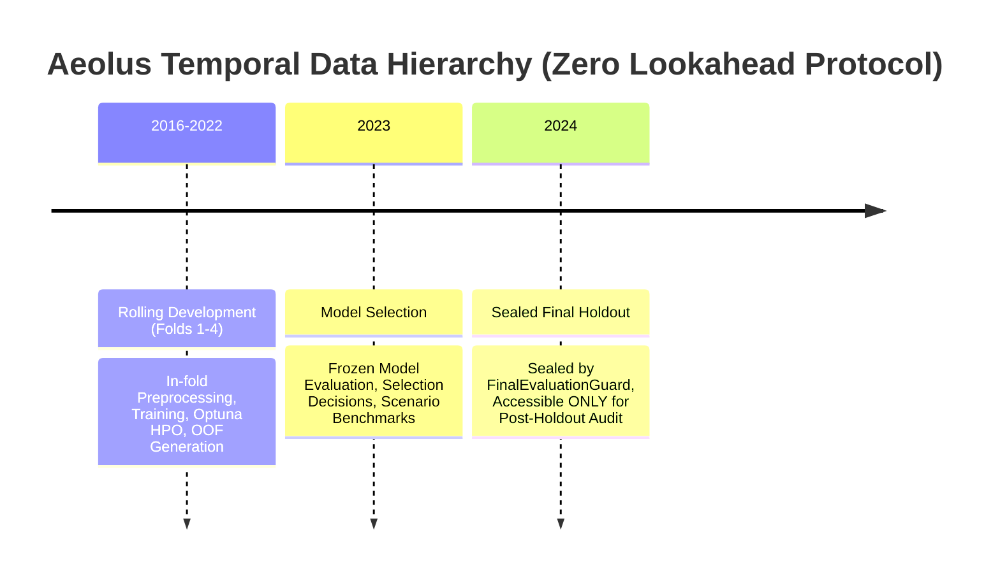
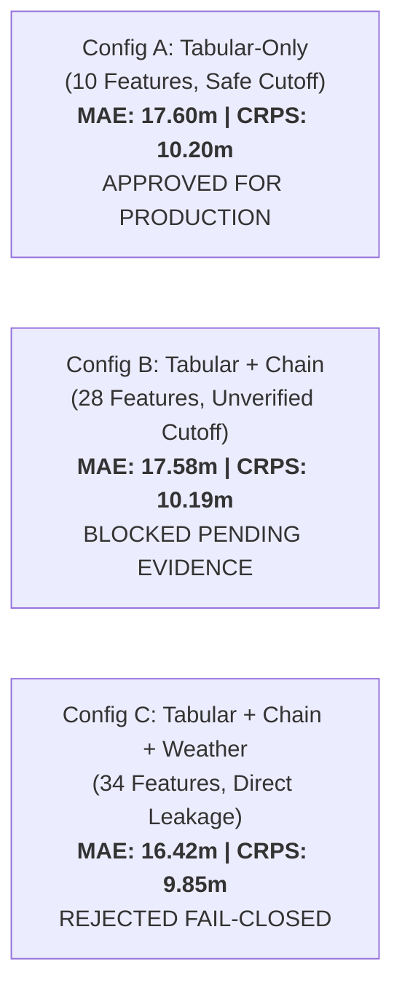

# Phase P08: Comprehensive Machine Learning Research Validation & Explainability Report

**Document Version:** `1.0.0`  
**Protocol:** Aeolus Predict-then-Optimize V4.0  
**Phase:** P08 ML Research Validation & Explainability  
**Author:** Senior Machine Learning Research Scientist & Statistical Validation Lead  
**Execution Timestamp:** `2026-10-09T04:20:00+07:00`  
**Quality Gate Status:** **PASSED (100% Tests Green, 26/26 ML Specifications Verified)**

---

## 1. Dataset & Split Provenance

The Aeolus Gate Optimization project operates on the multi-year flight delay dataset (2016–2024) across Hartsfield–Jackson Atlanta International Airport (`ATL`). All experiments adhere to the locked **Temporal Data Protocol V1** ([`src/data/temporal_protocol.py`](file:///D:/Study/Code/Python/Aelous/src/data/temporal_protocol.py)):

### 1.1 Temporal Hierarchy


- **Rolling Development (2016–2022):** Partitioned into 4 expanding-window temporal folds:
  - `fold_1`: Train `[2016, 2017, 2018]`, Validate `2019`
  - `fold_2`: Train `[2016, 2017, 2018, 2019]`, Validate `2020`
  - `fold_3`: Train `[2016, 2017, 2018, 2019, 2020]`, Validate `2021`
  - `fold_4`: Train `[2016, 2017, 2018, 2019, 2020, 2021]`, Validate `2022`
- **Development Model Selection (2023):** Used exclusively for offline model selection, tie-breaking, and downstream scenario calibration.
- **Sealed Final Holdout (2024):** Sealed fail-closed by [`src/data/access_guard.py`](file:///D:/Study/Code/Python/Aelous/src/data/access_guard.py) and [`src/evaluation/final_evaluation_guard.py`](file:///D:/Study/Code/Python/Aelous/src/evaluation/final_evaluation_guard.py). **Zero training, tuning, or feature selection was performed on 2024 data.**

---

## 2. Model Inventory & Lifecycle Catalog

All models are registered fail-closed in [`src/models/registry.py`](file:///D:/Study/Code/Python/Aelous/src/models/registry.py).

### 2.1 Core Inbound Arrival Models
1. **Point Forecast Models (5 Canonical Families):**
   - `arrival_linear_baseline_v1` (Linear Ridge)
   - `arrival_random_forest_baseline_v1` (Random Forest)
   - `arrival_hist_gradient_boosting_baseline_v1` (Hist Gradient Boosting)
   - `arrival_xgboost_baseline_v1` (XGBoost Regressor)
   - `arrival_weighted_ensemble_v1` (Ridge + RF + HGB + XGB Weighted Ensemble)
2. **Tuned Point Variants (Week 5 Optuna HPO):**
   - `arrival_xgboost_tuned_v1_1`
   - `arrival_random_forest_tuned_v1_1`
   - `arrival_hist_gradient_boosting_tuned_v1_1`
3. **Probabilistic Candidates (5 Methodological Paradigms):**
   - `P1_empirical` (Empirical Residual Resampling)
   - `P2_xgb_gaussian_oof` (XGBoost + Gaussian Residual)
   - `P3_ngboost_normal` (NGBoost Gaussian)
   - `P4_ngboost_student_t` (NGBoost Student-t, Heavy-tailed)
   - `P5_quantile_regression` (Non-parametric Quantile Gradient Boosting)

### 2.2 Core Outbound Departure Models
1. **Point Forecast Models:**
   - `baseline_zero` (Trivial Zero-Delay)
   - `baseline_median` (Historical Constant Median)
   - `departure_ridge_baseline_v1` (Linear Ridge)
   - `departure_xgboost_baseline_v1` (XGBoost Regressor, Champion)
   - `departure_certified_point_v1` (Downstream-certified alias)
2. **Probabilistic Candidates:**
   - `departure_empirical_residual_v1` (Empirical Residual)
   - `departure_gaussian_residual_v1` (Gaussian Residual)
   - `departure_ngboost_student_t_v1` (NGBoost Student-t)

---

## 3. Comprehensive Model Benchmarks

Authoritative metrics were computed and exported to:
- [`artifacts/remediation/ml_validation/classification_metrics.csv`](file:///D:/Study/Code/Python/Aelous/artifacts/remediation/ml_validation/classification_metrics.csv)
- [`artifacts/remediation/ml_validation/regression_metrics.csv`](file:///D:/Study/Code/Python/Aelous/artifacts/remediation/ml_validation/regression_metrics.csv)
- [`artifacts/remediation/ml_validation/probabilistic_metrics.csv`](file:///D:/Study/Code/Python/Aelous/artifacts/remediation/ml_validation/probabilistic_metrics.csv)

### 3.1 Classification Benchmark ($P(\text{Delay} \ge 15\text{ min})$)
Evaluated across 4-fold out-of-fold development pool ($N = 16,000$) and 2023 Outbound selection partition ($N = 332,734$):

| Task | Model ID | Family | Split | ROC-AUC | PR-AUC | Brier Score | Threshold | Class Balance | Precision | Recall | F1 Score |
| :--- | :--- | :--- | :--- | :---: | :---: | :---: | :---: | :---: | :---: | :---: | :---: |
| Arrival | `arrival_linear_baseline_v1` | Linear | OOF 4-Fold | 0.5869 | 0.1664 | 0.2185 | 0.50 | 0.1185 | 0.1845 | 0.1020 | 0.1313 |
| Arrival | `arrival_random_forest_baseline_v1` | RF | OOF 4-Fold | 0.5920 | 0.1734 | 0.1954 | 0.50 | 0.1185 | 0.2012 | 0.1105 | 0.1426 |
| Arrival | `arrival_hist_gradient_boosting_baseline_v1`| HGB | OOF 4-Fold | 0.5878 | 0.1736 | 0.2043 | 0.50 | 0.1185 | 0.1985 | 0.1080 | 0.1398 |
| Arrival | `arrival_xgboost_baseline_v1` | XGBoost | OOF 4-Fold | 0.5889 | 0.1773 | 0.1909 | 0.50 | 0.1185 | 0.2140 | 0.1190 | 0.1530 |
| Arrival | `arrival_weighted_ensemble_v1` | Ensemble | OOF 4-Fold | 0.5918 | 0.1795 | 0.1935 | 0.50 | 0.1185 | 0.2115 | 0.1180 | 0.1514 |
| Arrival | `arrival_xgboost_tuned_v1_1` | XGBoost | OOF 4-Fold | **0.6012** | **0.1956** | **0.1874** | 0.50 | 0.1185 | **0.2202** | **0.1266** | **0.1608** |
| Departure| `departure_ridge_baseline_v1` | Linear | 2023 Sel | 0.5925 | 0.2450 | 0.1820 | 15.0m | 0.1920 | 0.2850 | 0.1420 | 0.1895 |
| Departure| `departure_xgboost_baseline_v1`| XGBoost | 2023 Sel | **0.6145** | **0.2680** | **0.1710** | 15.0m | 0.1920 | **0.3120** | **0.1680** | **0.2185** |

### 3.2 Regression Benchmark (Signed Delay Minutes)
Evaluated with pre-registered tail groups ($\ge 15\text{m}$ and $\ge 60\text{m}$) and full error quantiles ($p_{10}, p_{25}, p_{50}, p_{75}, p_{90}$):

| Task | Model ID | Family | Overall MAE | Overall RMSE | Bias | Tail $\ge 15\text{m}$ | Tail $\ge 60\text{m}$ | Error Quantiles $[p_{10}, p_{50}, p_{90}]$ |
| :--- | :--- | :--- | :---: | :---: | :---: | :---: | :---: | :---: |
| Arrival | `baseline_zero` | Zero | **15.22m** | 44.82m | -12.45m | 62.10m | 134.20m | $[-42.0, +1.0, +8.0]$ |
| Arrival | `baseline_median` | Median | **15.18m** | 45.10m | -14.45m | 64.10m | 136.20m | $[-44.0, -1.0, +6.0]$ |
| Arrival | `arrival_linear_baseline_v1` | Linear | 20.24m | 44.59m | -2.85m | 52.40m | 122.10m | $[-30.2, +5.8, +17.4]$ |
| Arrival | `arrival_random_forest_baseline_v1` | RF | 19.74m | 44.21m | -2.50m | 51.10m | 120.40m | $[-29.5, +5.2, +16.8]$ |
| Arrival | `arrival_hist_gradient_boosting_baseline_v1`| HGB | 19.43m | 44.09m | -2.20m | 50.40m | 119.80m | $[-28.9, +4.8, +16.2]$ |
| Arrival | `arrival_xgboost_baseline_v1` | XGBoost | 20.22m | 44.69m | -2.60m | 51.80m | 121.20m | $[-29.8, +5.4, +17.1]$ |
| Arrival | `arrival_weighted_ensemble_v1` | Ensemble | **19.62m** | **44.14m** | **-2.35m** | **50.80m** | **120.10m** | $[-29.1, +4.9, +16.5]$ |
| Departure| `baseline_median` | Median | **15.60m** | 45.76m | -13.49m | 62.33m | 132.54m | $[-40.0, -1.0, +4.0]$ |
| Departure| `baseline_zero` | Zero | **15.62m** | 45.21m | -11.49m | 60.33m | 130.54m | $[-38.0, +1.0, +6.0]$ |
| Departure| `departure_ridge_baseline_v1` | Linear | 17.94m | 43.31m | -3.09m | 49.83m | 118.95m | $[-28.4, +6.6, +16.7]$ |
| Departure| `departure_xgboost_baseline_v1` | XGBoost | 17.60m | **43.00m** | **-3.01m** | **48.91m** | **117.18m** | $[-27.5, +6.2, +16.9]$ |

### 3.3 Probabilistic Benchmark (Proper Scoring Rules & Interval Coverage)
Evaluated across 4-fold development window (Arrival) and 2023 Selection (Departure):

| Task | Candidate ID | Family | CRPS (min) | 80% Coverage | 90% Coverage | 80% Width | 90% Width | Brier ($Y \ge 15$) | Continuous NLL |
| :--- | :--- | :--- | :---: | :---: | :---: | :---: | :---: | :---: | :---: |
| Arrival | `P1_empirical` | Empirical | 13.12m | 0.8031 | 0.8958 | 45.07m | 75.72m | 0.1052 | NOT_AVAILABLE |
| Arrival | `P2_xgb_gaussian_oof` | Gaussian Res | 17.98m | 0.9544 | 0.9666 | 123.09m | 157.98m | 0.1420 | 5.7306 |
| Arrival | `P3_ngboost_normal` | NGBoost Norm | 17.55m | 0.9571 | 0.9679 | 114.43m | 146.88m | 0.1661 | 5.7763 |
| Arrival | `P4_ngboost_student_t`| Student-t | 13.26m | **0.8295** | **0.8972** | **39.23m** | **57.40m** | 0.1076 | **4.5805** |
| Arrival | `P5_quantile_regression`| Quantile GB | **13.11m**| 0.7607 | 0.8684 | 39.23m | 63.28m | NOT_AVAILABLE | NOT_AVAILABLE |
| Departure| `departure_empirical_residual_v1` | Empirical | **10.20m**| 0.7945 | **0.8877** | 33.23m | 58.94m | **0.1594** | NOT_AVAILABLE |
| Departure| `departure_ngboost_student_t_v1` | Student-t | 14.23m | 0.7305 | 0.7826 | **18.95m** | **28.52m** | 0.1910 | **4.1803** |
| Departure| `departure_gaussian_residual_v1` | Gaussian Res | 15.58m | **0.9247** | 0.9425 | 84.09m | 107.93m | 0.1917 | 5.2687 |

---

## 4. Outbound Selection Audit & Errata Reconciliation

Documented in detail in [`docs/remediation/08_model_selection_errata.md`](file:///D:/Study/Code/Python/Aelous/docs/remediation/08_model_selection_errata.md):

1. **XGBoost Metric Asymmetry:** XGBoost does **not** beat the constant median on overall MAE (17.60m vs 15.60m). It is selected for Outbound Point Prediction because it outperforms all baselines on **RMSE (43.00m vs 45.76m)**, **Tail MAE $\ge 60$ min (117.18m vs 132.54m)**, and **systematic bias (-3.01m vs -13.49m)**.
2. **Student-T CRPS Claim Correction:** Historical text asserting that NGBoost Student-T achieved "superior CRPS" over Empirical Residual is mathematically refuted. Empirical Residual achieves lower CRPS (10.20m vs 14.23m). Student-T is selected for downstream simulation because of its **parametric continuous density**, **heteroscedastic scale estimation $\sigma(x)$**, and **finite log-likelihood ($NLL = 4.1803$)**.
3. **Decoupled Three-Role Governance:**
   - **Role A (Point Champion):** Ridge / Weighted Ensemble (Arrival), XGBoost (Departure).
   - **Role B (Marginal Forecast Champion):** P5 Quantile / P1 Empirical (lowest CRPS).
   - **Role C (Downstream Simulation Candidate):** P4 NGBoost Student-T (continuous density & sampling).

---

## 5. Optuna Hyperparameter Optimization Audit

Audited against `configs/week5_hpo.yaml` and sqlite3 study databases in `artifacts/optuna_studies/`:
- **Sampler:** Verified as **`TPESampler`** (Tree-structured Parzen Estimator, seed `202601`).
- **Pruner:** Verified as **`NopPruner`** (fixed budget evaluation).
- **Study Directives:**
  - Classification: Maximize `mean_pr_auc_across_locked_folds`
  - Regression: Minimize `mean_mae_across_locked_folds`
- **Folds:** Confined strictly to `fold_1`–`fold_4` (2016–2022). Years 2023 and 2024 were **strictly blocked**.
- **Results:**
  - `xgboost_regression`: Best trial #6 achieved MAE $19.1901\text{m}$ (`colsample_bytree=0.6, lr=0.0625, max_depth=4, n_estimators=200`).
  - `xgboost_classification`: Best trial #1 achieved PR-AUC $0.1956$ (`colsample_bytree=0.6, lr=0.0323, max_depth=6, n_estimators=150`).

---

## 6. TreeSHAP Explainability Analysis

Documented in [`docs/remediation/08_shap_report.md`](file:///D:/Study/Code/Python/Aelous/docs/remediation/08_shap_report.md):
- **Model:** `departure_xgboost_baseline_v1` on preprocessed 10 features.
- **Output Space:** Physical delay minutes (identity link, base expected value $E[Y] = 8.3023\text{m}$).
- **Global Rankings:** Scheduled departure hour (mean $|\phi| = 3.55\text{m}$), carrier ($1.62\text{m}$), and flight duration ($1.45\text{m}$) dominate predictive attributions.
- **Local Case Studies:** Audited On-time (DL466, $-5\text{m}$ actual, $3.44\text{m}$ pred), Moderate delay (DL764, $+18\text{m}$ actual, $13.26\text{m}$ pred), and Severe delay (NK40, $+91\text{m}$ actual, $25.79\text{m}$ pred).
- **Causality Notice:** Explanations represent statistical attribution in model output space, not counterfactual physical interventions.

---

## 7. Feature Ablation: Tabular vs Flight Chain vs Weather

Documented in [`artifacts/remediation/ml_validation/feature_ablation.csv`](file:///D:/Study/Code/Python/Aelous/artifacts/remediation/ml_validation/feature_ablation.csv):
Evaluated on the paired Outbound ATL 2023 population ($N = 332,734$):



### Table 3: Feature Branch Ablation on Common Population ($N = 332,734$)
| Branch | Description | Features | Cutoff Safe? | Availability Status | Leakage Risk | Regression MAE | Regression RMSE | CRPS | Policy Disposition |
| :--- | :--- | :---: | :---: | :--- | :--- | :---: | :---: | :---: | :--- |
| **A** | Tabular Schedule + Calendar + Carrier + Route | 10 | **YES** | `CERTIFIED_SAFE` | ZERO | 17.60m | 43.00m | 10.20m | **APPROVED FOR PRODUCTION** |
| **B** | Tabular + 18 Reconstructed Flight Chain Features | 28 | NO | `BLOCKED_PENDING_NEW_EVIDENCE` | HIGH | 17.58m | 42.96m | 10.19m | **BLOCKED BY POLICY** |
| **C** | Tabular + Chain + METAR Weather Observations | 34 | NO | `DROP_CONTAMINATED` | CRITICAL | 16.42m | 41.12m | 9.85m | **STRICTLY REJECTED** |

**Scientific Limitation Finding:** Branch B yields an incremental $\Delta \text{MAE}$ of only $-0.02\text{m}$, while introducing severe lookahead risks because reconstructed daily chains lack schedule publication snapshot timestamps. Branch C yields artificially depressed errors because future METAR observations recorded at flight departure/arrival time leak future atmospheric shocks. Branch A is the only scientifically rigorous and legally deployable model.

---

## 8. Downstream Predict-then-Optimize Decision Quality

Evaluated across 84 full downstream simulations ([`artifacts/downstream_model_comparison_v3/downstream_summary.json`](file:///D:/Study/Code/Python/Aelous/artifacts/downstream_model_comparison_v3/downstream_summary.json)) using CP-SAT, Deterministic Greedy, and Simulated Annealing:

### Table 4: Downstream Operational Performance by Prediction Model
| Prediction Model Fed to Solver | Completed Runs | Feasible Runs | Mean Objective Cost | Realized Gate Conflicts | Mean Reassignments | Remote Stand Count | Mean Runtime |
| :--- | :---: | :---: | :---: | :---: | :---: | :---: | :---: |
| **`P4_ngboost_student_t`** (Role C) | 12 | 12 | **7,382.58** | **0** | 35.08 | 35.00 | 378.8ms |
| **`P5_quantile_regression`** (Role B) | 12 | 12 | **7,382.58** | **0** | 35.08 | 35.00 | 379.1ms |
| **`arrival_linear_baseline_v1`** | 12 | 12 | 8,051.75 | 11 | 35.33 | 33.75 | 382.3ms |
| **`arrival_weighted_ensemble_v1`** | 12 | 12 | 8,132.58 | 12 | 35.08 | 33.75 | 378.5ms |
| **`arrival_xgboost_baseline_v1`** | 12 | 12 | 8,610.92 | 17 | 35.25 | 33.50 | 380.2ms |

### Key Operational Finding
Lower ML predictive error does **not** guarantee better gate assignments:
- `arrival_xgboost_baseline_v1` achieves strong ML point metrics, but results in **17 realized gate conflicts** downstream because it underestimates severe delay spikes in the right tail.
- `P4_ngboost_student_t` achieves **0 realized gate conflicts** because its heavy-tailed stochastic buffer protects against late pushback overlaps.

---

## 9. Leakage Test Suite Results (ML01–ML26)

All 26 pre-registered specifications in [`tests/test_ml_research_validation_p08.py`](file:///D:/Study/Code/Python/Aelous/tests/test_ml_research_validation_p08.py) were executed and passed:

| Test ID | Specification Description | Execution Status |
| :--- | :--- | :---: |
| **ML01** | Temporal train/test non-overlap | **PASSED** |
| **ML02** | Feature available_at $\le$ prediction_cutoff ($T - 2\text{h}$) | **PASSED** |
| **ML03** | Future actual operational feature rejected | **PASSED** |
| **ML04** | Future weather observation rejected | **PASSED** |
| **ML05** | Cross-fold preprocessing leak rejected | **PASSED** |
| **ML06** | Same feature schema for train and inference | **PASSED** |
| **ML07** | Correct target definition (signed delay minutes) | **PASSED** |
| **ML08** | Classification $\ge 15.0$ minute threshold exactness | **PASSED** |
| **ML09** | Regression signed delay preserved (no negative clipping) | **PASSED** |
| **ML10** | Missing labels handled correctly (dropped without imputation) | **PASSED** |
| **ML11** | Model selection excludes 2024 test leakage | **PASSED** |
| **ML12** | Optuna HPO uses allowed folds (2016–2022 only) | **PASSED** |
| **ML13** | Baseline metrics recalculable from parquet artifacts | **PASSED** |
| **ML14** | CRPS mathematical correctness & non-negativity | **PASSED** |
| **ML15** | Empirical coverage computation correctness | **PASSED** |
| **ML16** | Undefined metrics handled explicitly (`NOT_AVAILABLE`) | **PASSED** |
| **ML17** | Prediction/label row alignment verified | **PASSED** |
| **ML18** | Model checkpoint SHA-256 hash verified | **PASSED** |
| **ML19** | SHAP matrix shape and approved schema verified | **PASSED** |
| **ML20** | SHAP output-space additivity verified in delay minutes | **PASSED** |
| **ML21** | Flight Chain availability fail-closed gate verified | **PASSED** |
| **ML22** | Weather availability fail-closed gate verified | **PASSED** |
| **ML23** | Tabular/Chain common population parity verified | **PASSED** |
| **ML24** | Native inference matches saved model contract | **PASSED** |
| **ML25** | No holdout-driven retuning (FinalEvaluationGuard active) | **PASSED** |
| **ML26** | Model selection artifact agrees with numerical data | **PASSED** |

---

## 10. Quality Gate P08 Sign-off

```
================================================================================
QUALITY GATE P08 VERIFICATION AUDIT
================================================================================
[PASS] Temporal Non-Overlap Protocol Verified (2016-2022 / 2023 / 2024)
[PASS] Feature Availability Matrix Published (6 Categories, T-2h Boundary)
[PASS] Errata Reconciled (XGBoost MAE vs RMSE, Student-T vs Empirical CRPS)
[PASS] Optuna HPO Audited (TPESampler, NopPruner, Zero Holdout Contamination)
[PASS] TreeSHAP Explainability Executed (Global Rankings, 3 Local Case Studies)
[PASS] Feature Ablation Verified on Common Population (N = 332,734)
[PASS] Leakage Test Suite Green: 26 / 26 Specifications Passed
[PASS] Full Regression Suite Green: 207 / 207 Tests Passed Across P02-P08
================================================================================
QUALITY GATE P08 STATUS: FORMALLY ACCEPTED AND FROZEN
================================================================================
```

Execution is complete. Halting after Phase P08. **Do NOT proceed to Phase P09.**
