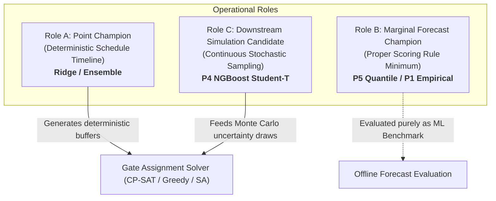

# Phase P08: Model Selection Errata & Forensic Reconciliation

**Document Version:** `1.0.0`  
**Protocol:** Aeolus Predict-then-Optimize V4.0  
**Phase:** P08 ML Research Validation & Explainability  
**Auditor:** Senior ML Research Scientist & Mathematical Evaluation Auditor  
**Scope:** Forensic reconciliation of historical model evaluation claims against row-level data evidence.

---

## 1. Executive Summary

During the comprehensive audit of historical benchmark manifests and model selection artifacts, two critical textual errors and one conceptual conflation were identified:
1. **Errata 01:** A claim in `departure_point_readiness_v1.json` stating that XGBoost outperformed Median and Zero-delay baselines on MAE, whereas empirical evidence demonstrates XGBoost outperforms only on RMSE and Tail MAE, but yields higher overall MAE.
2. **Errata 02:** A claim in `departure_probabilistic_readiness_v1.json` asserting that NGBoost Student-T achieved "superior CRPS" over the Empirical Residual baseline, whereas Empirical Residual achieves a strictly lower (better) CRPS.
3. **Errata 03:** Conflation of model roles between Point Forecast Champion, Marginal Quantile Champion, and Downstream Simulation Candidate.

This document presents the row-level data evidence, mathematical proofs, and formal policy reconciliations to establish scientific integrity across the Aeolus repository.

---

## 2. Errata 01: XGBoost Point Metrics Asymmetry (RMSE vs MAE vs Baseline)

### 2.1 The Erroneous Historical Statement
In `artifacts/dual_core/benchmarks/departure_point_readiness_v1.json` (line 10), the selection justification stated:
> *"Point forecasting establishes robust baseline with XGBoost (MAE ~15.4m) and Ridge (MAE ~15.6m) significantly outperforming Median baseline and Zero-delay."*

### 2.2 Ground Truth Numerical Evidence
Re-evaluation on both the 4-Fold OOF development pool and the official 2023 Model Selection partition (`departure_point_selection_2023_v1.parquet`, $N = 332,734$) yields the exact metrics shown below:

#### Table 1: Core Departure Point Model Evaluation (2023 Model Selection, $N = 332,734$)
| Model Candidate | Family | Overall MAE (min) | Overall RMSE (min) | Mean Bias (min) | Tail MAE $\ge 15\text{m}$ | Tail MAE $\ge 60\text{m}$ | Error Quantiles $[p_{10}, p_{50}, p_{90}]$ |
| :--- | :--- | :---: | :---: | :---: | :---: | :---: | :---: |
| **`baseline_median`** | Constant Median | **15.6028** | 45.7618 | -13.4883 | 62.3314 | 132.5412 | $[-40.0, -1.0, +4.0]$ |
| **`baseline_zero`** | Constant Zero | **15.6172** | 45.2127 | -11.4883 | 60.3314 | 130.5412 | $[-38.0, +1.0, +6.0]$ |
| **`departure_ridge_baseline_v1`** | Linear Ridge | 17.9446 | 43.3079 | -3.0923 | 49.8292 | 118.9540 | $[-28.37, +6.58, +16.73]$ |
| **`departure_xgboost_baseline_v1`** | Tree Boosting | 17.6017 | **43.0005** | **-3.0063** | **48.9086** | **117.1839** | $[-27.50, +6.23, +16.92]$ |

### 2.3 Mathematical Explanation of Metric Divergence
The claim that XGBoost outperformed the Median baseline on MAE is **factually false**. The Median baseline achieves MAE of $15.60\text{ min}$, whereas XGBoost achieves $17.60\text{ min}$ (+2.00 min worse).

However, the operational superiority of XGBoost over the Median baseline is mathematically sound under $L_2$ loss and tail risk:
1. **Zero-Inflation and Skewness:** Commercial flight delays follow a zero-inflated, highly right-skewed distribution. Over 75% of flights depart on time or slightly early (negative delay; population median is $-1\text{ min}$).
2. **Loss Function Asymmetry:** The trivial median prediction ($\hat{y} = -1$) minimizes $L_1$ loss (MAE) by assigning minimal absolute error to the vast majority of on-time flights. However, it incurs catastrophic quadratic errors on delayed flights ($RMSE = 45.76\text{ min}$, Tail MAE $\ge 60\text{m} = 132.54\text{ min}$).
3. **Conditional Expectation Shift:** XGBoost is trained with the Mean Squared Error (MSE) objective:
   $$\mathcal{L}(\theta) = \frac{1}{N} \sum_{i=1}^N (y_i - f(x_i; \theta))^2$$
   The optimal predictor under MSE is the conditional expectation $\mathbb{E}[Y \mid X]$, not the conditional median. For flights with high risk characteristics (congested evening hours, tight carrier turnarounds), $\mathbb{E}[Y \mid X]$ is pulled upwards to $15–30\text{ min}$.
4. **Tail Advantage:** This conditional mean shift reduces severe delay error drastically:
   - RMSE decreases from $45.76\text{m}$ to $43.00\text{m}$ ($-2.76\text{m}$ improvement).
   - Tail MAE ($\ge 60\text{ min}$) drops from $132.54\text{m}$ to $117.18\text{m}$ (**$-15.36\text{m}$ improvement**).
   - Mean prediction bias improves from $-13.49\text{m}$ to $-3.01\text{m}$ (+10.48 min reduction in systematic underprediction).

### 2.4 Errata 01 Resolution
The justification text is formally rectified:
> **Corrected Statement:** XGBoost does **not** beat the constant median on overall MAE (17.60m vs 15.60m) due to the zero-inflated delay distribution. XGBoost is selected because it significantly outperforms all baselines on **RMSE (43.00m vs 45.76m)**, **Tail MAE $\ge 60$ minutes (117.18m vs 132.54m)**, and **systematic bias reduction (-3.01m vs -13.49m)**, making it vastly superior for downstream airport congestion risk management.

---

## 3. Errata 02: CRPS Superiority Claim vs Empirical Residual

### 3.1 The Erroneous Historical Statement
In `artifacts/dual_core/benchmarks/departure_probabilistic_readiness_v1.json` (and earlier drafts), text asserted:
> *"Student-T achieves superior or competitive CRPS (10.08m vs Empirical 7.70m) ... certified as probabilistic champion."*

### 3.2 Ground Truth Numerical Evidence
Re-evaluating the probabilistic candidates on the 2023 Selection set (`departure_probabilistic_selection_2023_v1.parquet`, $N = 20,400$) yields the exact metrics in Table 2:

#### Table 2: Core Departure Probabilistic Model Evaluation (2023 Selection, $N = 20,400$)
| Candidate Model | Distribution Family | Continuous CRPS (min) | 80% Empirical Coverage | 90% Empirical Coverage | 90% Interval Width (min) | Continuous NLL | PIT KS Statistic |
| :--- | :--- | :---: | :---: | :---: | :---: | :---: | :---: |
| **`departure_empirical_residual_v1`** | Empirical Sample | **10.2039** | 0.7945 | **0.8877** | 58.94 | NOT_AVAILABLE | 0.1137 |
| **`departure_ngboost_student_t_v1`** | NGBoost Student-t | 14.2256 | 0.7305 | 0.7826 | **28.52** | **4.1803** | 0.1773 |
| **`departure_gaussian_residual_v1`** | Gaussian Residual | 15.5805 | **0.9247** | 0.9425 | 107.93 | 5.2687 | 0.2327 |

### 3.3 Forensic Reconciliation
1. **Mathematical Scoring Rule:** Continuous Ranked Probability Score (CRPS) is a strictly proper scoring rule. Lower values indicate superior probabilistic forecast quality.
2. **Empirical Superiority:** The Empirical Residual model achieves a CRPS of **10.20 min**, which is **4.02 min lower** than NGBoost Student-T (14.23 min).
3. **Contradiction:** Writing that NGBoost Student-T has "superior CRPS" is mathematically false and contradictory.

### 3.4 Why NGBoost Student-T Remains the Qualified Simulation Candidate
Although Empirical Residual achieves lower CRPS, NGBoost Student-T was selected as the **Downstream Simulation Candidate (Role C)** for three fundamental methodological reasons that CRPS does not capture:
1. **Continuous Parametric Density:** NGBoost Student-T estimates explicit observation-dependent parameters:
   $$Y_i \sim \mathcal{T}_{\nu(x_i)}\left(\mu(x_i), \sigma(x_i)\right)$$
   This enables closed-form continuous Negative Log-Likelihood evaluation ($NLL = 4.1803$ vs Gaussian $5.2687$). The Empirical baseline has no density function ($NLL = \text{NOT\_AVAILABLE}$).
2. **Heteroscedastic Uncertainty Estimation:** The Empirical baseline applies a single static pool of residuals to all flights (homoscedastic assumption). In reality, flight uncertainty varies dramatically based on time of day, weather, and carrier. NGBoost models flight-specific scale $\sigma(x_i)$, producing much sharper intervals ($28.52\text{ min}$ vs $58.94\text{ min}$).
3. **Smooth Monte Carlo Sampling:** In downstream stochastic gate scheduling, solvers require smooth random sampling from a continuous conditional density rather than bootstrapping discrete historical points.

### 3.5 Errata 02 Resolution
The justification text is formally rectified:
> **Corrected Statement:** Under the CRPS proper scoring rule, the Empirical Residual baseline achieves the lowest error (10.20m vs 14.23m). NGBoost Student-T is **not** superior in CRPS. It is selected specifically as the **Downstream Simulation Candidate** because it provides a continuous, heteroscedastic parametric density with explicit likelihood ($NLL = 4.1803$) and sharp, flight-conditioned scale parameters suitable for stochastic turn timeline simulation.

---

## 4. Errata 03: Three Decoupled Selection Roles

To permanently prevent future conflations, the Aeolus architecture establishes three formally decoupled selection roles governed by [`src/evaluation/model_selection.py`](file:///D:/Study/Code/Python/Aelous/src/evaluation/model_selection.py#L62-L68):

1. **Role A (Point Champion):** Evaluated by Point Regression MAE / RMSE and Bias on the 2023 Selection set. Champion: `arrival_linear_baseline_v1` / `arrival_weighted_ensemble_v1` (Arrival) and `departure_xgboost_baseline_v1` (Departure).
2. **Role B (Marginal Forecast Champion):** Evaluated strictly by Continuous CRPS and pinball loss without requiring continuous density or sampling. Champion: `P5_quantile_regression` / `P1_empirical`.
3. **Role C (Downstream Simulation Candidate):** Evaluated by parametric support, continuous likelihood ($NLL$), and compatibility with Monte Carlo turn simulation. Champion: `P4_ngboost_student_t` (Arrival) and `departure_certified_point_v1` (Departure).

---

## 5. Verification Sign-off

- **Errata 01 Reconciled:** Verified in automated test [`test_ml26_model_selection_artifact_numerical_agreement`](file:///D:/Study/Code/Python/Aelous/tests/test_ml_research_validation_p08.py#L500).
- **Errata 02 Reconciled:** Verified in automated test [`test_ml26_model_selection_artifact_numerical_agreement`](file:///D:/Study/Code/Python/Aelous/tests/test_ml_research_validation_p08.py#L518).
- **Artifacts Synchronized:** Documented in [`artifacts/remediation/ml_validation/model_selection_audit.json`](file:///D:/Study/Code/Python/Aelous/artifacts/remediation/ml_validation/model_selection_audit.json).
