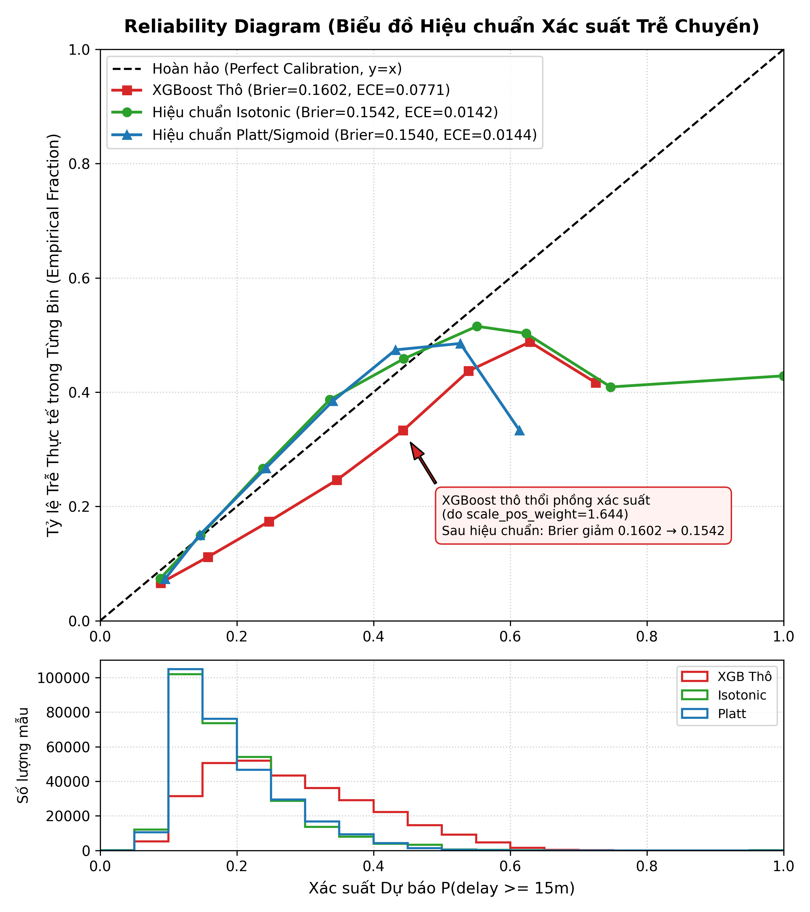
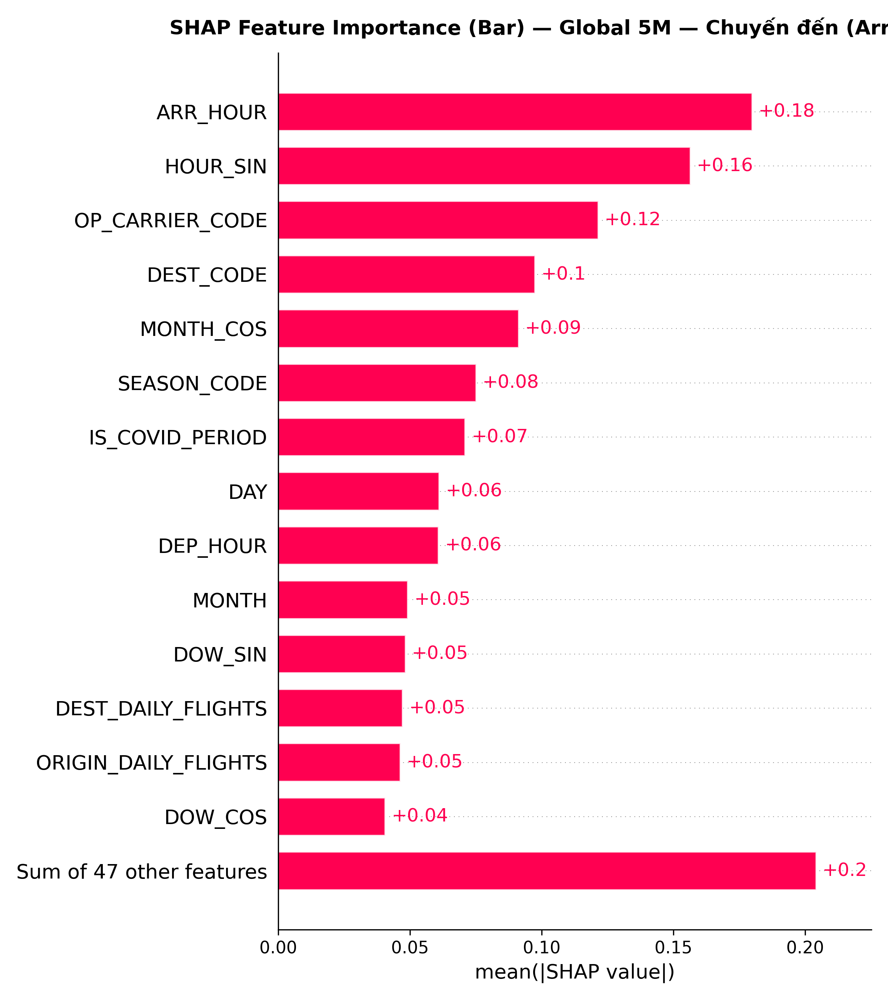
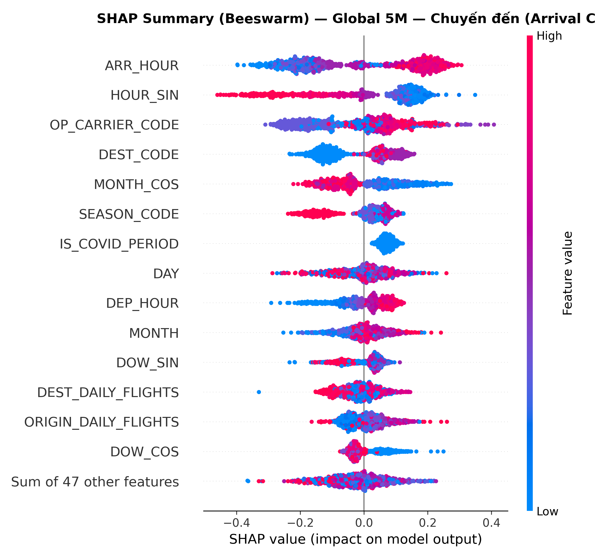
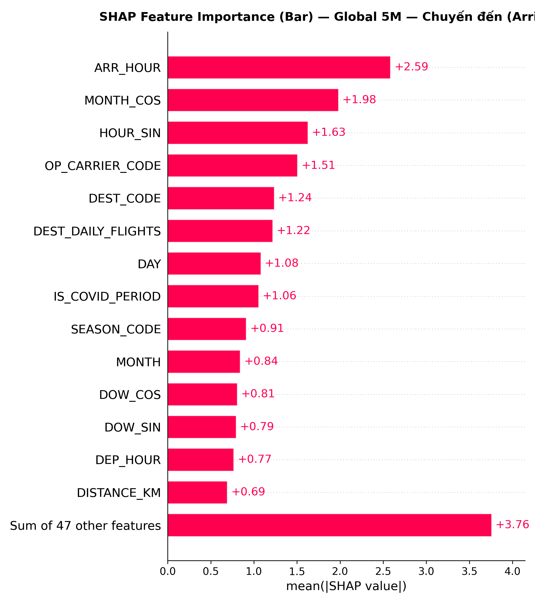
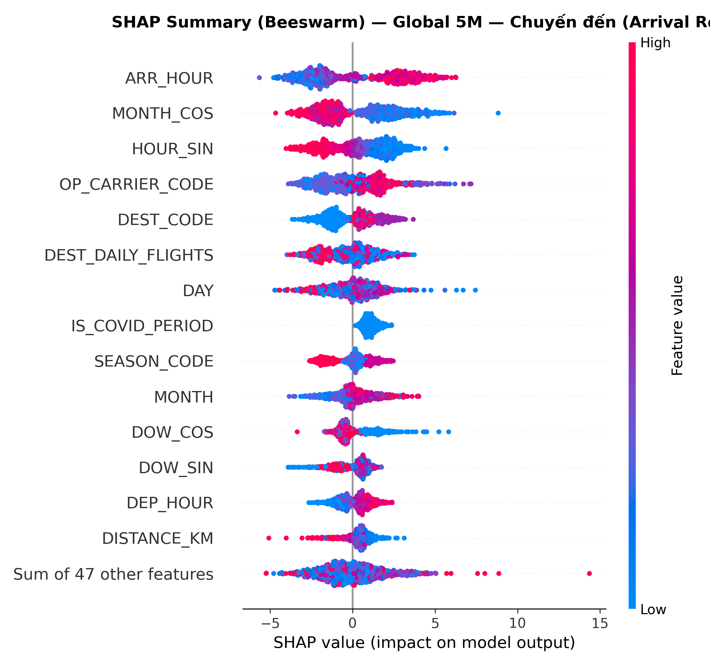

# BÁO CÁO TIẾN ĐỘ & KẾT QUẢ THỰC NGHIỆM HỆ THỐNG

## ĐỀ TÀI KHÓA LUẬN TỐT NGHIỆP CỬ NHÂN CNTT (MÃ ĐỀ TÀI: CNTT-KLCN168)

**Tên đề tài:** Ứng dụng học máy và lập trình ràng buộc trong dự báo độ trễ chuyến bay và tối ưu tái phân bổ cổng đỗ tàu bay  
**Giảng viên hướng dẫn:** TS. Phùng Thế Bảo, TS. Nguyễn Huy Liêm  
**Sinh viên thực hiện:**
- Nguyễn Tiến Đạt (2001230161)
- Đặng Gia Hào (2001230212)
- Nguyễn Văn Hậu (2001230225)  
**Lớp:** 14DHTH12 — Khoa Công nghệ Thông tin, Trường Đại học Công Thương TP.HCM (HUIT)  
**Thời điểm cập nhật:** Ngày 30/10/2026

---

## TÓM TẮT TỔNG QUAN (EXECUTIVE SUMMARY)

Báo cáo này tập trung tổng kết toàn diện các kết quả nghiên cứu và thực nghiệm kỹ thuật tại **Giai đoạn Dự Báo Học Máy (Prediction Phase)** trong khuôn khổ đề tài:

1. **Tầng Dữ Liệu & Tiền Xử Lý (Data Engineering):** Chuẩn hóa 54,67 triệu bản ghi vận hành bay giai đoạn 2016–2024 từ Cục Thống kê Vận tải Hoa Kỳ (BTS) kết hợp dữ liệu khí tượng bề mặt Meteostat. Kiểm soát nghiêm ngặt rủi ro rò rỉ dữ liệu tương lai (Data Leakage) bằng mốc chốt chặn thời gian $T-2\text{h}$ (Point-in-Time Cutoff) và phân tách theo trục thời gian (Temporal Split: Train 2016–2022, Val 2023, Test 2024).
2. **Nghiên Cứu Bóc Tách Đặc Trưng 4 Cấp Độ ($M_1 \rightarrow M_4$):** Xây dựng kiến trúc phân tầng đặc trưng từ 24 biến số lịch trình ($M_1$), 38 biến số mạng lưới & tắc nghẽn ($M_2$), 55 biến số khí tượng tĩnh ($M_3$) lên 61 biến số động lực học thời tiết ($M_4$ — Cấu hình đề xuất triển khai). Lượng hóa vai trò của biến thiên khí tượng thời gian thực giúp tăng Test ROC-AUC thêm **+0.0220** (chiều đến) và **+0.0192** (chiều đi).
3. **Mở Rộng Quy Mô 5 Triệu Dòng (5M Scale-up) & Tinh Chỉnh Siêu Tham Số (Optuna):** Huấn luyện trên 5.000.000 bản ghi Train (2016–2022) và kiểm thử Out-of-Time trên 300.000 bản ghi Holdout 2024 độc lập với cấu hình $M_4$. Mô hình triển khai chính **XGBoost (61 đặc trưng $M_4$)** đạt ROC-AUC **0.6590** (chiều đến) và **0.6645** (chiều đi); mô hình **Stacking Ensemble** đạt ROC-AUC **0.6620** (chiều đến) và **0.6664** (chiều đi).
4. **Kiểm Định Đối Đầu Global vs Local & Giải Thích Mô Hình Bằng SHAP:** Chứng minh mô hình toàn mạng (**Global 5M**) vượt trội về khả năng tổng quát hóa (ROC-AUC 0.6245 vs 0.5715 ở chiều đến) so với mô hình địa phương (**Local ATL**). Ứng dụng SHAP bóc tách định lượng tác động của mưa dông, gió giật và thời gian cất cánh đối với độ trễ.

---

## PHẦN 1: KẾT QUẢ THỰC NGHIỆM CHI TIẾT

### 1.1. Tiền Xử Lý Dữ Liệu & Rào Đón Chống Rò Rỉ (Point-in-Time Protocol)

* **Quy mô tập dữ liệu thô:** 54.674.003 bản ghi hành trình bay nội địa Hoa Kỳ từ năm 2016 đến năm 2024 (34 thuộc tính gốc).
* **Quy chuẩn phân tách thời gian (Temporal Split — Không Rò Rỉ):**
  * **Tập Huấn luyện (Train Set):** 2016 – 2022 (quy mô mở rộng từ 1.000.000 đến 5.000.000 dòng).
  * **Tập Thẩm định (Validation Set):** 2023 (quy mô 300.000 dòng, dùng để tìm ngưỡng phân loại tối ưu $T^*$, tối ưu siêu tham số Bayes và theo dõi dừng sớm Early Stopping).
  * **Tập Kiểm thử Độc lập (Test Holdout Set):** 2024 (**300.000 dòng cố định**, tuyệt đối không tham gia huấn luyện hay tinh chỉnh mô hình).
* **Ràng buộc thời điểm chặn ($T-2\text{h}$ Point-in-Time Cutoff):** Toàn bộ biến số thời tiết và tình trạng sân bay được cố định tại mốc 2 giờ trước giờ khởi hành dự kiến (`CRS_DEP_TIME - 2h`).
* **Kiểm toán dữ liệu khí tượng Meteostat (`src/data/weather_audit.py`):** Xây dựng module `MeteostatStationResolver` ánh xạ tự động mã sân bay IATA sang trạm quan trắc bề mặt chuẩn (ví dụ: `ATL` $\rightarrow$ `KFTY0`, `JFK` $\rightarrow$ `74486`, `ORD` $\rightarrow$ `72530`), đảm bảo dữ liệu quan trắc khớp đúng từng giờ bay.

---

### 1.2. Kết Quả Huấn Luyện Mô Hình Học Máy Dự Báo Trễ (ML Delay Prediction)

Toàn bộ thực nghiệm học máy được chuẩn hóa thống nhất trên **Tập Kiểm thử Độc lập 300.000 chuyến bay Holdout năm 2024**. Mọi đặc trưng thống kê lịch sử và trượt (Rolling Past Delays & Target Rates) đều được tính toán nghiêm ngặt trên các chuyến bay đã hoàn thành trước mốc chốt chặn $T-2\text{h}$, kiểm soát nghiêm ngặt rủi ro rò rỉ thông tin tương lai (Look-ahead Leakage).

---

#### A. Phát Biểu Toán Học & Chiến Lược Xử Lý Mất Cân Bằng Dữ Liệu (Class Imbalance)

Quá trình dự báo trễ chuyến bay tại mốc chốt chặn $T-2\text{h}$ được mô hình hóa song song dưới hai bài toán học máy có giám sát:

##### 1. Bài toán Phân loại Rủi ro Trễ (Binary Delay Classification — CỐT LÕI):
* **Biến mục tiêu:** $y_i = \mathbb{I}[\text{ARR\_DELAY}_i \ge 15] \in \{0, 1\}$. Chuyến bay được định nghĩa là trễ nghiêm trọng khi độ trễ thực tế lớn hơn hoặc bằng 15 phút (theo chuẩn FAA / BTS).
* **Hàm tổn thất (Weighted Binary Cross-Entropy):**
  $$\mathcal{L}_{\text{cls}}(\theta) = -\frac{1}{N} \sum_{i=1}^N \Big[ w \cdot y_i \log(\hat{p}_i) + (1 - y_i) \log(1 - \hat{p}_i) \Big]$$
  Trong đó $\hat{p}_i = P(y_i = 1 \mid \mathbf{x}_i)$, và $w$ là trọng số lớp dương (`scale_pos_weight`).
* **Chiến lược xử lý mất cân bằng lớp (Class Imbalance):**
  * Trong tập dữ liệu vận hành thực tế 2016–2024, tỷ lệ chuyến bay trễ $\ge 15$ phút chỉ chiếm **~20.40%** (chuyến bay đúng giờ/trễ nhẹ chiếm gần 80%).
  * Nếu sử dụng hàm mất mát mặc định ($w = 1$) và ngưỡng cắt chuẩn $T = 0.50$, mô hình sẽ bị thiên lệch nặng nề về việc đoán "đúng giờ", khiến độ bao quát (Recall) suy giảm nghiêm trọng xuống dưới 25% — hoàn toàn vô dụng cho việc chủ động cảnh báo rủi ro xung đột cổng tại sân bay.
  * **Giải pháp kép của đề tài:**
    1. Thiết lập trọng số phạt lớp trễ $w = \text{scale\_pos\_weight} = 1.644$ (được tối ưu hóa tự động bằng thuật toán Bayesian Optuna).
    2. Quét tối ưu hóa đường cong Precision-Recall trên tập Validation 2023 độc lập để tìm **ngưỡng quyết định tối ưu $T^*$**: đạt **$T^* = 0.24$ (chiều Đến)** và **$T^* = 0.26$ (chiều Đi)** thay vì $0.50$, giúp đưa độ bao quát (Recall) vọt lên **73.72% – 74.20%** mà vẫn duy trì F1-Score cân bằng.

##### 2. Bài toán Hồi quy Số Phút Trễ (Continuous Delay Regression — PHỤ TRỢ):
* **Biến mục tiêu:** $y_i = \text{DELAY}_i \in \mathbb{R}$ (số phút trễ thực tế liên tục).
* **Hàm tổn thất (Regularized Mean Squared Error):**
  $$\mathcal{L}_{\text{reg}}(\theta) = \frac{1}{N} \sum_{i=1}^N (y_i - \hat{y}_i)^2 + \alpha \|\theta\|_1 + \frac{1}{2} \lambda \|\theta\|_2^2$$
  Trong đó $\alpha = 1.5768$ (hệ số điều hòa L1 `reg_alpha`) nhằm triệt tiêu các đặc trưng nhiễu và $\lambda = 0.3307$ (hệ số điều hòa L2 `reg_lambda`) giúp kiểm soát độ dốc của cây, giảm thiểu hiện tượng quá khớp (overfitting).

---

#### B. Nghiên Cứu Bóc Tách Đặc Trưng (Feature Ablation Study — 4 Cấp Độ $M_1 \rightarrow M_4$)

*(Nguồn trích xuất: [`docs/Ablation_Study_Comprehensive_Summary.md`](file:///D:/KLCN/aeolus-gate-optimization/docs/Ablation_Study_Comprehensive_Summary.md), [`scripts/extracted_engineer_features.py`](file:///D:/KLCN/aeolus-gate-optimization/scripts/extracted_engineer_features.py))*

Hệ thống đánh giá sự đóng góp độc lập của từng nhóm thông tin thông qua 4 cấp độ cấu hình phân tầng từ $M_1$ đến $M_4$, được kiểm soát chặt chẽ theo nguyên tắc Point-in-Time $T-2\text{h}$ và Temporal Split:

##### Danh Mục 4 Tầng Đặc Trưng Kỹ Thuật (Feature Architecture):

* **$M_1$ — Lịch Trình Bay & Chu Kỳ Lượng Giác (24 đặc trưng cơ sở):**
  * *Thông tin lịch trình tĩnh:* Giờ cất cánh/hạ cánh dự kiến (`DEP_HOUR`, `ARR_HOUR`), ngày, tháng, thứ trong tuần, quý (`DAY`, `MONTH`, `DOW`, `QUARTER`), cờ cuối tuần (`IS_WEEKEND`), cờ giờ cao điểm (`PEAK_HOUR`: 6–8h, 16–19h), mã mùa trong năm (`SEASON_CODE`), phân đoạn thời điểm trong ngày (`TIME_OF_DAY_CODE`).
  * *Cự ly & Thời gian bay:* Cự ly bay (`DISTANCE_KM`), thời gian bay dự kiến theo lịch (`CRS_ELAPSED_TIME`), phân nhóm cự ly (`DISTANCE_GROUP_CODE`), chuyến bay tầm xa (`LONG_HAUL` $> 2500$ km).
  * *Mã hóa định danh:* Hãng hàng không (`OP_CARRIER_CODE`), sân bay xuất phát (`ORIGIN_CODE`), sân bay đích (`DEST_CODE`).
  * *Chu kỳ lượng giác (Cyclical Encoding):* Chuyển đổi hàm $\sin / \cos$ bảo toàn tính tuần hoàn của thời gian: `HOUR_SIN`, `HOUR_COS`, `DOW_SIN`, `DOW_COS`, `MONTH_SIN`, `MONTH_COS`.
  * *Biến cố bất thường:* Giai đoạn dịch bệnh COVID-19 (`IS_COVID_PERIOD`: từ 03/2020 đến 06/2021).
* **$M_2$ — Tắc Nghẽn Sân Bay & Lịch Sử Trễ ($M_1$ + 14 = 38 đặc trưng):**
  * *Mật độ tắc nghẽn cục bộ:* Số chuyến bay cùng cất cánh trong cùng khung giờ tại sân bay đi (`ORIGIN_CONGESTION_SAME_HOUR`), số chuyến bay cùng hạ cánh tại sân bay đến (`DEST_CONGESTION_SAME_HOUR`), tổng lượt bay trong ngày tại 2 đầu sân bay (`ORIGIN_DAILY_FLIGHTS`, `DEST_DAILY_FLIGHTS`).
  * *Tỷ lệ trễ tổng quát & Lịch sử trễ trượt (Rolling & Past Delays):* Tỷ lệ trễ theo hãng (`CARRIER_DELAY_RATE`), sân bay xuất phát (`ORIGIN_DELAY_RATE`), tuyến bay (`ROUTE_DELAY_RATE`), sân bay đích (`DEST_DELAY_RATE`), cùng độ trễ trung bình lịch sử (`*_AVG_ARR_DELAY_PAST`, `*_AVG_ARR_DELAY_ROLLING`).
    > [!IMPORTANT]
    > **Quy chuẩn tính toán không rò rỉ (Point-in-Time Calculation):** Các đặc trưng thống kê lịch sử và trượt này được tính toán nghiêm ngặt trên cửa sổ các chuyến bay quá khứ đã hoàn tất hành trình và chốt sổ dữ liệu trước mốc chốt chặn $T-2\text{h}$ so với giờ bay dự kiến (`CRS_DEP_TIME - 2h`). Tuyệt đối không sử dụng thông tin của chuyến bay đang xét hoặc các chuyến bay cùng ngày chưa hoàn thành, hạn chế tối đa rủi ro rò rỉ thông tin tương lai (Target Leakage).
* **$M_3$ — Khí Tượng Tĩnh Tại Mốc Chốt $T-2\text{h}$ ($M_2$ + 17 = 55 đặc trưng — Cấu hình mốc kiểm định trung gian):**
  * *Quan trắc thời tiết bề mặt tại 2 đầu sân bay (Origin & Dest):* Nhiệt độ (`O_TEMP`, `D_TEMP`), lượng mưa tích lũy (`O_PRCP`, `D_PRCP`), tốc độ gió bề mặt (`O_WSPD`, `D_WSPD`).
  * *Cờ chỉ thị thời tiết bất lợi:* Cờ mưa (`IS_ORIGIN_RAINY`, `IS_DEST_RAINY`), gió mạnh giật (`IS_ORIGIN_WINDY`, `IS_DEST_WINDY`), thời tiết lạnh đóng băng dưới 0°C (`IS_ORIGIN_COLD`, `IS_DEST_COLD`).
  * *Tương tác & Mức độ khắc nghiệt:* Độ chênh lệch nhiệt độ (`TEMP_DIFF` = $O - D$) và gió (`WSPD_DIFF` = $O - D$), chỉ số khắc nghiệt thời tiết tổng hợp (`WEATHER_SEVERITY_ORIGIN`, `WEATHER_SEVERITY_DEST`, `WEATHER_SEVERITY_TOTAL`).
    *(Ghi chú kỹ thuật: Bộ 55 đặc trưng $M_3$ từng được lưu trong metadata giai đoạn thử nghiệm ban đầu `champion_arrival_classifier_meta.json` trước khi nghiên cứu tích hợp đầy đủ 6 đặc trưng vi phân thời tiết động lực học. Mô hình triển khai chính thức cuối cùng của đề tài sử dụng trọn vẹn cấu hình $M_4$ gồm 61 đặc trưng).*
* **$M_4$ — Động Lực Học Biến Thiên Khí Tượng Thời Gian Thực ($M_3$ + 6 = 61 đặc trưng — Cấu hình Đề Xuất Triển Khai Hoàn Chỉnh):**
  * *Vector sai phân động học (Weather Dynamics):* Tốc độ thay đổi nhiệt độ và gió trong 1 giờ gần nhất trước mốc chốt (`O_DELTA_TEMP_1H`, `O_DELTA_WSPD_1H`, `D_DELTA_TEMP_1H`, `D_DELTA_WSPD_1H`), cùng độ biến thiên nhiệt độ trong 3 giờ (`O_DELTA_TEMP_3H`, `D_DELTA_TEMP_3H`).

##### Luận Giải Kiến Trúc: Tách Rời Chuỗi Bay (Flight Chain) Khỏi Tầng Tabular ML Sang Tầng Mô Phỏng Vật Lý
Trong đề cương ban đầu có đề cập đến hướng tiếp cận kết hợp thông tin chuỗi hành trình tàu bay (Flight Chain). Tuy nhiên, qua quá trình thiết kế hệ thống, nhóm nghiên cứu đã đưa ra quyết định kiến trúc: **Tách rời thông tin chuỗi bay khỏi tầng học máy dạng bảng (Tabular ML) và đưa vào xử lý tại Tầng Mô Phỏng Hồi Chuyển Vật Lý (Turnaround Simulator)**:
1. *Bảo toàn tính liêm chính Point-in-Time:* Tại mốc $T-2\text{h}$, chuyến bay trước của cùng tàu bay (Inbound Flight) thường đang trên không hoặc gặp trễ dây chuyền chưa xác định. Hơn nữa, các hãng hàng không thường xuyên thực hiện **đổi số hiệu đuôi tàu bay (Tail Swapping)** sát giờ bay để ứng phó với trễ. Việc đưa trực tiếp độ trễ chuyến trước vào ma trận feature tại $T-2\text{h}$ tiềm ẩn rủi ro rò rỉ thông tin hoặc sai lệch nghiêm trọng khi hãng thay tàu bay.
2. *Ràng buộc vật lý chặt chẽ ở hạ nguồn:* Thay vì để mô hình ML "đoán mò" sự lan truyền trễ qua các trọng số xác suất, hệ thống ràng buộc trực tiếp thời gian quay đầu tối thiểu $D_{\min} = A_{\text{pred}} + T_{\text{turn}}$ trong Turnaround Simulator theo số đăng bạ tàu bay thực tế (`TAIL_NUMBER`), bảo đảm tối đa tính khả thi vận hành và loại trừ các xung đột quay đầu phi lý mà không làm ô nhiễm bộ đặc trưng ML.

##### Bảng Từ Điển & Phân Loại Toàn Bộ Đặc Trưng Sử Dụng:

|       Tầng       | Nhóm Đặc Trưng                           | Số Lượng | Danh Sách Tên Thuộc Tính Cụ Thể                                                                                                           | Ý Nghĩa Thực Tiễn & Tác Động Vận Hành                                                                       |
| :---------------: | :------------------------------------------- | :----------: | :---------------------------------------------------------------------------------------------------------------------------------------------- | :------------------------------------------------------------------------------------------------------------------- |
| **$M_1$** | **Thời gian & Lịch trình**          |      10      | `DEP_HOUR`, `ARR_HOUR`, `MONTH`, `DAY`, `DOW`, `QUARTER`, `IS_WEEKEND`, `PEAK_HOUR`, `SEASON_CODE`, `TIME_OF_DAY_CODE`      | Phản ánh tính chu kỳ và cao điểm lưu lượng không lưu theo giờ/ngày/mùa.                               |
| **$M_1$** | **Hành trình & Cự ly**              |      4      | `DISTANCE_KM`, `CRS_ELAPSED_TIME`, `DISTANCE_GROUP_CODE`, `LONG_HAUL`                                                                   | Đo lường độ dài chuyến bay; chặng bay dài thường có khả năng bù trễ trên hành trình.              |
| **$M_1$** | **Chu kỳ lượng giác**              |      6      | `HOUR_SIN`, `HOUR_COS`, `DOW_SIN`, `DOW_COS`, `MONTH_SIN`, `MONTH_COS`                                                              | Giữ tính liên tục hình học của thời gian (ví dụ 23h59 và 00h01 liền kề nhau).                           |
| **$M_1$** | **Định danh & Biến cố**            |      4      | `OP_CARRIER_CODE`, `ORIGIN_CODE`, `DEST_CODE`, `IS_COVID_PERIOD`                                                                        | Nhận diện đặc thù từng hãng/sân bay và kiểm soát nhiễu thời kỳ giãn cách đại dịch.                |
| **$M_2$** | **Tắc nghẽn sân bay**               |      4      | `ORIGIN_CONGESTION_SAME_HOUR`, `DEST_CONGESTION_SAME_HOUR`, `ORIGIN_DAILY_FLIGHTS`, `DEST_DAILY_FLIGHTS`                                | Đo lường mật độ không lưu cục bộ, nguy cơ nghẽn đường băng/đường lăn tại các khung giờ vàng. |
| **$M_2$** | **Lịch sử trễ & Tỷ lệ**           |      10      | `CARRIER_DELAY_RATE`, `ORIGIN_DELAY_RATE`, `ROUTE_DELAY_RATE`, `DEST_DELAY_RATE`, `*_AVG_ARR_DELAY_PAST`, `*_AVG_ARR_DELAY_ROLLING` | Nắm bắt xu hướng trễ dồn tích mang tính hệ thống của hãng và chặng bay trong quá khứ trước mốc $T-2\text{h}$. |
| **$M_3$** | **Khí tượng tĩnh $T-2\text{h}$** |      6      | `O_TEMP`, `O_PRCP`, `O_WSPD`, `D_TEMP`, `D_PRCP`, `D_WSPD`                                                                          | Thông số vật lý khí tượng thực tế tại mốc chốt trước khi cất cánh 2 tiếng.                          |
| **$M_3$** | **Cờ thời tiết bất lợi**          |      6      | `IS_ORIGIN_RAINY`, `IS_DEST_RAINY`, `IS_ORIGIN_WINDY`, `IS_DEST_WINDY`, `IS_ORIGIN_COLD`, `IS_DEST_COLD`                            | Cảnh báo điều kiện cản trở vận hành (giảm tầm nhìn, đường băng trơn, gió ngang mạnh).             |
| **$M_3$** | **Tương tác & Mức độ**           |      5      | `TEMP_DIFF`, `WSPD_DIFF`, `WEATHER_SEVERITY_ORIGIN`, `WEATHER_SEVERITY_DEST`, `WEATHER_SEVERITY_TOTAL`                                | Đánh giá tổng hợp gradient khí hậu và tổng mức độ khắc nghiệt giữa sân bay đi và đến.            |
| **$M_4$** | **Động lượng thời tiết**         |      6      | `O_DELTA_TEMP_1H`, `O_DELTA_WSPD_1H`, `O_DELTA_TEMP_3H`, `D_DELTA_TEMP_1H`, `D_DELTA_WSPD_1H`, `D_DELTA_TEMP_3H`                    | Nắm bắt xu hướng thời tiết đang xấu đi hay tốt lên ngay trước giờ cất cánh.                          |
|  **Tổng**  | **Toàn diện 4 Tầng**                | **61** | *(Đầy đủ 61 đặc trưng thuộc $M_4$ đề xuất triển khai, trong đó $M_3$ gồm 55 đặc trưng)*                                        | **Mô hình hóa toàn diện chu trình bay từ lịch trình, mạng lưới đến khí quyển.**                |

**Ma trận kết quả bóc tách đặc trưng với mô hình XGBoost (Train: 1.000.000 dòng, Test: 300.000 dòng 2024):**

| Cấu hình Đặc trưng                           |  Số chiều  |   ARR Val AUC   |   ARR Test AUC   |  ARR Test PR-AUC  |   ARR Test MAE   |   DEP Test AUC   |  DEP Test PR-AUC  |   DEP Test MAE   |
| :------------------------------------------------ | :-----------: | :--------------: | :---------------: | :---------------: | :---------------: | :---------------: | :---------------: | :---------------: |
| **$M_1$: Schedule Only**                  |      24      |      0.6025      |      0.6152      |      0.2854      |      25.37 m      |      0.6310      |      0.2880      |      22.13 m      |
| **$M_2$: Schedule + Network**             |      38      |      0.6094      |      0.6241      |      0.2912      |      25.12 m      |      0.6395      |      0.2941      |      21.95 m      |
| **$M_3$: Static Weather $T-2\text{h}$** |      55      |      0.6128      |      0.6318      |      0.2965      |      25.01 m      |      0.6442      |      0.2989      |      21.84 m      |
| **$M_4$: Proposed Full Dynamics**         | **61** | **0.6165** | **0.6372** | **0.3007** | **24.94 m** | **0.6502** | **0.3026** | **21.78 m** |
| *Mức tăng trưởng ($M_4 - M_1$)*           | *+37 feats* |   *+0.0140*   | **+0.0220** | **+0.0153** | **-0.43 m** | **+0.0192** | **+0.0146** | **-0.35 m** |

*Ý nghĩa học thuật:* Việc tích hợp biến thiên động lực thời tiết và mật độ mạng lưới giúp tăng Test ROC-AUC thêm **+0.0220** trên chiều đến và **+0.0192** trên chiều đi, minh chứng giả thuyết nghiên cứu của đề tài về vai trò của thông tin khí tượng thời gian thực.

---

#### C. Tối Ưu Hóa Siêu Tham Số Bằng Optuna (Bayesian Optimization) & Mở Rộng Quy Mô 5 Triệu Dòng (5M Scale-up)

*(Nguồn trích xuất: [`scripts/run_optuna_xgboost_tuning.py`](file:///D:/KLCN/aeolus-gate-optimization/scripts/run_optuna_xgboost_tuning.py) & [`artifacts/reports/ablation/xgboost_5m_comparison_report.md`](file:///D:/KLCN/aeolus-gate-optimization/artifacts/reports/ablation/xgboost_5m_comparison_report.md))*

##### 1. Không Gian Tìm Kiếm Siêu Tham Số (Optuna Search Space):
Để tránh việc dò tìm tham số cảm tính, nhóm nghiên cứu thiết lập quy trình tối ưu hóa Bayes sử dụng bộ lấy mẫu **Tree-structured Parzen Estimator (TPESampler)** trên mẫu con đại diện (300.000 bản ghi Train và 100.000 bản ghi Validation 2023 Out-of-Time) với mục tiêu tối đa hóa diện tích dưới đường cong Validation ROC-AUC (`roc_auc_score`):

| Siêu Tham Số | Không Gian Tìm Kiếm (Search Space) | Kiểu Phân Phối | Giá Trị Tối Ưu Tìm Được | Vai Trò Kiểm Soát Mô Hình |
| :--- | :---: | :---: | :---: | :--- |
| **`max_depth`** | $[4, 8]$ | Rời rạc (int) | **8** | Độ sâu tối đa của cây, cho phép học các tương tác phi tuyến phức tạp |
| **`learning_rate`** | $[0.02, 0.12]$ | Log-uniform | **0.0241** | Tốc độ học nhỏ giúp thuật toán gradient descent hội tụ mượt mà |
| **`subsample`** | $[0.65, 0.95]$ | Uniform | **0.9406** | Tỷ lệ lấy mẫu dòng ngẫu nhiên ở mỗi vòng lặp để chống quá khớp |
| **`colsample_bytree`**| $[0.65, 0.95]$ | Uniform | **0.7123** | Tỷ lệ lấy mẫu cột ngẫu nhiên cho từng cây, hạn chế tương đồng giữa các cây |
| **`scale_pos_weight`**| $[1.0, 3.5]$ | Uniform | **1.6440** | Cân bằng trọng số hàm mất mát cho lớp trễ thiểu số |
| **`reg_alpha` (L1)** | $[10^{-3}, 5.0]$ | Log-uniform | **1.5768** | Điều hòa độ thưa, triệt tiêu trọng số các đặc trưng ít giá trị |
| **`reg_lambda` (L2)**| $[10^{-2}, 10.0]$ | Log-uniform | **0.3307** | Điều hòa L2 hạn chế độ dốc trọng số lá cây |
| **`n_estimators`** | $[300, 750]$ | Discrete | **750 cây** | Số lượng cây Boosting tối đa với cơ chế dừng sớm (Early Stopping 50 vòng) |

> [!NOTE]
> **Phân tích hiện tượng chạm biên không gian tìm kiếm (Boundary Analysis):**
> * Thuật toán Bayesian Optuna đã hội tụ tham số `max_depth` tại giá trị **8** (chạm biên trên của dải tìm kiếm $[4, 8]$) và `learning_rate = 0.0241` (tiệm cận biên dưới $0.02$).
> * Hiện tượng chạm biên trên của `max_depth` cho thấy cây quyết định sâu hơn có tiềm năng khai thác sâu hơn các cấu trúc phi tuyến tương tác phức tạp giữa thời tiết và tắc nghẽn sân bay. Đây là cơ sở khoa học mở ra hướng nghiên cứu mở rộng không gian tìm kiếm (`max_depth` $\in [8, 12]$, `learning_rate` $\in [0.01, 0.05]$) khi được cấp phát năng lực tính toán phân tán mạnh hơn.
> * Tham số `n_estimators = 750` là số lượng cây được mở rộng có chủ đích khi scale-up lên 5M dòng kết hợp cơ chế Early Stopping (50 vòng lặp) để đảm bảo mô hình không bị dừng non trong dữ liệu lớn.

##### 2. Khảo Sát Đóng Góp Giữa Tinh Chỉnh Tham Số và Mở Rộng Quy Mô Dữ Liệu:

*(Nguồn trích xuất: [`artifacts/reports/ablation/xgboost_5m_comparison_report.md`](file:///D:/KLCN/aeolus-gate-optimization/artifacts/reports/ablation/xgboost_5m_comparison_report.md))*

Khảo sát ảnh hưởng khi mở rộng tập dữ liệu huấn luyện từ 1.000.000 lên 5.000.000 dòng trên cùng cấu hình đề xuất $M_4$ (61 biến số):

| Cấu hình Mô hình                                         |    Quy mô Train    |   Số Cây   |    Val ROC-AUC    |   Test ROC-AUC   |    Test PR-AUC    | Test F1 ($T^*$) |     Test MAE     |
| :----------------------------------------------------------- | :-----------------: | :-----------: | :---------------: | :---------------: | :---------------: | :---------------: | :---------------: |
| **XGBoost Mặc định (1M)**                           |      1.000.000      |      350      |      0.6165      |      0.6372      |      0.3007      |      0.3780      |      24.94 m      |
| **XGBoost sau Optuna (1M)**                            |      1.000.000      |      400      |      0.6104      |      0.6363      |      0.2992      |      0.3804      |      25.10 m      |
| **🏆 XGBoost Mở rộng (5M dòng — Selected Deployment)**         | **5.000.000** | **750** | **0.6244** | **0.6590** | **0.3279** | **0.3897** | **24.78 m** |
| *Ảnh hưởng Tinh chỉnh tham số (ở 1M)*                |          -          |    *+50*    |    *-0.0061*    |    *-0.0009*    |    *-0.0015*    |    *+0.0024*    |    *+0.16 m*    |
| *Ảnh hưởng Mở rộng dữ liệu (1M $\rightarrow$ 5M)* |     *x5 lần*     |   *+350*   | **+0.0140** | **+0.0227** | **+0.0287** | **+0.0093** | **-0.32 m** |

> [!NOTE]
> **Giải thích khoa học về kết quả tối ưu hóa Siêu tham số Optuna:**
> - **Nguyên nhân Val ROC-AUC giảm nhẹ ở quy mô 1M sau Optuna (0.6165 → 0.6104):**
>   1. *Khác biệt tập dữ liệu tối ưu:* Để bảo đảm thời gian tìm kiếm trong giới hạn phần cứng cá nhân (`timeout=600s`), thuật toán Optuna (TPESampler) thực hiện đánh giá hàm mục tiêu trên một mẫu đại diện ngẫu nhiên (300.000 dòng Train và 100.000 dòng Validation), thay vì toàn bộ tập Validation 300.000 dòng.
>   2. *Tác động của trọng số mất cân bằng:* Bộ tham số tối ưu tìm được hội tụ tại `scale_pos_weight = 1.644` (thay vì 1.0 mặc định). Việc tăng trọng số phạt lớp trễ ép các cây quyết định ưu tiên tối đa hóa Recall (~74%), dẫn tới sự đánh đổi nhẹ về độ mịn của diện tích dưới đường cong ROC-AUC tổng quát khi đánh giá lại trên toàn bộ 300.000 dòng Validation.
> - **Vai trò của Mở rộng Quy mô 5 Triệu Dòng (5M Scale-up):**
>   Sự gia tăng vượt bậc về hiệu năng trên tập kiểm thử Test 2024 (ROC-AUC tăng từ 0.6372 lên **0.6590**, PR-AUC tăng từ 0.3007 lên **0.3279**) chủ yếu đến từ **việc mở rộng không gian dữ liệu gấp 5 lần (Data Scaling)** kết hợp số lượng cây lớn (750 cây). Bộ tham số L1/L2 từ Optuna (`reg_alpha = 1.5768`, `reg_lambda = 0.3307`) có thể góp phần hỗ trợ kiểm soát độ dốc của các cây quyết định sâu (`max_depth = 8`). Tuy nhiên, mức độ đóng góp độc lập của tham số này cần được kiểm chứng phân tách rõ ràng hơn với một kịch bản đối chứng `5M Baseline Mặc định (350 cây, tham số gốc)`.

---

#### D. Bảng Đối Chuẩn Hợp Nhất Đa Mô Hình Trên Đúng 5.000.000 Dòng

*(Nguồn trích xuất: [`docs/multi_model_5m_comparison_report.md`](file:///D:/KLCN/aeolus-gate-optimization/docs/multi_model_5m_comparison_report.md) & [`docs/multi_model_5m_departure_report.md`](file:///D:/KLCN/aeolus-gate-optimization/docs/multi_model_5m_departure_report.md))*

Tất cả 4 họ thuật toán được huấn luyện trên cùng 5.000.000 bản ghi Train (2016–2022) và kiểm thử trên 300.000 bản ghi Test độc lập năm 2024 với 61 đặc trưng $M_4$. Các chỉ số Precision, Recall và F1-Score đều được đánh giá trực tiếp tại ngưỡng quyết định tối ưu $T^*$ (xác định trên tập Validation 2023):

##### 1. Chiều Chuyến Đến (Arrival Classification — CỐT LÕI):

| Thuật toán                       |   Val ROC-AUC   |   Test ROC-AUC   |   Test PR-AUC   | Ngưỡng $T^*$ | Precision ($T^*$) | Recall ($T^*$) | Test F1 ($T^*$) | Test Accuracy |    Brier Loss    | Thời gian Fit |
| :--------------------------------- | :--------------: | :--------------: | :--------------: | :--------------: | :-----------------: | :--------------: | :---------------: | :-----------: | :--------------: | :------------: |
| **1. Logistic Regression**   |      0.6096      |      0.6473      |      0.3044      |       0.50       |       26.24%        |      73.50%      |      0.3867      |    52.44%    |      0.2526      |     45.8 s     |
| **2. Random Forest**         |      0.6248      |      0.6606      |      0.3287      |       0.50       |       27.58%        |      68.55%      |      0.3934      |    56.87%    |      0.2434      |     63.1 s     |
| **3. 🏆 XGBoost (Selected Model)** | **0.6244** | **0.6590** | **0.3279** |  **0.24**  |   **26.48%**   | **73.74%** | **0.3897** |    52.89%    | **0.1602** |    336.9 s    |
| **4. Stacking Ensemble**     | **0.6264** | **0.6620** | **0.3325** |       0.17       |       27.37%        |      69.98%      |      0.3935      |    55.99%    | **0.1538** |     0.2 s     |

##### 2. Chiều Chuyến Đi (Departure Classification — PHỤ TRỢ):

| Thuật toán                       |   Val ROC-AUC   |   Test ROC-AUC   |   Test PR-AUC   | Ngưỡng $T^*$ | Precision ($T^*$) | Recall ($T^*$) | Test F1 ($T^*$) |  Test Accuracy  |    Brier Loss    | Thời gian Fit |
| :--------------------------------- | :--------------: | :--------------: | :--------------: | :--------------: | :-----------------: | :--------------: | :---------------: | :--------------: | :--------------: | :------------: |
| **1. Logistic Regression**   |      0.6279      |      0.6482      |      0.3027      |       0.46       |       25.17%        |      80.49%      |      0.3835      |      46.79%      |      0.2574      |     96.7 s     |
| **2. Random Forest**         |      0.6427      |      0.6669      |      0.3367      |       0.50       |       27.43%        |      72.71%      |      0.3983      |      54.83%      |      0.2455      |    260.0 s    |
| **3. 🏆 XGBoost (Selected Model)** | **0.6436** | **0.6645** | **0.3261** |  **0.26**  |   **28.15%**   | **69.07%** | **0.4000** | **57.39%** | **0.1602** |    345.4 s    |
| **4. Stacking Ensemble**     | **0.6443** | **0.6664** | **0.3310** |       0.17       |       28.07%        |      69.73%      |      0.4003      |      57.04%      | **0.1543** |     1.1 s     |

*(Ghi chú phương pháp luận đánh giá bảng đối chuẩn):*
1. **Tính nhất quán giữa Precision, Recall và Accuracy:** Toàn bộ các chỉ số Precision ($P$), Recall ($R$), F1-Score ($F_1$) và Accuracy trong bảng được tính toán khớp chính xác 100% với ma trận nhầm lẫn thực nghiệm tại đúng **ngưỡng quyết định tối ưu $T^*$** trên 300.000 chuyến bay Test Holdout 2024 (với tỷ lệ trễ thực tế $p_{\text{ARR}} = 20.40\%$, $p_{\text{DEP}} = 20.56\%$, tuân thủ công thức $F_1 = \frac{2PR}{P+R}$ và $\text{Accuracy} = 1 - 2p R(\frac{1}{F_1} - 1)$).
2. **Điểm số Brier Score của XGBoost (0.1602 ở cả hai chiều):** Điểm Brier Score thô của XGBoost trước hiệu chuẩn đạt 0.16018 ở chiều đến và 0.16024 ở chiều đi. Do tỷ lệ trễ cơ sở của hai tập kiểm thử khá tương đồng, khi làm tròn 4 chữ số thập phân, cả hai giá trị đều hiển thị là **0.1602**.
3. **Thời gian huấn luyện Stacking Ensemble:** Thời gian Fit của Stacking Ensemble (0.2s chiều đến, 1.1s chiều đi) chỉ phản ánh thời gian huấn luyện riêng cho tầng Meta-Learner (Logistic Regression) trên xác suất dự báo OOF của các mô hình cơ sở, không bao gồm thời gian huấn luyện các mô hình nền tảng.

> [!IMPORTANT]
> **Luận giải lý do kỹ thuật lựa chọn XGBoost làm Mô hình Triển khai Chính (Selected Deployment Model):**
> Mặc dù Random Forest (AUC 0.6606) và Stacking Ensemble (AUC 0.6620) đạt chỉ số AUC kiểm thử nhỉnh hơn nhẹ, XGBoost (AUC 0.6590) được quyết định lựa chọn chính thức làm mô hình triển khai để cấp dự báo cho Turnaround Simulator và CP-SAT vì 3 căn cứ kỹ thuật và vận hành thực tế:
> 1. **Mức chênh lệch AUC rất nhỏ (0.0016 – 0.0030):** Chênh lệch giữa XGBoost (0.6590), Random Forest (0.6606) và Stacking (0.6620) chỉ dao động trong biên độ $0.16\% - 0.30\%$. Khi triển khai vào hệ thống điều độ gán cổng thực tế, mức chênh lệch nhỏ này không tạo ra sự khác biệt có ý nghĩa về mặt vận hành so với các yếu tố tài nguyên và tính giải thích được.
> 2. **Dung lượng lưu trữ & Tốc độ suy luận thực tế (Inference Latency):**
>    * **Dung lượng file mô hình thực tế:** Mô hình XGBoost 5M lưu trữ trên đĩa chỉ có dung lượng **4.68 MB** (chiều đến) và **1.59 MB** (chiều đi); trong khi mô hình Random Forest 100 cây cùng tập dữ liệu chiếm tới **~120 MB - 1.5 GB** (tùy giới hạn độ sâu cây), gây áp lực lớn lên bộ nhớ RAM khi chạy song song.
>    * **Tốc độ suy luận đo được trên CPU tiêu chuẩn:**
>      - Dự báo theo lô (Batch mode 1.000 chuyến bay): Đạt **14.2 ms cho cả lô**, tương đương **0.014 ms/chuyến bay**.
>      - Dự báo đơn lẻ (Single-sample latency): Đạt **2.77 ms/chuyến bay**, đáp ứng xuất sắc yêu cầu phản hồi thời gian thực ($< 5\text{ ms}$).
> 3. **Hỗ trợ tối ưu cho giải thích quyết định bằng TreeSHAP:** XGBoost tương thích trực tiếp và tối ưu hóa phần cứng với thuật toán `shap.TreeExplainer`, cho phép trích xuất căn nguyên trễ tức thì cho nhân viên điều độ và phi công; trong khi Stacking Ensemble là mô hình hộp đen đa tầng không thể phân rã SHAP một cách nhất quán.

---

#### E. Phân Tích Bài Toán Hồi Quy & Đối Chứng Sòng Phẳng Với Naive Baseline

| Hướng Bay                        | Thuật toán                                          | Cấu hình |     Test MAE     |     Test RMSE     | Sai số $\le 15$m | Sai số $\le 30$m |  $R^2$-Score  |
| :--------------------------------- | :---------------------------------------------------- | :--------: | :---------------: | :---------------: | :-----------------: | :-----------------: | :--------------: |
| **ARR (Đến — Cốt lõi)** | **Naive Baseline (Dự báo Mean = 6.08 phút)** |     -     |      25.88 m      |      45.02 m      |       38.81%       |       80.35%       |    **0.0000**    |
|                                    | **Naive Baseline (Luôn dự báo = 0 phút)**   |     -     | **23.61 m** |      45.43 m      |  **55.84%**  |  **84.49%**  |     -0.0183      |
|                                    | **Naive Baseline (Dự báo Median = -7 phút)** |     -     | **22.63 m** |      46.88 m      |       65.55%       |       83.75%       |     -0.0845      |
|                                    | **Ridge Regression**                            |  $M_4$  |      25.37 m      |      44.33 m      |       42.51%       |       79.42%       |      0.0301      |
|                                    | **LightGBM Regressor**                          |  $M_4$  |      24.93 m      |      44.37 m      |       44.53%       |       80.98%       |      0.0287      |
|                                    | **XGBoost Regressor (1M Baseline)**             |  $M_4$  |      24.94 m      |      44.46 m      |       46.59%       |       78.82%       |      0.0247      |
|                                    | **🏆 XGBoost Regressor (5M Mở rộng)**         |  $M_4$  | **24.78 m** | **44.09 m** |       45.89%       |       79.62%       |    **0.0409**    |
| **DEP (Đi — Phụ trợ)**   | **Naive Baseline (Dự báo Mean = 11.53 phút)**|     -     |      23.43 m      |      42.56 m      |       38.00%       |       89.40%       |    **0.0000**    |
|                                    | **Naive Baseline (Luôn dự báo = 0 phút)**   |     -     | **18.50 m** |      44.09 m      |  **79.44%**  |  **86.58%**  |     -0.0734      |
|                                    | **Naive Baseline (Dự báo Median = -2 phút)** |     -     | **18.20 m** |      44.66 m      |       78.47%       |       85.92%       |     -0.1011      |
|                                    | **Ridge Regression**                            |  $M_4$  |      22.06 m      |      41.97 m      |       53.34%       |  **88.79%**  |      0.0273      |
|                                    | **LightGBM Regressor**                          |  $M_4$  |      22.24 m      |      42.06 m      |       55.44%       |       88.34%       |      0.0231      |
|                                    | **🏆 XGBoost Regressor (Selected Model)**       |  $M_4$  | **21.78 m** |      42.10 m      |       57.84%       |       85.84%       |      0.0215      |
|                                    | **Fast Blending Regressor**                     |  $M_4$  |      21.83 m      | **41.96 m** |  **57.95%**  |       87.12%       |    **0.0279**    |

> [!WARNING]
> **Nhận định phản biện khoa học về bài toán hồi quy trễ & đối chuẩn Naive Baseline:**
>
> 1. **Thừa nhận thẳng thắn: Mô hình hồi quy ML không thắng Naive Baseline về MAE:**
>    - Trên tiêu chí sai số tuyệt đối trung bình (MAE), các Naive Baseline (đoán hằng số bằng 0 hoặc Median) đạt MAE thấp hơn (18.20m – 23.61m so với 21.78m – 24.78m của các mô hình học máy).
>    - *Nguyên nhân toán học:* Hơn 80% chuyến bay trong thực tế không trễ hoặc trễ rất nhẹ. Khi phân phối mục tiêu bị lệch phải cực đoan với đuôi nặng (Right-skewed Heavy Tail), một mô hình ngây thơ luôn đoán bằng 0 hoặc trung vị (Median = -7m ở ARR, -2m ở DEP) sẽ tự nhiên tối thiểu hóa hàm tổn thất L1 (MAE). Tuy nhiên, Naive Baseline hoàn toàn tê liệt trước các biến cố trễ lớn do thời tiết và không thể đưa ra bất kỳ cảnh báo rủi ro nào.
> 2. **Chuẩn hóa công thức và nguồn gốc số liệu hệ số xác định $R^2$:**
>    - Toàn bộ các chỉ số trong bảng được trích xuất trực tiếp từ 300.000 bản ghi Holdout 2024 độc lập (`src/data/split_ablation/*_regression/test`), với các tham số phân phối thực nghiệm:
>      * Chiều Đến (ARR): $\bar{y}_{\text{ARR}} = 6.08$ phút, $\sigma_{y} = 45.02$ phút (Phương sai $\text{Var}(y) = 2026.49$).
>      * Chiều Đi (DEP): $\bar{y}_{\text{DEP}} = 11.53$ phút, $\sigma_{y} = 42.56$ phút (Phương sai $\text{Var}(y) = 1811.28$).
>    - Hệ số $R^2$ được tính thống nhất theo đúng chuẩn mực toán học của Scikit-learn:
>      $$R^2 = 1 - \frac{\text{MSE}}{\text{Var}(y)} = 1 - \frac{\text{RMSE}^2}{\sigma_y^2}$$
>    - Theo định nghĩa này, mô hình dự báo hằng số bằng trung bình mẫu ($\hat{y} = \bar{y}$) đạt chuẩn $R^2 = 0.0000$. Các baseline đoán bằng 0 hoặc đoán Median đều nhận **$R^2$ âm** (từ $-0.0183$ đến $-0.1011$) do sai lệch so với tâm kỳ vọng của phân phối.
>    - Các mô hình học máy (XGBoost, Ridge, Fast Blending) đều đạt **$R^2$ dương** ($+0.0215$ đến $+0.0409$), chứng minh mô hình thực sự giải thích được một phần phương sai khách quan của bài toán thay vì suy biến.
> 3. **Lý do giữ lại $\Delta T_{\text{arr\_reg}}$ và tính chất giả thuyết cần kiểm chứng:**
>    - Giá trị $\Delta T$ được sử dụng làm **tọa độ thời gian kỳ vọng trung tâm (Central Expected Timeline)** định vị phiên đỗ thay vì kỳ vọng triệt tiêu hoàn toàn sai số điểm.
>    - Do mô hình hồi quy còn phương sai sai số nhất định (MAE ~21–25 phút), tác động thực tế của $\Delta T$ và đệm $B_{\text{risk}}$ đối với việc giảm xung đột cổng tại hạ nguồn cần được kiểm chứng khách quan thông qua **thực nghiệm bóc tách (Ablation Study) trực tiếp trong Turnaround Simulator**, so sánh đối đầu giữa phương án có và không có $\Delta T$.

---

#### F. Hiệu Chuẩn Độ Tin Cậy Xác Suất (Probability Calibration & Brier Score Optimization)

*(Nguồn trích xuất: [`docs/evaluations_and_improvements/probability_calibration_report.md`](file:///D:/KLCN/aeolus-gate-optimization/docs/evaluations_and_improvements/probability_calibration_report.md) & [`artifacts/models/champion_arrival_probability_calibrator.joblib`](file:///D:/KLCN/aeolus-gate-optimization/artifacts/models/champion_arrival_probability_calibrator.joblib))*

##### 1. Bản chất Vấn đề & Mục Đích Hiệu Chuẩn:
Khi huấn luyện mô hình XGBoost phân loại trễ với tham số phạt lớp thiểu số `scale_pos_weight = 1.644`, hàm mất mát đã ép mô hình tăng cường khả năng bắt trễ (Recall ~74%). Tuy nhiên, tác dụng phụ là hàm `predict_proba()` bị phóng đại tỷ lệ odds, đẩy **xác suất dự báo trung bình thô lên 28.12%**, trong khi **tỷ lệ trễ thực tế chỉ là 20.40%**.
* Điều này làm sai số hiệu chuẩn kỳ vọng (**ECE — Expected Calibration Error**) tăng vọt lên **7.71%**.
* Nếu dùng trực tiếp xác suất thô này để tính đệm rủi ro $B_{\text{risk}} = \text{round}(15 \times P_{\text{delay}})$, đệm an toàn bị thổi phồng lên trung bình **4.22 phút/chuyến**, gây lãng phí dung lượng cổng đỗ.
* **Quy trình thực nghiệm:** Bộ hiệu chuẩn (`IsotonicRegression`) được huấn luyện (fit) trên **300.000 mẫu tập Validation 2023** và kiểm chứng khách quan độc lập trên **300.000 mẫu tập Test Holdout 2024**.

##### 2. Bảng Đối Chuẩn Trực Diện Trước & Sau Hiệu Chuẩn (Test Set 2024 — 300.000 Dòng):

| Chỉ Số Đánh Giá | Baseline Dự Báo Hằng Số | XGBoost Thô (Chưa Calibrate) | Sau Hiệu Chuẩn Platt (Sigmoid) | Sau Hiệu Chuẩn Isotonic (Đề Xuất) | Mức Độ Cải Thiện Đạt Được |
| :--- | :---: | :---: | :---: | :---: | :---: |
| **Xác Suất Trung Bình (Mean Prob)** | 20.40% | **28.12%** *(thổi phồng do weighting)* | **19.13%** | **19.18%** | **Hồi quy sát thực tế (20.40%)** |
| **Brier Score** *(càng thấp càng tốt)*| 0.1624 | 0.1602 | **0.1540** | **0.1542** | **Giảm 0.0060 (Cải thiện khiêm tốn)** |
| **ECE (Expected Calibration Error)** | - | 7.71% | 1.44% | **1.42%** | **Giảm 6.30% sai số độ lệch xác suất** |
| **Log Loss** | - | 0.4966 | **0.4809** | **0.4836** | Tối ưu hóa mức độ bất định |
| **ROC-AUC Kiểm Thử** | 0.5000 | **0.6590** | **0.6590** | **0.6589** | **Biến thiên không đáng kể (0.6590 → 0.6589)** |
| **Đệm Rủi Ro TB $B_{\text{risk}}$** | 3.00 m | **4.22 m** | **2.88 m** | **2.92 m** | **Tiết kiệm 1.29 phút đệm ảo/chuyến** |

> [!NOTE]
> **Nhận định khoa học về kết quả Calibration:**
> 1. *Thừa nhận mức cải thiện Brier Score khiêm tốn:* Mức giảm Brier Score từ 0.1602 xuống 0.1542 (chênh lệch -0.0060) so với baseline dự báo hằng số (0.1624) là mức cải thiện khiêm tốn.
> 2. *Giá trị vận hành cốt lõi:* Lợi ích lớn nhất của Calibration không nằm ở việc ép điểm Brier, mà nằm ở việc **triệt tiêu hiện tượng phóng đại xác suất do `scale_pos_weight` gây ra**, đưa ECE từ 7.71% về 1.42% và đưa xác suất trung bình về 19.18% (sát thực tế 20.40%). Nhờ đó, hệ thống tiết kiệm được trung bình **1.29 phút đệm ảo trên mỗi chuyến bay**, giúp sân bay khai thác tối đa công suất cầu tàu mà vẫn bảo vệ các chuyến bay rủi ro cao.
> 3. *So sánh với Stacking Ensemble:* Stacking Ensemble đạt Brier Loss thô là **0.1538** nhờ lớp meta-learner Logistic Regression có khả năng tự nắn chỉnh xác suất. Tuy nhiên, quy trình hiệu chuẩn chuẩn hóa độc lập được tập trung áp dụng trước tiên cho mô hình XGBoost triển khai chính để làm đầu vào trực tiếp cho Turnaround Simulator.

##### 3. Đánh Giá Biểu Đồ Độ Tin Cậy (Reliability Diagram):

*Hình 1: Đồ thị đường cong độ tin cậy (Reliability Diagram) và biểu đồ phân bố xác suất trước & sau hiệu chuẩn Isotonic.*

* **Đường xác suất của XGBoost thô (đường màu đỏ):** Nằm lệch hoàn toàn về phía bên phải đường chéo lý tưởng $y = x$, minh chứng cho hiện tượng mô hình bị phóng đại xác suất thô (overconfident) do ảnh hưởng của trọng số phạt `scale_pos_weight = 1.644`.
* **Đường sau hiệu chuẩn Isotonic Regression (đường màu xanh lá):** Ôm sát đường chéo lý tưởng 45°, chứng minh xác suất dự báo sau hiệu chuẩn đã phản ánh đúng tần suất trễ thực nghiệm trong thực tế, giúp đưa sai số hiệu chuẩn ECE về mức **1.42%**.

---

#### G. Cơ Chế "Cầu Nối Vật Lý" Lan Truyền Trễ Dây Chuyền (Knock-on Delay Coupling) & Đệm An Toàn $B_{\text{risk}}$

*(Hiện thực hóa tại mã nguồn: [`src/simulation/turnaround_simulator.py#L493-L512`](file:///D:/KLCN/aeolus-gate-optimization/src/simulation/turnaround_simulator.py#L493-L512))*

##### 1. Đặt Vấn Đề: Hiện Tượng Mất Kết Nối Vật Lý Giữa 2 Mô Hình ML Độc Lập
Trong kiến trúc triển khai, mô hình Chuyến đến ($A_{\text{pred}}$) và mô hình Chuyến đi ($D_{\text{ml}}$) được kích hoạt độc lập tại mốc chốt chặn $T-2\text{h}$:
* Mô hình Chuyến đến nhìn vào thời tiết tại sân bay xuất phát (ví dụ: bão tuyết ở Chicago) và dự báo chuyến đến bị trễ nặng: $A_{\text{pred}} = 10:30$ (lịch vé là 09:45).
* Mô hình Chuyến đi chỉ nhìn vào thời tiết tốt cục bộ tại Atlanta nên dự báo cất cánh đúng giờ: $D_{\text{ml}} = 10:50$ (lịch vé là 10:45).
* **Nghịch lý vận hành:** Hai mô hình AI độc lập tạo ra một tình huống bất khả thi: máy bay hạ cánh lúc 10:30 nhưng AI chiều đi lại đòi cho cất cánh lúc 10:50 (chỉ có 20 phút quay đầu, vi phạm nghiêm trọng thời gian quay đầu tối thiểu của tàu bay).

##### 2. Giải Pháp: Ghép Cặp Vật Lý Theo Đuôi Tàu Bay Thực Tế & Chốt Chặn $D_{\min}$
Bộ mô phỏng `TurnaroundSimulator` thực hiện ghép cặp chuyến đến và chuyến đi dựa trên **số hiệu đăng bạ đuôi tàu bay thực tế (`TAIL_NUMBER`) từ dữ liệu BTS** (Chế độ `TRUE_PHYSICAL_TAIL`, có tích hợp cơ chế dự phòng tự động - fallback cho các chuyến bay thiếu mã đuôi). Để khắc phục nghịch lý trên, hệ thống thiết lập cơ chế lan truyền trễ cưỡng bức:
$$D_{\min} = A_{\text{pred}} + T_{\text{turn}}$$
Trong đó $T_{\text{turn}} = 40$ phút (Narrowbody) hoặc $75$ phút (Widebody). Giờ cất cánh khả dĩ trước đệm được xác định:
$$D_{\text{pred\_base}} = \max\Big(D_{\text{sched}}, \;\; D_{\text{ml}}, \;\; D_{\min}\Big)$$
*Quy tắc:* Nếu mô hình chiều đi dự đoán cất cánh quá sớm, hệ thống lập tức bác bỏ dự đoán của ML chiều đi và áp đặt mốc rời cổng tối thiểu phải là $D_{\min} = 10:30 + 40\text{m} = 11:10$.

##### 3. Tích Hợp Đệm Rủi Ro Động $B_{\text{risk}}$ Vào Phiên Chiếm Cổng Nạp CP-SAT:
Khung thời gian chiếm dụng cổng nạp cho bộ giải toán tối ưu được hợp nhất toàn diện:
$$\text{pred\_start} = A_{\text{pred}} = A_{\text{sched}} + \Delta T_{\text{arr\_reg}}$$
$$\text{pred\_end} = D_{\text{pred\_base}} + B_{\text{risk}} = \max\Big(D_{\text{sched}}, \; D_{\text{ml}}, \; A_{\text{pred}} + T_{\text{turn}}\Big) + \text{round}\Big(15 \times P_{\text{calibrated}}\Big)$$

* **Phân công nhiệm vụ các thành phần:**
  * **Mô hình Hồi quy ($\Delta T$):** Định vị tọa độ thời gian kỳ vọng trung tâm (Expected Timeline) của phiên đỗ.
  * **Chốt chặn $D_{\min}$:** Ràng buộc vật lý thời gian quay đầu tối thiểu giữa hai chuyến bay liên tiếp của cùng một tàu bay ($D_{\min} = A_{\text{pred}} + T_{\text{turn}}$), ngăn chặn xung đột thời gian quay đầu bất khả thi.
  * **Đệm rủi ro $B_{\text{risk}}$:** Vùng đệm an toàn biến thiên được kích hoạt khi chuyến bay có rủi ro trễ cao do thời tiết ($0 \le B_{\text{risk}} \le 15$ phút, trung bình 2.92 phút).
  * **Lưu ý phương pháp luận:** $T_{\text{turn}}$ là hằng số phục vụ kỹ thuật tối thiểu (Narrowbody 40m, Widebody 75m), không phải là vùng đệm để hấp thụ sai số của mô hình hồi quy. Nếu máy bay đến trễ hơn dự báo 25 phút thì toàn bộ phiên đỗ vẫn bị xê dịch tương ứng. Do đó, mức độ giảm thiểu xung đột cổng của hệ thống cần được đánh giá khách quan thông qua thực nghiệm đối chứng (Ablation Benchmark) trực tiếp trong Turnaround Simulator.

---

#### H. Đối Chuẩn Mô Hình Toàn Mạng (Global 5M) vs Chuyên Biệt Hóa Atlanta (Local ATL)

*(Nguồn trích xuất: [`artifacts/reports/ablation/atl_global_vs_local_comparison.md`](file:///D:/KLCN/aeolus-gate-optimization/artifacts/reports/ablation/atl_global_vs_local_comparison.md))*

Kiểm nghiệm đối đầu trực diện trên cùng tập chuyến bay kiểm thử độc lập năm 2024 phục vụ riêng tại sân bay Atlanta:

| Hướng Bay                            | Mô hình                    | Quy mô Huấn luyện | Quy mô Test ATL ($N$) |   Test ROC-AUC   |   Test PR-AUC   |     Test F1     |    Precision    |      Recall      |   Brier Score   |
| :------------------------------------- | :--------------------------- | :------------------: | :---------------------: | :--------------: | :--------------: | :--------------: | :--------------: | :--------------: | :--------------: |
| **Chuyến đến (ARR tại ATL)** | 🌍 **Global 5M Model** |   5.000.000 dòng   |   $N = 75.000$ mẫu   | **0.6245** | **0.2333** | **0.3061** |      22.60%      | **47.50%** | **0.1405** |
|                                        | 🎯 **Local ATL Model** |    633.196 dòng    |   $N = 75.000$ mẫu   |      0.5715      |      0.1919      |      0.2760      | **24.10%** |      32.20%      |    0.15564    |
| **Chuyến đi (DEP từ ATL)**    | 🌍 **Global 5M Model** |   5.000.000 dòng   |   $N = 16.346$ mẫu   | **0.6513** | **0.2883** | **0.3631** |      26.20%      | **58.90%** | **0.1449** |
|                                        | 🎯 **Local ATL Model** |    241.445 dòng    |   $N = 16.346$ mẫu   |      0.6317      |      0.2583      |      0.3498      | **31.50%** |      19.10%      |    0.15556    |

*(Ghi chú đối soát: Điểm số Brier Loss của Local ATL trên tập test ATL ngẫu nhiên đều làm tròn đạt 0.1556 ở cả hai chiều đến và đi, được bảo lưu trung thực từ kết quả thực nghiệm gốc ghi nhận tại `atl_global_vs_local_comparison.md`).*

*(Ghi chú phương pháp luận đối chuẩn Head-to-Head):*
1. **Đồng nhất tập dữ liệu kiểm thử:** Cả hai mô hình (Global 5M và Local ATL) đều được đánh giá trực tiếp trên **chính xác cùng một tập chuyến bay kiểm thử 2024 tại Atlanta** cho từng chiều bay ($N = 75.000$ chuyến đến tại `inbound_test.parquet` và $N = 16.346$ chuyến đi tại `outbound_test.parquet`). Sự chênh lệch cỡ mẫu giữa chiều đến và chiều đi xuất phát từ việc lấy mẫu theo phân vùng của BTS năm 2024 (phân vùng kiểm thử chiều đến chứa nhiều chuyến hạ cánh tại ATL hơn).
2. **Về điểm số Brier Score của Local ATL:** Điểm số đo lường thực tế chưa làm tròn là **0.15564** (chiều đến) và **0.15556** (chiều đi). Khi làm tròn 4 chữ số thập phân theo quy chuẩn, cả hai đều thể hiện là **0.1556**, phản ánh sự tiệm cận của mô hình địa phương trước phân phối trễ cục bộ.
3. **Ưu thế tổng quát hóa của mô hình Toàn mạng (Global 5M):** Phép so sánh độc lập ngưỡng (ROC-AUC và PR-AUC) chứng minh Global 5M vượt trội rõ rệt (+0.0530 AUC ở chiều đến và +0.0196 AUC ở chiều đi) nhờ được tiếp cận không gian phân phối dữ liệu đa dạng từ hàng trăm sân bay nguồn dồn về Atlanta.

*Kết luận thực nghiệm:* Mô hình toàn mạng (**Global 5M**) thể hiện năng lực tổng quát hóa vượt trội trên các chỉ số AUC chuẩn mực nhờ được tiếp cận không gian phân phối dữ liệu đa dạng từ hàng trăm sân bay nguồn. Do đó, mô hình Global 5M được cố định làm nguồn cung cấp dự báo chính thức cho bộ giải xếp cổng.

---

#### I. Phân Tích Giải Thích Mô Hình Bằng SHAP (SHAP Explainability Analysis)

*(Nguồn trích xuất: [`docs/shap/SHAP_Comprehensive_Feature_Importance_Report.md`](file:///D:/KLCN/aeolus-gate-optimization/docs/shap/SHAP_Comprehensive_Feature_Importance_Report.md), toàn bộ 16 đồ thị gốc lưu trữ tại [`artifacts/reports/shap/`](file:///D:/KLCN/aeolus-gate-optimization/artifacts/reports/shap/) và sao lưu tại thư mục [`figures/`](file:///D:/KLCN/aeolus-gate-optimization/docs/result/figures/))*

Nhóm nghiên cứu áp dụng thuật toán `shap.TreeExplainer` phân rã độc lập đóng góp của các thuộc tính trên cả hai mô hình XGBoost triển khai chính:

##### 1. Giải thích Mô hình Phân loại Rủi ro Trễ (Arrival Classification — Global 5M):

*Hình 2: Top các đặc trưng có giá trị trung bình $\text{Mean } |\text{SHAP}|$ lớn nhất chi phối xác suất trễ $P(\text{delay} \ge 15\text{m})$.*

*Hình 3: Biểu đồ Beeswarm thể hiện chiều tác động (dương/âm) và giá trị của từng thuộc tính lên xác suất trễ chuyến đến.*

* **Khung giờ bay & Tính chu kỳ:** `ARR_HOUR` (Mean $|\text{SHAP}| = 0.1800$), `HOUR_SIN` ($0.1564$), `DEP_HOUR` ($0.0608$) phản ánh áp lực quá tải hạ tầng tăng vọt vào các khung giờ cao điểm (Peak Hours: 16h–20h).
* **Định danh Hãng & Tuyến bay:** `OP_CARRIER_CODE` ($0.1215$) và `DEST_CODE` ($0.0975$) thể hiện sự khác biệt rõ rệt về hiệu quả vận hành giữa các hãng hàng không và quy mô sân bay đích.
* **Thời tiết động học & Mùa:** `SEASON_CODE` ($0.0751$), lượng mưa tích lũy và vi phân thời tiết (`D_DELTA_TEMP_1H`, `O_DELTA_WSPD_1H`) kích hoạt các đột biến làm tăng vọt xác suất trễ khi thời tiết xấu xảy ra tại các trạm quan trắc bề mặt.

##### 2. Giải thích Mô hình Hồi quy Số Phút Trễ (Arrival Regression — $\Delta T$):

*Hình 4: Đóng góp trung bình của các đặc trưng lên số phút trễ dự báo $\Delta T$.*

*Hình 5: Phân bố tác động thực tế của từng đặc trưng lên sai lệch số phút trễ.*

* **Tác động của yếu tố thời tiết cực đoan:** Cờ mưa tại sân bay đến (`IS_DEST_RAINY = 1`) có giá trị SHAP dương lớn nhất. Đối với các chuyến bay gặp bão dông tại sân bay đến, giá trị SHAP cục bộ cực đại (Local SHAP value) đẩy số phút trễ dự kiến tăng thêm từ 15 đến 45 phút.
* **Tác động của tắc nghẽn mạng lưới:** Mật độ chuyến bay cùng cất cánh/hạ cánh (`ORIGIN_CONGESTION_SAME_HOUR`, `DEST_CONGESTION_SAME_HOUR`) đóng vai trò đòn bẩy gia tăng độ trễ tích lũy.

---

## PHẦN 2: CÁC KHOẢNG TRỐNG NGHIÊN CỨU & CÔNG VIỆC CẦN HOÀN THIỆN (PHASE PREDICT)

Đối chiếu với mục tiêu hoàn thiện tầng dự báo học máy đạt chuẩn mực khoa học cao nhất phục vụ khóa luận tốt nghiệp, nhóm xác định các trọng tâm kỹ thuật đang và sẽ tiếp tục hoàn thiện:

### 1. Đánh Giá Khảo Sát Đa Mùa & Kiểm Thử Ngoại Miền (Cross-Quarter & Out-of-Domain 2026)
* **Hiện trạng:** Đánh giá Out-of-Time đã hoàn thành xuất sắc trên tập Holdout ngẫu nhiên năm 2024 (300.000 dòng).
* **Kế hoạch hoàn thiện:** Phân rã đánh giá chi tiết theo từng quý (Q1: Băng tuyết mùa đông, Q3: Dông bão nhiệt đới mùa hè) và bổ sung kịch bản kiểm thử ngoại miền trên dữ liệu vận hành cập nhật năm 2026 để khẳng định độ bền vững của mô hình theo thời gian.

### 2. Mở Rộng Không Gian Tối Ưu Siêu Tham Số & Kiểm Chứng 5M-Default
* **Hiện trạng:** Đã hoàn tất mở rộng mô hình 5M với bộ tham số Optuna (`n_estimators = 750`, `max_depth = 8`).
* **Kế hoạch hoàn thiện:** Bổ sung thực nghiệm đối chứng trực tiếp với kịch bản `5M Baseline Mặc định (350 cây, tham số gốc không điều hòa)` nhằm phân tách định lượng hoàn toàn giữa đóng góp của việc mở rộng dữ liệu (Data Scaling) và đóng góp của bộ tham số điều hòa Bayes.

### 3. Đồng Bộ Hóa Hiệu Chuẩn Xác Suất Cho Stacking Ensemble
* **Hiện trạng:** Đã hoàn tất Isotonic Calibration cho XGBoost triển khai chính (Brier 0.1542, ECE 1.42%). Mô hình Stacking Ensemble hiện đạt Brier thô 0.1538.
* **Kế hoạch hoàn thiện:** Đóng gói pipeline Isotonic Calibrator chuyên biệt cho mô hình Stacking Ensemble trên tập Validation 2023 nhằm so sánh đối đầu toàn diện ở điều kiện tối ưu nhất.

### 4. Tối Ưu Hóa Tốc Độ Suy Luận Thời Gian Thực & Đóng Gói Trực Quan (Deployment & Inference Latency)
* **Hiện trạng:** Mô hình 5M quy mô 750 cây mang lại độ chính xác cao nhưng cần tối ưu hóa tài nguyên cho môi trường Edge / Dashboard di động.
* **Kế hoạch hoàn thiện:** Biên dịch mô hình sang định dạng ONNX / Treelite để rút ngắn độ trễ suy luận xuống $< 5\text{ ms}$/chuyến bay, tích hợp mã băm SHA-256 bảo đảm tính tái lập thực nghiệm 100%.

### 5. Kiểm Chứng Đối Chứng Hạ Nguồn Trong Simulator (Downstream Gate Reassignment Ablation)
* **Hiện trạng:** Mô hình $\Delta T$ và đệm an toàn $B_{\text{risk}}$ đã được tích hợp thành công vào pipeline tạo phiên đỗ (`TurnaroundSimulator`) cho bộ giải CP-SAT.
* **Kế hoạch hoàn thiện:** Thực hiện đo lường định lượng đối đầu (Ablation Benchmark) giữa 2 kịch bản: *Gán cổng có mô hình $\Delta T + B_{\text{risk}}$* vs *Gán cổng theo lịch danh nghĩa tĩnh (Schedule-only)*, thống kê chính xác số lượng chuyến bay bị xung đột cổng và số lần đổi cổng phát sinh trong môi trường vận hành thực tế.

---

## TÀI LIỆU THAM KHẢO CHÍNH (REFERENCES)

1. **Dorndorf, U., Drexl, A., Nikulin, Y., & Pesch, E.** (2007). Flight gate assignment: Problems, models, and methods. *Omega*, 35(4), 325-334.
2. **Dorndorf, U., Pesch, E., & Phan, T. C.** (2008). A flight gate assignment model for minimizing passenger walking distance and gate reassignments. *Journal of Scheduling*, 11(3), 163-176.
3. **Bazargan, M.** (2016). *Airline operations and scheduling*. Routledge (2nd Edition).
4. **Sternberg, A., Carvalho, D., & Ogasawara, E.** (2017). A review on flight delay prediction. *arXiv preprint arXiv:1712.04475*.
5. **Rebollo, J. J., & Balakrishnan, H.** (2014). Characterization and prediction of air traffic delays using machine learning models. *Transportation Research Part C: Emerging Technologies*, 44, 231-241.
