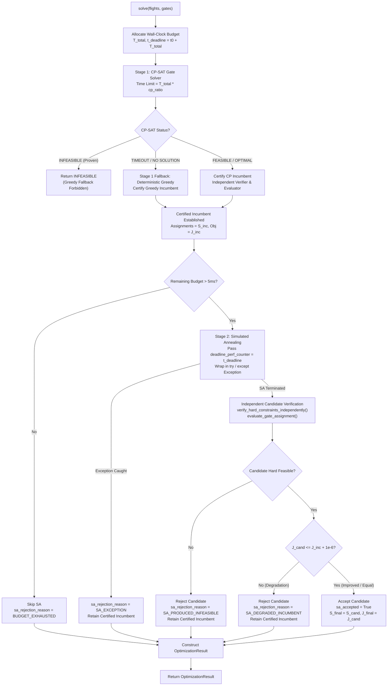

# 03_HYBRID_INCUMBENT_DESIGN.md

## AEOLUS-G12B Hybrid CP-SAT + Simulated Annealing: Incumbent Protection & Budget Architecture

**Author:** Senior Operations Research Engineer, Principal Python Software Engineer, Constraint Programming Specialist  
**Date:** October 12, 2026  
**Repository:** `aeolus-gate-optimization`  
**Target Scope:** `src/optimization/solvers/hybrid_solver.py`, `src/optimization/sa/annealer.py`

---

### 1. Motivation & Problem Statement

In two-stage hybrid optimization frameworks combining exact Constraint Programming (Stage 1) with metaheuristics (Stage 2), the classic promise is:
1. **Stage 1 (CP-SAT):** Finds a provably hard-feasible incumbent solution within a bounded fraction of the computational budget.
2. **Stage 2 (Simulated Annealing):** Refines soft objectives via neighborhood exploration without violating hard constraints.

However, an audit of the pre-G12B codebase revealed two critical failure modes:
1. **Incumbent Vulnerability (Heuristic Degradation):** In the un-remediated solver, Stage 2 SA directly returned its final state without an outer incumbent guard. If SA accepted inferior moves near the end of the cooling schedule, encountered a numerical issue, or produced an infeasible candidate, the solver discarded the high-quality CP-SAT incumbent and returned the degraded solution.
2. **Wall-Clock Budget Blowout:** The Simulated Annealing loop operated strictly on an iteration count (`iterations = 100,000`). It lacked any wall-clock deadline checks. In large instances (e.g., 200 or 300 flights), SA would run for 70+ seconds, completely ignoring the configured time limit (`time_limit_seconds = 5.0`).

G12B establishes a rigorous, fail-safe architecture to eliminate both vulnerabilities.

---

### 2. Architectural Design: The Outer Incumbent Guard

---

### 3. Formal Invariant Guarantees

#### 3.1 Hard Feasibility Invariant
Let $\mathcal{F}$ denote the set of assignments satisfying all operational hard constraints:
$$\mathcal{F} = \{S \mid \text{conflict\_count}(S) = 0 \land \text{unassigned}(S) = 0 \land \text{compat}(S) = \text{True} \land \text{avail}(S) = \text{True}\}$$

If the Stage 1 incumbent $S_{\text{inc}} \in \mathcal{F}$, then:
$$S_{\text{final}} \in \mathcal{F} \quad \text{strictly holds}.$$

#### 3.2 Monotonic Objective Invariant
Let $J(S)$ denote the authoritative objective function computed by `evaluate_gate_assignment()`:
$$J(S_{\text{final}}) \le J(S_{\text{inc}}) + 10^{-6}$$
Under no circumstance can the hybrid solver output an objective strictly worse than the certified Stage 1 incumbent.

#### 3.3 Proof of Global Optimality Inheritance
If Stage 1 CP-SAT mathematically proves that $S_{\text{inc}}$ is optimal ($S_{\text{inc}} = S^*, \text{status} = \text{OPTIMAL}$):
- No feasible perturbation in Stage 2 can achieve $J(S) < J(S^*)$.
- If SA preserves $J(S^*)$, the hybrid solver inherits `status = "OPTIMAL"` and `optimality_proven = True`.
- If SA degrades $J(S)$, the Outer Incumbent Guard rejects SA, preserves $S^*$, and maintains `status = "OPTIMAL"`.

---

### 4. Wall-Clock Budget Partitioning & Scheduling Mechanism

#### 4.1 Global Budget Specification
The solver config specifies `total_wall_clock_budget_seconds` ($T_{\text{total}}$), with fallback to `time_limit_seconds`. The absolute deadline is:
$$t_{\text{deadline}} = t_0 + T_{\text{total}}$$
where $t_0 = \texttt{time.perf\_counter()}$.

#### 4.2 Stage 1 Budget Allocation
Stage 1 CP-SAT is budgeted to fraction $r_{\text{CP}} \in (0, 1)$ (default $r_{\text{CP}} = 0.5$):
$$T_{\text{CP}} = \max\left(0.01, \min(T_{\text{total}} \cdot r_{\text{CP}}, T_{\text{total}})\right)$$

#### 4.3 Stage 2 Budget Allocation & Loop Interruption
Upon completion of Stage 1 at time $t_{\text{CP\_end}}$, the remaining budget is:
$$T_{\text{rem}} = t_{\text{deadline}} - t_{\text{now}}$$
- If $T_{\text{rem}} \le 0.005$ seconds (5 ms), Stage 2 is skipped immediately.
- If $T_{\text{rem}} > 0.005$ seconds, SA is invoked with `deadline_perf_counter = t_deadline`.
- Inside `SimulatedAnnealingGateSolver.solve()`, each iteration $k \in \{1, \dots, K\}$ inspects:
  $$\texttt{if time.perf\_counter() >= deadline\_perf\_counter: break}$$
- Upon break, the loop terminates early with `termination_reason = TerminationReason.TIME_LIMIT`, returning the best feasible state found up to that millisecond.

---

### 5. Transparency & Provenance Contract

The solver configuration dictionary in `OptimizationResult` records full stage provenance:
| Field | Type | Description |
|---|---|---|
| `cp_solver_status` | `str` | Raw OR-Tools CP-SAT status (`OPTIMAL`, `FEASIBLE`, `INFEASIBLE`, `UNKNOWN`) |
| `initial_solution_source` | `str` | Source of Stage 1 incumbent (`CP_SAT`, `GREEDY_FALLBACK`, `NONE`) |
| `initial_cost` | `float` | Authoritative objective of certified Stage 1 incumbent |
| `sa_executed` | `bool` | Whether Stage 2 SA was executed |
| `sa_accepted` | `bool` | Whether SA candidate was accepted over incumbent |
| `sa_improved` | `bool` | Whether SA strictly improved the incumbent ($J_{\text{cand}} < J_{\text{inc}} - 10^{-6}$) |
| `sa_rejection_reason` | `str` | Diagnostic reason if rejected (`SA_DEGRADED_INCUMBENT_OBJECTIVE`, `SA_PRODUCED_INFEASIBLE_SOLUTION`, `SA_EXCEPTION_...`, `BUDGET_EXHAUSTED_BEFORE_STAGE2`, `NONE`) |
| `stage1_wall_clock_ms` | `float` | Monotonic runtime of Stage 1 in milliseconds |
| `stage2_wall_clock_ms` | `float` | Monotonic runtime of Stage 2 in milliseconds |
| `total_wall_clock_ms` | `float` | Total end-to-end runtime of HybridGateSolver |
