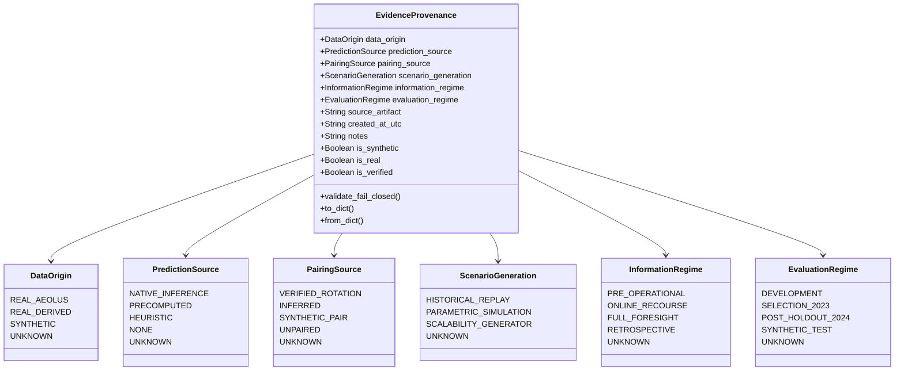

# ĐẶC TẢ SCHEMA NGUỒN DỮ LIỆU ĐA CHIỀU — AEOLUS-G1

**Mã tài liệu:** SPEC-PROV-V4.1  
**Giai đoạn ban hành:** AEOLUS-G1 — Data Provenance, Temporal Contracts & Evidence Lineage  
**Module triển khai:** `src/contracts/provenance.py`  
**Ngôn ngữ:** Python 3.11  

---

## 1. ĐỘNG LỰC THIẾT KẾ (DESIGN MOTIVATION)

Trong các hệ thống tối ưu hóa và học máy phức tạp, việc sử dụng một nhãn provenance đơn lẻ (ví dụ: `REAL` hoặc `SYNTHETIC`) thường dẫn đến ngộ nhận khoa học nghiêm trọng:
- Một kịch bản có thể chứa các chuyến bay thực tế từ BTS nhưng lại được ghép cặp quay đầu giả lập và phân bổ cổng ngẫu nhiên.
- Một kết quả dự báo có thể được tính toán từ mô hình ML thật nhưng lại được lưu trữ sẵn (precomputed) thay vì chạy suy luận trực tiếp tại runtime.

Để giải quyết triệt để vấn đề này, Aeolus Protocol V4 ban hành chuẩn **Taxonomy Nguồn Dữ Liệu 6 Chiều Độc Lập**, đảm bảo mọi luồng dữ liệu đều được định danh minh bạch và có thể kiểm toán độc lập.

---

## 2. HỆ THỐNG PHÂN LOẠI 6 CHIỀU (THE 6-DIMENSIONAL TAXONOMY)



### 2.1. Chiều 1: `data_origin` (Nguồn gốc vật lý của bản ghi)
- `REAL_AEOLUS`: Bản ghi lịch trình gốc được trích xuất trực tiếp từ kho dữ liệu BTS On-Time Performance (2016–2023) tại hub ATL (`DEST == 'ATL'` hoặc `ORIGIN == 'ATL'`).
- `REAL_DERIVED`: Dữ liệu được trích xuất hoặc lấy mẫu từ các bản ghi BTS thực tế nhưng đã qua biến đổi định dạng, gán mã định danh kịch bản hoặc tái chuẩn hóa mốc thời gian.
- `SYNTHETIC`: Dữ liệu do thuật toán mô phỏng hoặc trình sinh số ngẫu nhiên tạo ra hoàn toàn từ đầu.
- `UNKNOWN`: Chưa có bằng chứng kiểm toán độc lập xác nhận nguồn gốc.

### 2.2. Chiều 2: `prediction_source` (Cơ chế sinh dự báo trễ)
- `NATIVE_INFERENCE`: Dự báo được sinh trực tiếp tại runtime bằng cách nạp checkpoint mô hình máy học đã đóng băng (`XGBoost`, `NGBoost`) với vector đặc trưng tính toán tại $T - 2\text{h}$.
- `PRECOMPUTED`: Dự báo được nạp từ tệp kết quả tính sẵn lưu trong artifacts (`predictions_sample.csv`, v.v.).
- `HEURISTIC`: Dự báo dựa trên quy tắc đơn giản hoặc hằng số giả định (ví dụ: gán mặc định trễ bằng 0).
- `NONE`: Chế độ lập lịch cơ sở (Schedule Baseline), hoàn toàn không sử dụng dự báo trễ.
- `UNKNOWN`: Không xác định được phương pháp tạo dự báo.

### 2.3. Chiều 3: `pairing_source` (Nguồn gốc ghép cặp quay đầu tàu bay)
- `VERIFIED_ROTATION`: Cặp chuyến bay đến (ARR) và chuyến bay đi (DEP) được ghép nối vật lý dựa trên số hiệu đuôi tàu bay (`TAIL_NUM`) xác thực từ dữ liệu khai thác thực tế.
- `INFERRED`: Cặp quay đầu được suy diễn dựa trên chuỗi hành trình lịch trình khả dĩ (schedule chain heuristic).
- `SYNTHETIC_PAIR`: Cặp quay đầu được tạo nhân tạo bởi bộ sinh phiên mô phỏng (simulation session generator) phục vụ bài toán tối ưu.
- `UNPAIRED`: Chuyến bay độc lập (chỉ có nhánh đến hoặc chỉ có nhánh đi).
- `UNKNOWN`: Chưa rõ cơ chế liên kết.

### 2.4. Chiều 4: `scenario_generation` (Phương pháp kiến tạo kịch bản)
- `HISTORICAL_REPLAY`: Tái hiện nguyên trạng toàn bộ lịch khai thác của một ngày lịch sử cụ thể.
- `PARAMETRIC_SIMULATION`: Sinh các hiện thực trễ dựa trên phân phối xác suất tham số (ví dụ: Monte Carlo 500 kịch bản).
- `SCALABILITY_GENERATOR`: Sinh kịch bản kiểm thử ứng suất quy mô lớn (ví dụ: 120 chuyến x 25 cổng, 1500 chuyến x 50 cổng) bằng cách lấy mẫu và phân bổ cổng xoay vòng.
- `UNKNOWN`: Không rõ phương pháp xây dựng kịch bản.

### 2.5. Chiều 5: `information_regime` (Ranh giới thông tin ra quyết định)
- `PRE_OPERATIONAL`: Chỉ sử dụng thông tin khả dụng trước mốc cắt ra quyết định ($T - 2\text{h}$).
- `ONLINE_RECOURSE`: Chế độ điều hành trực tuyến cho phép cập nhật thông tin và điều chỉnh cổng trong khung thời gian vận hành.
- `FULL_FORESIGHT`: Chế độ Oracle có tầm nhìn toàn tri (biết trước độ trễ thực tế để làm cận tham chiếu lý thuyết; tuyệt đối không thể triển khai thực tế).
- `RETROSPECTIVE`: Đánh giá hậu kiểm sau khi ngày vận hành đã kết thúc.
- `UNKNOWN`: Chưa xác định ranh giới thông tin.

### 2.6. Chiều 6: `evaluation_regime` (Quy chế đánh giá khoa học)
- `DEVELOPMENT`: Dữ liệu thuộc các năm huấn luyện và phân chia rolling folds (2016–2022).
- `SELECTION_2023`: Dữ liệu phục vụ lựa chọn mô hình và minh họa kịch bản chuẩn (2023).
- `POST_HOLDOUT_2024`: Dữ liệu kiểm nghiệm cuối cùng năm 2024 (tiếp tục niêm phong).
- `SYNTHETIC_TEST`: Kiểm thử ứng suất trên dữ liệu mô phỏng.
- `UNKNOWN`: Chưa phân định quy chế đánh giá.

---

## 3. CẤU TRÚC ĐỐI TƯỢNG VÀ QUY TẮC FAIL-CLOSED

### 3.1. Dataclass `EvidenceProvenance`
```python
@dataclass(frozen=True)
class EvidenceProvenance:
    data_origin: DataOrigin = DataOrigin.UNKNOWN
    prediction_source: PredictionSource = PredictionSource.UNKNOWN
    pairing_source: PairingSource = PairingSource.UNKNOWN
    scenario_generation: ScenarioGeneration = ScenarioGeneration.UNKNOWN
    information_regime: InformationRegime = InformationRegime.UNKNOWN
    evaluation_regime: EvaluationRegime = EvaluationRegime.UNKNOWN
    source_artifact: Optional[str] = None
    created_at_utc: Optional[str] = None
    notes: str = ""

    @property
    def is_synthetic(self) -> bool:
        return (
            self.data_origin == DataOrigin.SYNTHETIC
            or self.scenario_generation in (
                ScenarioGeneration.PARAMETRIC_SIMULATION,
                ScenarioGeneration.SCALABILITY_GENERATOR,
            )
            or self.pairing_source == PairingSource.SYNTHETIC_PAIR
        )

    @property
    def is_real(self) -> bool:
        return (
            self.data_origin in (DataOrigin.REAL_AEOLUS, DataOrigin.REAL_DERIVED)
            and self.pairing_source in (PairingSource.VERIFIED_ROTATION, PairingSource.UNPAIRED)
            and self.scenario_generation in (ScenarioGeneration.HISTORICAL_REPLAY, ScenarioGeneration.UNKNOWN)
            and self.scenario_generation != ScenarioGeneration.SCALABILITY_GENERATOR
            and self.scenario_generation != ScenarioGeneration.PARAMETRIC_SIMULATION
            and self.pairing_source != PairingSource.SYNTHETIC_PAIR
        )
```

### 3.2. Quy tắc Fail-Closed
1. **Quy tắc `require_real`:** Khi gọi `validate_fail_closed(require_real=True)`, nếu `self.is_real` là `False`, hệ thống lập tức ném ngoại lệ `SilentFallbackError`.
2. **Quy tắc `require_native`:** Khi gọi `validate_fail_closed(require_native=True)`, nếu `self.prediction_source != PredictionSource.NATIVE_INFERENCE`, hệ thống ném `ProvenanceMismatchError`.
3. **Quy tắc `forbid_unknown`:** Nếu có bất kỳ chiều nào mang giá trị `UNKNOWN`, hệ thống ném `DataLineageError`.

---

## 4. CẤU HÌNH CHUẨN TẮC CHO CÁC KỊCH BẢN CHÍNH

| Kịch bản | `data_origin` | `prediction_source` | `pairing_source` | `scenario_generation` | `information_regime` | `evaluation_regime` | `is_synthetic` |
| :--- | :--- | :--- | :--- | :--- | :--- | :--- | :---: |
| **`SCEN_P09_CANONICAL_120`** | `REAL_DERIVED` | `NONE` / `PRECOMPUTED` | `UNPAIRED` | `SCALABILITY_GENERATOR` | `PRE_OPERATIONAL` | `SELECTION_2023` | **True** |
| **`SCEN_P07_DUAL_CORE_30`** | `REAL_DERIVED` | `NATIVE_INFERENCE` | `SYNTHETIC_PAIR` | `PARAMETRIC_SIMULATION` | `PRE_OPERATIONAL` | `SELECTION_2023` | **True** |
| **`HISTORICAL_ATL_REAL`** | `REAL_AEOLUS` | `NONE` | `VERIFIED_ROTATION` | `HISTORICAL_REPLAY` | `PRE_OPERATIONAL` | `DEVELOPMENT` | **False** |
