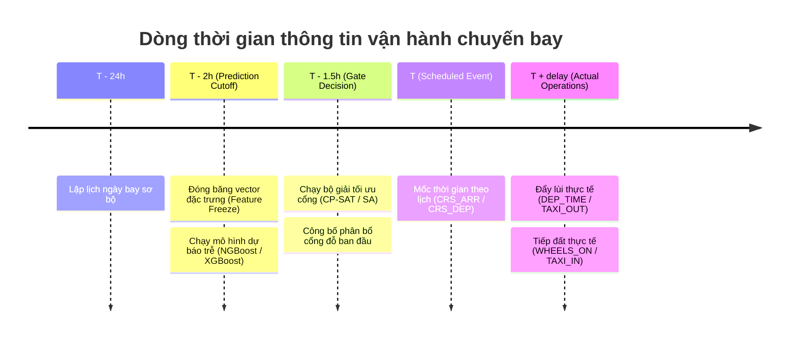

# HỢP ĐỒNG THÔNG TIN THỜI GIAN VÀ RANH GIỚI NHÂN QUẢ — AEOLUS-G1

**Mã tài liệu:** SPEC-TIME-V4.1  
**Giai đoạn ban hành:** AEOLUS-G1 — Data Provenance, Temporal Contracts & Evidence Lineage  
**Module triển khai:** `src/contracts/temporal.py`  
**Ngôn ngữ:** Python 3.11  

---

## 1. MỤC TIÊU VÀ NGUYÊN LÝ NHÂN QUẢ VẬN HÀNH

Trong bài toán dự báo độ trễ và phân bổ cổng đỗ tàu bay, rò rỉ dữ liệu tương lai (Data Leakage) có thể biến một mô hình học máy thành một hệ thống "tiên tri vô dụng" trên thực tế nếu nó vô tình tiếp cận thông tin chỉ xuất hiện sau khi quyết định vận hành đã được đưa ra.

Hợp đồng thông tin thời gian Aeolus Protocol V4 thiết lập một **bức tường thông tin bất khả xâm phạm (Information Barrier)** tại thời điểm $T - 2\text{h}$ trước khi chuyến bay diễn ra theo lịch trình.

---

## 2. CÁC MỐC THỜI GIAN VẬN HÀNH VÀ BẤT BIẾN TOÁN HỌC



### 2.1. Định nghĩa các mốc thời gian
1. **$T_{\text{event}}$ (Thời điểm sự kiện theo lịch):**  
   - Chuyến bay đến: $T_{\text{arr\_sched}} =$ `CRS_ARR_TIME` (tính theo giờ địa phương sân bay đến, ATL).
   - Chuyến bay đi: $T_{\text{dep\_sched}} =$ `CRS_DEP_TIME` (tính theo giờ địa phương sân bay đi, ATL).
2. **$T_{\text{cutoff}}$ (Thời điểm cắt thông tin dự báo):**  
   $$T_{\text{cutoff}} = T_{\text{event}} - 2\text{ giờ}$$
3. **$T_{\text{avail}}(f)$ (Thời điểm khả dụng của đặc trưng $f$):**  
   Thời điểm sớm nhất mà dữ liệu của đặc trưng $f$ được ghi nhận và có thể truy cập được bởi hệ thống điều hành.
4. **$T_{\text{decision}}$ (Thời điểm ra quyết định phân bổ cổng):**  
   Thời điểm bộ giải tối ưu cổng được kích hoạt. Bắt buộc: $T_{\text{decision}} \ge T_{\text{cutoff}}$.
5. **$T_{\text{obs}}$ (Thời điểm quan sát thực tế):**  
   Thời điểm diễn ra các hoạt động thực tế trên sân đỗ (`DEP_TIME`, `WHEELS_OFF`, `WHEELS_ON`, `ARR_TIME`). Bắt buộc: $T_{\text{obs}} > T_{\text{cutoff}}$.

### 2.2. Bất biến cơ bản (The Non-Leakage Invariant)
Một đặc trưng $f$ chỉ được phép đưa vào mô hình dự báo khi và chỉ khi thỏa mãn bất đẳng thức nhân quả nghiêm ngặt:

$$\forall f \in \mathcal{F}_{\text{model}}, \quad T_{\text{avail}}(f) \le T_{\text{cutoff}}$$

Bất kỳ vi phạm nào ($T_{\text{avail}}(f) > T_{\text{cutoff}}$) đều cấu thành hành vi rò rỉ dữ liệu tương lai và bị hệ thống chặn đứng với ngoại lệ `TemporalLeakageError`.

---

## 3. DANH MỤC THUỘC TÍNH BỊ CẤM TUYỆT ĐỐI (FORBIDDEN FEATURES)

Dựa trên nguyên lý bất biến thời gian, các nhóm thuộc tính sau **bị cấm tuyệt đối** không được xuất hiện trong tập đặc trưng dự báo hoặc kịch bản phân bổ cổng ban đầu:

| Nhóm thuộc tính | Các cột cụ thể | Lý do cấm về mặt nhân quả |
| :--- | :--- | :--- |
| **Vận hành khởi hành thực tế** | `DEP_TIME`, `TAXI_OUT`, `WHEELS_OFF` | Chỉ xuất hiện khi tàu bay bắt đầu đẩy lùi khỏi cổng và cất cánh thực tế. |
| **Vận hành hạ cánh thực tế** | `WHEELS_ON`, `TAXI_IN`, `ARR_TIME` | Chỉ xuất hiện khi tàu bay chạm bánh và lăn vào cổng thực tế. |
| **Khoảng thời gian thực tế** | `ACTUAL_ELAPSED_TIME`, `AIR_TIME` | Được tính toán sau khi chuyến bay hoàn tất hành trình. |
| **Nhãn mục tiêu trễ** | `ARR_DELAY`, `DEP_DELAY`, `y_arr_cls`, `y_dep_cls`, v.v. | Là biến mục tiêu cần dự báo, tuyệt đối không được đưa vào tập input. |
| **Hiện thực hóa mô phỏng** | `p_delay`, `actual_delay_min`, `pred_time_min` | Kết quả sau khi chạy mô phỏng, không thể dùng làm dữ liệu đầu vào tiên nghiệm. |
| **Thời tiết quan trắc thô** | `O_TEMP`, `O_PRCP`, `O_WSPD`, `D_TEMP`, `D_PRCP`, `D_WSPD` | Không có chứng chỉ chứng minh dấu thời gian quan trắc độc lập nằm trước $T - 2\text{h}$ (chính sách `DROP`). |

---

## 4. CHUẨN HÓA MÚI GIỜ VÀ XỬ LÝ CHUYẾN BAY QUA NỬA ĐÊM

### 4.1. Quy tắc Múi giờ Sân bay Hub ATL
- Múi giờ gốc của sân bay Hartsfield-Jackson Atlanta (ATL) là `America/New_York` (IANA Standard).
- Xử lý Daylight Saving Time (DST):
  - Giờ mùa hè (EDT): $\text{UTC} - 4\text{h}$.
  - Giờ mùa đông (EST): $\text{UTC} - 5\text{h}$.
- Mọi phép so sánh thời gian giữa các chuyến bay đến từ các múi giờ khác nhau đều phải được quy đổi về **chuẩn thời gian thống nhất UTC** thông qua hàm `ensure_utc_datetime()`.

### 4.2. Xử lý chuyến bay qua nửa đêm (Midnight Rollover)
- Đối với các chuyến bay khởi hành vào buổi tối và hạ cánh vào sáng sớm hôm sau (Overnight Flights), mốc thời gian phút từ nửa đêm (`sched_arr_time_min`) được hỗ trợ mở rộng an toàn lên tới $2880$ phút ($48$ giờ) trong `FlightPredictionView` và `TurnPair`, tránh lỗi tràn số hoặc âm số thời gian khi tính toán khoảng đỗ cổng.

---

## 5. GIAO DIỆN KIỂM TRA TỰ ĐỘNG (API SPECIFICATION)

### 5.1. `validate_feature_temporal_availability()`
```python
def validate_feature_temporal_availability(
    feature_name: str,
    available_at_utc: datetime | None,
    decision_cutoff_utc: datetime,
    *,
    allow_unverified: bool = False,
) -> None:
    """Kiểm tra thời điểm khả dụng của đặc trưng so với mốc cắt.
    
    Raises:
        TemporalLeakageError: Nếu available_at_utc > decision_cutoff_utc.
        TemporalUncertaintyError: Nếu available_at_utc is None và allow_unverified=False.
    """
```

### 5.2. `calculate_prediction_cutoff_utc()`
```python
def calculate_prediction_cutoff_utc(
    scheduled_event_dt: datetime,
    hours_before: float = 2.0,
    event_tz: str = "America/New_York",
) -> datetime:
    """Tính mốc cắt dự báo chuẩn tắc UTC (T - 2h)."""
```
