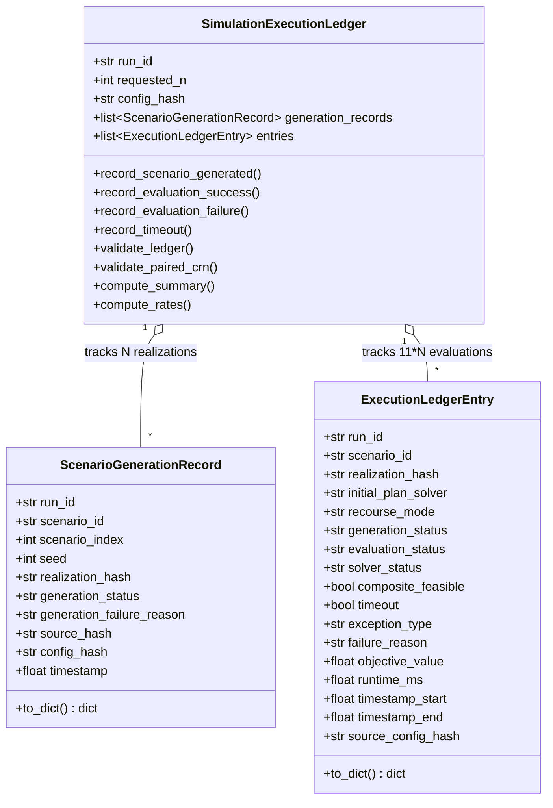

# AEOLUS-MC500-P1: LEDGER DATA MODEL, CONSERVATION EQUATIONS & SCIENTIFIC INVARIANTS

**Date:** 2026-10-12  
**Auditor:** Principal Scientific Software Engineer, Monte Carlo Reproducibility Engineer  
**Sprint:** AEOLUS-MC500-P1  
**Status:** **MATHEMATICALLY FORMALIZED & VERIFIED**

---

## 1. Architectural Separation: Realization vs. Evaluation

Trước phiên bản P1, ledger cũ gộp chung việc sinh kịch bản ngẫu nhiên và việc đánh giá bộ giải, dẫn đến lỗi hạch toán nghiêm trọng: khi chạy 5 stochastic realizations với 3 bộ giải ban đầu, hệ thống báo $n\_generated = 15$. Khi mở rộng ra 11 lần đánh giá cho 5 chế độ, số lượng này sẽ bị báo sai thành 55 realizations.

Phiên bản **MC500-P1** tách bạch tuyệt đối hai thực thể dữ liệu độc lập:

### 1.1. Thực thể 1: `ScenarioGenerationRecord` (Stochastic Realization)
- **Định nghĩa:** Đại diện cho một lần rút mẫu ngẫu nhiên độc lập từ mô hình Gaussian Copula kết hợp phân phối Student-t.
- **Khóa duy nhất (Unique Identity):** `scenario_id` (ví dụ: `MC_REM_000`, `MC_REM_001`, ...).
- **Quy tắc bảo toàn:** Mỗi stochastic realization chỉ được sinh và đăng ký chính xác **MỘT LẦN DUY NHẤT** vào ledger.

### 1.2. Thực thể 2: `ExecutionLedgerEntry` (Solver Evaluation)
- **Định nghĩa:** Đại diện cho một lần thực thi thuật toán phân bổ cổng đỗ tại một chế độ recourse xác định.
- **Khóa duy nhất (Compound Key):**
  $$\text{Key} = (\text{run\_id}, \text{scenario\_id}, \text{recourse\_mode}, \text{initial\_plan\_solver})$$
- **Hỗ trợ đa chế độ:** Cho phép cùng một `scenario_id` và `initial_plan_solver` (ví dụ: `Greedy`) được đánh giá độc lập dưới `MODE_A`, `MODE_B1`, và `MODE_B2` mà không gây xung đột khóa trùng lặp.

---

## 2. Canonical Protocol & Evaluation Slot Matrix

Theo đề cương và hợp đồng khoa học của khóa luận, mỗi realization hợp lệ bắt buộc phải trải qua đầy đủ **11 evaluation slots**:

| STT | Recourse Mode | Initial Solver / Variant | Vai trò Khoa học | Mã định danh Slot |
|:---:|---|---|---|---|
| **1** | `MODE_A` | `Greedy` | Kế hoạch cố định gốc (0 re-optimizations) | `(MODE_A, Greedy)` |
| **2** | `MODE_A` | `CPSat` | Kế hoạch cố định tối ưu trước giờ G | `(MODE_A, CPSat)` |
| **3** | `MODE_A` | `Hybrid` | Kế hoạch cố định lai ghép | `(MODE_A, Hybrid)` |
| **4** | `MODE_B1` | `Greedy` | Tái phân bổ hồi cứu toàn cục (Full Hindsight) | `(MODE_B1, Greedy)` |
| **5** | `MODE_B1` | `CPSat` | Tái phân bổ hồi cứu với kế hoạch ban đầu CP-SAT | `(MODE_B1, CPSat)` |
| **6** | `MODE_B1` | `Hybrid` | Tái phân bổ hồi cứu với kế hoạch ban đầu Hybrid | `(MODE_B1, Hybrid)` |
| **7** | `MODE_B2` | `Greedy` | Tái phân bổ cuốn chiếu thời gian thực (Causal Online Recourse) | `(MODE_B2, Greedy)` |
| **8** | `MODE_B2` | `CPSat` | Causal Online Recourse với kế hoạch CP-SAT | `(MODE_B2, CPSat)` |
| **9** | `MODE_B2` | `Hybrid` | Causal Online Recourse với kế hoạch Hybrid | `(MODE_B2, Hybrid)` |
| **10** | `MODE_C1` | `ForesightGreedy` | Heuristic Baseline biết trước toàn bộ trễ tương lai | `(MODE_C1, ForesightGreedy)` |
| **11** | `MODE_C2` | `ForesightCPSat` | Mathematical Proven Optimal Lower Bound (Oracle) | `(MODE_C2, ForesightCPSat)` |

$$\mathbf{N_{\text{expected\_evaluations}} = 11 \times N_{\text{generated\_realizations}}}$$

- Với $N = 5$: $5 \text{ realizations} \times 11 = \mathbf{55\text{ evaluations}}$.
- Với $N = 20$: $20 \text{ realizations} \times 11 = \mathbf{220\text{ evaluations}}$.
- Với $N = 500$: $500 \text{ realizations} \times 11 = \mathbf{5.500\text{ evaluations}}$.

---

## 3. Mathematical Conservation Equations & Denominators

Ledger kiểm soát nghiêm ngặt 3 phương trình bảo toàn:

### Phương trình 1: Bảo toàn Sinh kịch bản (Generation Conservation)
$$N_{\text{requested\_realizations}} = N_{\text{generated\_realizations}} + N_{\text{generation\_failures}}$$

### Phương trình 2: Bảo toàn Đánh giá Thuật toán (Evaluation Conservation)
$$N_{\text{expected\_evaluations}} = N_{\text{completed\_evaluations}} + N_{\text{evaluation\_failures}} + N_{\text{missing\_evaluations}}$$
- **Điều kiện không thất thoát (Zero Silent Drops):**
  $$N_{\text{missing\_evaluations}} = 0$$

### Phương trình 3: Phân rã Tính khả thi (Feasibility Decomposition Conservation)
$$N_{\text{completed\_evaluations}} = N_{\text{feasible\_evaluations}} + N_{\text{infeasible\_evaluations}}$$

### Các mẫu số toán học rõ ràng (Explicit Denominators):
1. **Generation Failure Rate:**
   $$\text{Rate}_{\text{gen\_fail}} = \frac{N_{\text{generation\_failures}}}{N_{\text{requested\_realizations}}}$$
2. **Evaluation Failure Rate:**
   $$\text{Rate}_{\text{eval\_fail}} = \frac{N_{\text{evaluation\_failures}}}{N_{\text{expected\_evaluations}}}$$
3. **Composite Feasible Rate:**
   $$\text{Rate}_{\text{feasible}} = \frac{N_{\text{feasible\_evaluations}}}{N_{\text{completed\_evaluations}}}$$

---

## 4. Invariant Verification Rules in Validation Gates

Hàm `validate_ledger()` và `validate_paired_crn()` thực thi các phép kiểm tra bất biến (invariants):

1. **Accounting Completeness:** Số lượng `unique_scenarios` phải khớp chính xác với `requested_n`.
2. **Protocol Completeness:** Đối với mỗi realization đã sinh, nếu thiếu bất kỳ slot nào trong 11 slots quy định, `validate_ledger()` lập tức raise `ValueError` chỉ rõ tên mode, solver và kịch bản bị thiếu.
3. **Hash Consistency Gate:** Mã băm `realization_hash` trong tất cả 11 evaluation records của một kịch bản bắt buộc phải khớp tuyệt đối với mã băm đã được ghi nhận tại `ScenarioGenerationRecord`.
4. **CRN Paired Alignment Gate:** `validate_paired_crn()` từ chối trả về `PASS` nếu danh sách bản ghi rỗng (Empty records rejected) hoặc nếu mã băm giữa các solvers/modes trong cùng kịch bản bị phân kỳ.
